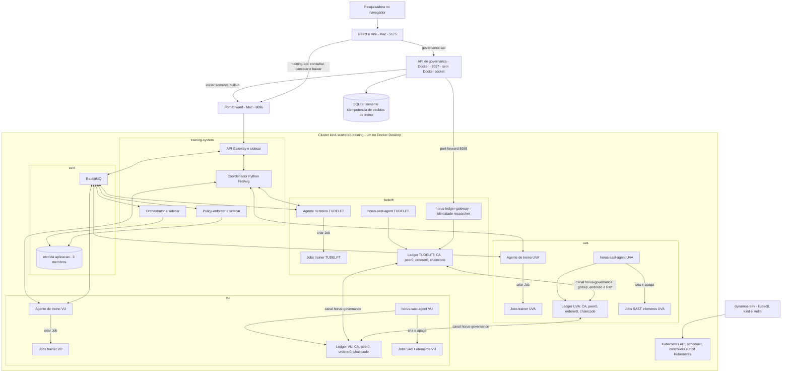
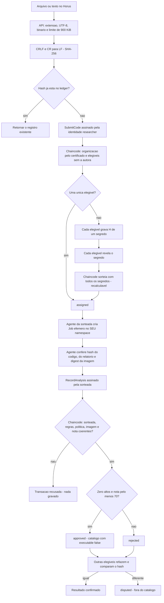
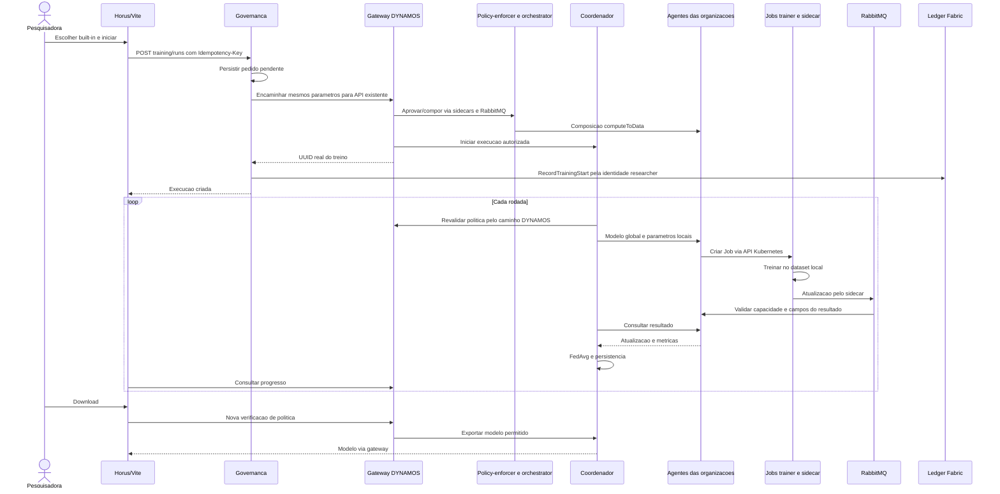
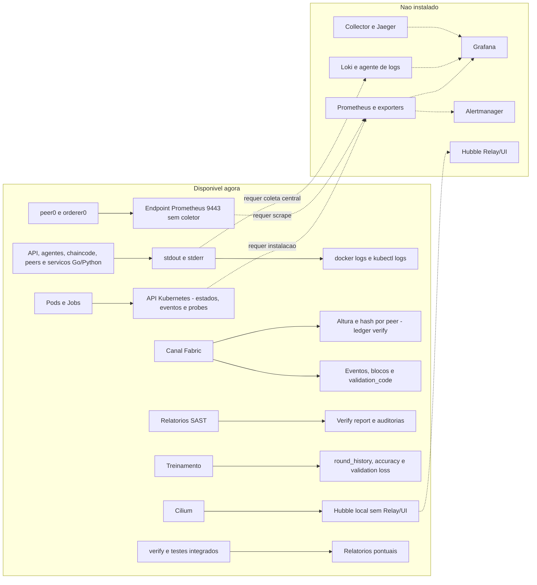

# Horus: guia completo do codigo, testes e observacao

**Referencia:** implementacao local consolidada em 02/11/2026 e atualizada em
03/11/2026 com o ledger Hyperledger Fabric e a analise SAST local por organizacao.
**Raiz usada neste documento:** Scattered-Directive.

Este guia explica o codigo implementado, suas conexoes e como executar,
testar e observar o sistema. Nao pressupoe que todos os processos estejam
ligados. Configuracoes preservadas e funcionalidades futuras nao sao
apresentadas como componentes ja instalados.

## Sumario

1. [Estado atual](#1-estado-atual)
2. [Arquitetura e componentes](#2-arquitetura-e-componentes)
3. [Organizacao do codigo](#3-organizacao-do-codigo)
4. [Configuracao e persistencia](#4-configuracao-e-persistencia)
5. [Inicializacao e parada](#5-inicializacao-e-parada)
6. [Submissao, sorteio e SAST](#6-submissao-sorteio-e-sast)
7. [Treinamento federado](#7-treinamento-federado)
8. [Ledger e integridade](#8-ledger-e-integridade)
9. [Demonstracao manual](#9-demonstracao-manual)
10. [Observacao e monitoracao](#10-observacao-e-monitoracao)
11. [Endpoints](#11-endpoints)
12. [Testes automatizados e novos casos](#12-testes-automatizados-e-novos-casos)
13. [Diagnostico, recuperacao e backup](#13-diagnostico-recuperacao-e-backup)
14. [Limites conhecidos](#14-limites-conhecidos)
15. [Evidencias e checklist](#15-evidencias-e-checklist)

## 1. Estado atual

O sistema combina aprendizado federado DYNAMOS e governanca Horus. A
governanca analisa codigo e registra decisoes; o DYNAMOS autoriza e executa
o treinamento horizontal built-in. Sao controles diferentes.

Desde 03/11/2026 a governanca segue o principio de **confianca zero**: o
sorteio da revisora, a analise SAST e o registro do resultado nao dependem
mais do servidor Horus. A explicacao detalhada, etapa por etapa, esta em
[ledger Fabric e SAST local](ledger-fabric-e-sast-local.md).

| Capacidade | Situacao |
| --- | --- |
| Regressao logistica com FedAvg | Real, com UVA/VU/TUDELFT e dados sinteticos. |
| Jobs Kubernetes trainer + sidecar | Reais, um por organizacao em cada rodada. |
| Dados locais readOnly no trainer | Real; sem exportacao de CSV ao coordenador. |
| Identidade Meirylene Avelino / TUDelft | Configuracao no servidor para a interface; no ledger, certificado Fabric `researcher` da TUDELFT. Nao e login OIDC. |
| Upload .py/.txt ou texto | Real; UTF-8 valido, sem binario, ate 900 KiB. |
| Revisora diferente da organizacao autora | Sorteio por commit-reveal entre as organizacoes elegiveis, feito pelo chaincode. |
| Semgrep por organizacao | Job Kubernetes efemero no namespace da organizacao sorteada, sem rede, criado pelo agente dela. |
| Assinatura do resultado | Transacao Fabric assinada pela identidade da organizacao revisora. |
| Auditoria por re-execucao | Real: a outra organizacao elegivel refaz a analise; hash diferente marca disputa. |
| Execucao de codigo submetido | Nao ocorre. O codigo e apenas texto para analise. |
| Catalogo de algoritmos aprovados | Derivado do ledger: aprovados e nao disputados. |
| Treino de algoritmo novo aprovado | Bloqueado no frontend e no servidor; sandbox futura. |
| Ledger | Hyperledger Fabric 2.5.16: canal horus-governance, 3 peers e 3 orderers Raft, um de cada organizacao. |
| Chain head / Verify report | Reais, consultando o peer da TUDELFT; `tools.py ledger verify` compara os tres peers. |
| TrainingStarted | Gravado no ledger pela identidade researcher; clientes diretos de 8096 ficam fora dele. |
| Federated training / Ledger | Telas conectadas a APIs reais. |
| Dashboard | Status do ledger e eventos reais; outros dados continuam demonstrativos. |
| ExtremeXP | Repositorio preservado; contratos nao usados (ver secao 12 do documento do ledger). |
| VFL/TTP/FABRIC original | Preservado, nao acionado pelo fluxo horizontal do Horus. A pasta `fabric/` e do testbed FABRIC, nao do Hyperledger Fabric. |
| Prometheus/Grafana/Loki/collector/Jaeger | Nao instalados neste sandbox. Peers e orderers expoem metricas Prometheus na porta 9443, ainda sem coletor. |
| Hubble | Agente habilitado no Cilium, sem Relay/UI. |

As organizacoes sao namespaces no mesmo cluster/no local, nao datacenters
independentes. O desenho do ledger e o de producao (cada organizacao com suas
chaves, peer, orderer e agente), mas neste sandbox um unico operador
administra o cluster inteiro.

O projeto antigo foi retirado da workspace e guardado em
`~/.Trash/DYNAMOS-antigo-2026-10-29`. Seus clusters ficaram parados, nao
apagados. O projeto novo tem Git e ferramentas proprios. Dados/modelos dos
clusters antigos nao foram migrados automaticamente para o novo.

## 2. Arquitetura e componentes

Desenhos deste guia: [arquitetura](diagrams/horus-guia-completo-1.svg),
[fluxo SAST](diagrams/horus-guia-completo-2.svg),
[sequencia do treino](diagrams/horus-guia-completo-3.svg) e
[observabilidade](diagrams/horus-guia-completo-4.svg). Desenhos detalhados do
ledger: [ledger-fabric-1 a 4](ledger-fabric-e-sast-local.md).



### Ambientes e unidades

| Unidade | Papel |
| --- | --- |
| Mac | Navegador, Vite, Python dos launchers e port-forwards. |
| Docker Desktop | Ambiente Linux de containers no Mac. |
| scattered-training-control-plane | Container que representa o no kind; nao e um trainer. |
| dynamos-dev | Docker CLI, kind, kubectl e Helm, fora do cluster. |
| horus-governance-api | API sem Docker socket; publica somente localhost:8097. Nao e confiavel para as organizacoes. |
| horus-ledger-gateway | Ponte HTTP para o peer da TUDELFT com a identidade `researcher`; exposto em 8098 por port-forward. |
| ledger-ca / ledger-enroll | CA e Job de matricula de cada organizacao; chaves geradas no proprio namespace. |
| peer0 / orderer0 | No do ledger e membro Raft de cada organizacao. |
| horus-chaincode | Regras do Horus (chaincode Go) de cada organizacao. |
| horus-sast-agent | Sorteio, analise e auditoria em nome de UMA organizacao. |
| Job horus-sast-* | Analisador temporario sem rede, token, dataset ou socket. |
| ledger-admin | Console do administrador da organizacao; usado no setup. |
| Namespace | Separacao logica no mesmo cluster. |
| Deployment | Mantem Pods de servicos permanentes. |
| Pod | Containers que compartilham rede localhost. |
| Job | Tarefa que precisa terminar: treino local de uma rodada ou uma analise SAST. |
| Service | Nome/endereco estavel, resolvido por CoreDNS. |
| PVC | Volume persistente local; nao e backup nem replicacao entre organizacoes. |
| ServiceAccount/RBAC | Permissoes Kubernetes, distintas dos acordos de negocio e das identidades Fabric. |
| Sidecar DYNAMOS | Ponte gRPC/RabbitMQ; nao e Linkerd nem ferramenta SAST. |

### Namespaces e Pods

| Namespace | Componentes |
| --- | --- |
| core | RabbitMQ e etcd-0/1/2 da aplicacao. |
| training-system | Gateway, policy-enforcer, orchestrator e coordenador. |
| uva, vu, tudelft | Treino: um agente permanente, seed e Jobs por rodada. Ledger: ledger-ca, orderer0, peer0, ledger-admin, horus-chaincode, horus-sast-agent, Job ledger-enroll e Jobs horus-sast efemeros. Em tudelft tambem horus-ledger-gateway. |
| kube-system | API Kubernetes, scheduler, controllers, etcd Kubernetes, CoreDNS, kube-proxy e Cilium/Envoy/operator. |
| local-path-storage | Provisionador dos volumes locais. |

A aplicacao de treinamento tem 11 Pods permanentes, sem contar infraestrutura
e Jobs: quatro em core, quatro em training-system e tres agentes. O ledger
acrescenta 19 Pods permanentes: seis por organizacao e o gateway na TUDELFT.
A API de governanca e um container Docker e nao entra nessa contagem.

O etcd de core guarda configuracao da aplicacao. O etcd de kube-system guarda
o estado do Kubernetes. O ledger Fabric guarda a governanca. Sao tres bases
diferentes: nao usar uma para consultar ou editar a outra.

## 3. Organizacao do codigo

Os caminhos seguintes sao relativos a raiz Scattered-Directive.

```text
Scattered-Directive/
  dev.sh                         ferramentas independentes
  horus-sandbox-frontend/
    src/pages/                   telas e fluxo visual
    src/components/              controles e paineis
    src/data/                    cliente de governanca e mocks legados
    src/types/                   contratos TypeScript
  horus-governance/
    app/                         API, cliente do ledger, catalogo e ponte de treino
    ledger/                      Go: chaincode, sast-agent e gateway (um binario)
    deploy/ledger/               chart Helm e setup.py do ledger Fabric
    sast/                        Semgrep e runner Docker (CLI de operador)
    config/                      identidade, politica e organizacoes/MSPs
    examples/                    scripts para tratar somente como texto
    tests/                       testes de contrato, API e integracao
    .local/                      dados privados da instancia (inclui .local/ledger/)
    compose.yaml                 somente a API
    tools.py                     CLI: build, ledger, start/stop/status, analise
  go/                            servicos DYNAMOS e sidecars
  python/federated-training/      coordenador e algoritmo horizontal
  charts/federated-training/      recursos Kubernetes do treinamento
  configuration/federated-training/ setup, isolamento e testes
  proto-files/                   protocolos gRPC/Protobuf
  extremexp_accesscontrol/        Flask/Web3 e contratos ABAC preservados, nao usados
  fabric/                        notebooks do testbed FABRIC (nao e Hyperledger Fabric)
  house_energy_consumption/      material do workload vertical original
  web/                           frontend original, distinto do Horus
  docs/                          guias e desenhos
```

### Frontend

| Arquivo | Responsabilidade |
| --- | --- |
| [App.tsx](../horus-sandbox-frontend/src/App.tsx) | Rotas, Sidebar, Topbar e area de conteudo. |
| [FederatedTraining.tsx](../horus-sandbox-frontend/src/pages/FederatedTraining.tsx) | Identidade, catalogo, inicio via governanca, progresso, cancelamento e download. |
| [AlgorithmSubmission.tsx](../horus-sandbox-frontend/src/components/AlgorithmSubmission.tsx) | Arquivo/texto, polling, as cinco etapas (submissao, sorteio, revisora, assinatura, auditorias), disputa, achados e links ao ledger. |
| [Ledger.tsx](../horus-sandbox-frontend/src/pages/Ledger.tsx) | Eventos Fabric com organizacao/MSP, filtros, paginacao, bloco e validacao da transacao, verificadores. |
| [Dashboard.tsx](../horus-sandbox-frontend/src/pages/Dashboard.tsx) | Status do ledger e eventos reais; componentes demonstrativos remanescentes. |
| [SandboxStatusPanel.tsx](../horus-sandbox-frontend/src/components/SandboxStatusPanel.tsx) | Apresenta status recebido; nao mede infraestrutura por conta propria. |
| [data/governance.ts](../horus-sandbox-frontend/src/data/governance.ts) | Cliente HTTP de /governance-api. |
| [types/governance.ts](../horus-sandbox-frontend/src/types/governance.ts) | Tipos de identidade, catalogo, submissao, auditoria, eventos, transacao e status. |
| [data/mock.ts](../horus-sandbox-frontend/src/data/mock.ts) | Dados ficticios usados fora do fluxo implementado. |
| [vite.config.ts](../horus-sandbox-frontend/vite.config.ts) | Dois proxies e tokens lidos apenas no servidor Vite. |

O browser nao recebe o bearer token no bundle. React exibe codigo/mensagens
como texto escapado, nao HTML interpretado. O Vite continua sendo servidor
local de desenvolvimento, nao autenticacao de producao.

### Governanca (Python)

| Arquivo e simbolo | Responsabilidade |
| --- | --- |
| [app/main.py](../horus-governance/app/main.py): create_app / BoundedBody | Rotas, bearer token, Origin, schemas, limite de corpo, upload e erros sanitizados. |
| [app/settings.py](../horus-governance/app/settings.py): Settings | Identidade exibida, URL de treino, URL e token do gateway do ledger. |
| [app/reviewer.py](../horus-governance/app/reviewer.py): eligible_reviewers | So valida a selecao e exclui a autora. Nao sorteia mais. |
| [app/service.py](../horus-governance/app/service.py): Governance | Normaliza, limita a 900 KiB, deduplica pelo ledger, apresenta o estado e verifica relatorios. |
| [app/ledger.py](../horus-governance/app/ledger.py): FabricLedger | Cliente HTTP do gateway; mapeia erros do chaincode para HTTP. |
| [app/storage.py](../horus-governance/app/storage.py): Store | SQLite apenas para pedidos de treino idempotentes. |
| [app/training_bridge.py](../horus-governance/app/training_bridge.py): TrainingBridge | Inicio built-in, idempotencia, reconciliacao e TrainingStarted no ledger. |
| [sast/contracts.py](../horus-governance/sast/contracts.py) | Limites, normalizacao, JSON canonico, nota e hash. |
| [sast/analyze.py](../horus-governance/sast/analyze.py) | Parsing de sintaxe, Semgrep local e extracao sem snippets (roda dentro do Job). |
| [sast/docker_runner.py](../horus-governance/sast/docker_runner.py) | Build das imagens e CLI `tools.py analyze` de operador; fora do fluxo da API. |
| [config/policy.json](../horus-governance/config/policy.json) | Politica comum de nota e aprovacao. |
| [config/organizations.json](../horus-governance/config/organizations.json) | Imagem SAST, namespace e MSP de cada organizacao. |
| [config/settings.example.json](../horus-governance/config/settings.example.json) | Identidade exibida e configuracao inicial do servidor. |
| [sast/rules.yaml](../horus-governance/sast/rules.yaml) | Regras em sintaxe JSON, tambem valida em YAML. |

### Ledger (Go) e implantacao

| Arquivo | Responsabilidade |
| --- | --- |
| [ledger/governance/contract.go](../horus-governance/ledger/governance/contract.go) | Regras do chaincode: configuracao acordada, submissao, commit-reveal, sorteio, registro, recalculo da nota, auditoria, treino e consultas. |
| [ledger/governance/model.go](../horus-governance/ledger/governance/model.go) | Estruturas gravadas no ledger e interface Context. |
| [ledger/internal/chaincode](../horus-governance/ledger/internal/chaincode/chaincode.go) | Adaptador shim/cid: MSP, atributos, OU admin e timestamp da transacao. |
| [ledger/internal/agent](../horus-governance/ledger/internal/agent/agent.go) | sast-agent: ciclo de 3 s, commit/reveal, analise, auditoria, novas tentativas. |
| [ledger/internal/agent/kube.go](../horus-governance/ledger/internal/agent/kube.go) | Job e ConfigMap efemeros, leitura de logs e do digest da imagem. |
| [ledger/internal/fabclient](../horus-governance/ledger/internal/fabclient/fabclient.go) | Conexao Fabric Gateway com TLS e assinatura da identidade. |
| [ledger/internal/httpgw](../horus-governance/ledger/internal/httpgw/httpgw.go) | API HTTP do gateway e consultas qscc (altura, bloco, validacao). |
| [deploy/ledger/chart](../horus-governance/deploy/ledger/chart/) | CA, matricula, orderer, peer, console, chaincode, agente, gateway, RBAC e NetworkPolicies por organizacao. |
| [deploy/ledger/setup.py](../horus-governance/deploy/ledger/setup.py) | Setup idempotente: identidades, canal, chaincode, configuracao e verificacao cruzada. |

### Treinamento

| Local | Responsabilidade |
| --- | --- |
| [Gateway training.go](../go/cmd/api-gateway/training.go) | Rota ML, identidade, aprovacao, capacidades e intermedio com coordenador. |
| [Policy-enforcer](../go/cmd/policy-enforcer/generate_validation_response.go) | Acordos e permissoes de ML. |
| [Orchestrator training.go](../go/cmd/orchestrator/training.go) | Aprovacao de todas as organizacoes para computeToData. |
| [composition_request.go](../go/cmd/orchestrator/composition_request.go) | Composicao e distribuicao aos agentes. |
| [Agente training.go](../go/cmd/agent/training.go) | Registro online, capacidades, ConfigMaps, Jobs e validacao de resultados. |
| [pkg/training](../go/pkg/training/training.go) | Contrato e assinatura/verificacao de capacidades. |
| [Sidecar](../go/cmd/sidecar/) | Transporte gRPC/RabbitMQ e encerramento de sidecars temporarios. |
| [service.py](../python/federated-training/service.py) | Ciclo de rodadas, consulta aos agentes, cancelamento e persistencia. |
| [model.py](../python/federated-training/model.py) | Dataset, treino local, FedAvg e exportacao. |
| [integration.py](../python/federated-training/integration.py) | Aprovacao e envio do resultado via sidecar. |
| [Chart](../charts/federated-training/) | Deployments, seeds, Secrets, Services, PVCs, RBAC e NetworkPolicies. |
| [manage.py](../configuration/federated-training/manage.py) | Setup, status, verify e port-forward. |
| [verify.py](../configuration/federated-training/verify.py) | Probes reais de mounts, rede e RBAC. |

As pastas protegidas acima nao foram alteradas pela governanca nem pelo
ledger: o ledger usa os mesmos namespaces, mas com chart e Pods proprios, e as
NetworkPolicies novas selecionam apenas Pods do ledger. VFL/TTP/FABRIC e
ExtremeXP sao fluxos preservados distintos.

## 4. Configuracao e persistencia

### Portas e fronteiras

| Porta/nome | Onde | Uso |
| --- | --- | --- |
| 5175 | localhost no Mac | Vite/Horus e os dois proxies. |
| 8096 | localhost no Mac | Port-forward do Service api-gateway (treino). |
| 8097 | localhost no Mac | API de governanca publicada pelo Compose. |
| 8098 | localhost no Mac | Port-forward do horus-ledger-gateway (tudelft). |
| 8080 | Interna ao cluster | HTTP entre gateway, coordenador e agentes; gateway do ledger. |
| 50051 | Local aos Pods Go | gRPC para sidecars DYNAMOS. |
| 5672 | RabbitMQ em core | Mensagens da aplicacao, nao painel web do broker. |
| 2379/2380 | etcd em core | Cliente/peers do etcd da aplicacao. |
| 7050 | orderer0 de cada organizacao | Ordenacao e Raft, TLS. |
| 7051 | peer0 de cada organizacao | Endosso, gossip e Fabric Gateway, TLS. |
| 7053 | orderer0 | Administracao do canal (osnadmin), TLS mutuo. |
| 7054 | ledger-ca | CA, TLS; so o Job de matricula acessa. |
| 9999 | horus-chaincode | Chaincode-as-a-service; so o peer local acessa. |
| 9443 | peer0/orderer0 | Saude e metricas Prometheus, sem coletor instalado. |

Nao abrir portas internas indiscriminadamente. O navegador nao acessa
diretamente agentes/coordenador/peers. Localhost nao e uma solucao de acesso
remoto.

| Variavel | Finalidade |
| --- | --- |
| DOCKER_BIN | Caminho Docker usado pelos launchers. |
| DYNAMOS_DEV_CONTAINER | Nome das ferramentas, padrao dynamos-dev. |
| SCATTERED_CONTAINER_ROOT | Mount nas ferramentas, padrao /workspace/Scattered-Directive. |
| HORUS_KIND_CLUSTER | Cluster do ledger, padrao scattered-training. |
| HORUS_SETTINGS | Arquivo de identidade no processo de governanca. |
| HORUS_STATE_ROOT | Pasta do estado da governanca; /state no container. |
| HORUS_TRAINING_URL | URL de treino vista pelo processo da governanca. |
| HORUS_TRAINING_TOKEN_FILE | Token de treino, montado somente leitura. |
| HORUS_LEDGER_URL | URL do gateway do ledger; no container `http://host.docker.internal:8098`. |
| HORUS_LEDGER_TOKEN_FILE | Token do gateway; no container `/state/ledger/gateway-token`. |
| HORUS_UID/GID | Usuario/grupo usados pelo Compose; launcher preenche valores locais. |

O Compose monta explicitamente config/settings.example.json. Mudar apenas
variavel no shell do Mac nao altera esse mount. A organizacao usada no ledger
vem do certificado `researcher`, nao desse arquivo.

### Dados persistentes

| Local | Conteudo |
| --- | --- |
| horus-governance/.local/governance.sqlite3 | Tabela training_requests (idempotencia). Tabelas do ledger SQLite anterior, se existirem, ficam intactas e nao sao mais lidas. |
| horus-governance/.local/api-token | Token da governanca lido pelo Vite; nao publicar. |
| horus-governance/.local/ledger/gateway-token | Token do gateway do ledger; nao publicar. |
| horus-governance/.local/ledger/governance.json | Configuracao acordada (publica). |
| horus-governance/.local/ledger/genesis.block, public/ | Bloco genese e material publico das organizacoes. Sem chaves privadas. |
| horus-governance/.local/ledger/chaincode-ids.json, values.json | IDs de pacote e ultimos valores Helm aplicados. |
| PVC ledger-crypto de cada organizacao | Identidades e chaves privadas daquela organizacao. Sensivel. |
| PVC ledger-ca de cada organizacao | Chave da CA. Sensivel. |
| PVCs ledger-peer-data / ledger-orderer-data | Copia do ledger e dados Raft. |
| PVC ledger-agent-state | Segredos do sorteio do agente. |
| configuration/federated-training/.local/ | Credenciais, valores locais e relatorios do treinamento. Nao versionar. |
| PVC training-data de cada organizacao | Dataset sintetico; somente o trainer o monta readOnly. |
| PVC training-state dos agentes | Estado e resultados das rodadas locais. |
| PVC do coordenador | Historico por UUID e modelo global. |
| ConfigMap por rodada | Entrada e capacidade de resultado; nao imprimir valores em demonstracoes publicas. |

O codigo submetido fica no estado do canal (visivel as tres organizacoes) e
nao mais no SQLite do servidor. Governanca apenas le o token de treinamento:
se ele nao existir, start recusa iniciar. Backup do Git nao inclui .local/ nem
os PVCs.

## 5. Inicializacao e parada

### Preparacao em cada terminal no Mac

```bash
PROJECT="$HOME/Desktop/TUDelft/desenvolvimento/DYNAMOS_TUDelft_Test/Scattered-Directive"
cd "$PROJECT"
export DOCKER_BIN=/Applications/Docker.app/Contents/Resources/bin/docker
kc() { "$DOCKER_BIN" exec dynamos-dev kubectl --context kind-scattered-training "$@"; }
```

Adaptar PROJECT ao local da sua copia e o Docker no Linux. Definir
variaveis/funcao em cada terminal novo. kc fixa o contexto em toda chamada,
sem mudar o contexto global. Requisitos: Docker Desktop/Compose, Python 3.10+
para governanca, Node.js 18+ e Go 1.23+ apenas para rodar os testes Go fora
do Docker.

Com 4 CPUs/8 GB, manter os clusters antigos parados. Tres clusters simultaneos
ja causaram saturacao/timeouts nesta maquina. O ledger acrescenta cerca de
1 GB de memoria ao no kind.

### Primeira instalacao, somente quando necessaria

```bash
bash dev.sh
python3 configuration/federated-training/manage.py setup
cd horus-governance
python3 tools.py ledger setup
```

O primeiro setup cria o cluster de treino. O segundo cria o ledger nos
namespaces uva, vu e tudelft (secao 5 do
[documento do ledger](ledger-fabric-e-sast-local.md) explica cada etapa).
Ambos podem baixar imagens na instalacao; a analise SAST posterior e offline.

**Nao repetir setup ou verify do treino durante um treino.** `ledger setup` e
idempotente e pode ser repetido, mas reinicia chaincode/agentes/gateway se a
imagem horus-ledger mudar.

### Retomar ambiente instalado

```bash
bash dev.sh --no-rebuild
"$DOCKER_BIN" ps -a --format 'table {{.Names}}\t{{.Status}}'
```

Se scattered-training-control-plane existir e estiver parado:

```bash
"$DOCKER_BIN" start scattered-training-control-plane
kc wait --for=condition=Ready nodes --all --timeout=180s
kc get pods -A
```

Os Pods do ledger voltam sozinhos com o no; volumes e identidades persistem.

### Terminal 1: API de treinamento

```bash
python3 configuration/federated-training/manage.py forward
```

Esperado: Forwarding from 127.0.0.1:8096. Manter esse terminal aberto.

### Terminal 2: gateway do ledger

```bash
cd "$PROJECT/horus-governance"
python3 tools.py ledger forward
```

Esperado: Forwarding from 127.0.0.1:8098. Alternativa sem ocupar terminal:
`python3 tools.py ledger forward --background`. O encaminhamento cai se o Pod
do gateway reiniciar; repetir o comando.

### Terminal 3: governanca em background

```bash
cd "$PROJECT/horus-governance"
python3 tools.py build      # so quando imagens SAST/regras/politica mudarem
python3 tools.py start
python3 tools.py status
```

start exige o token do treino e o token do gateway (criado por ledger setup).
So a API sobe; nao existe mais worker nem Docker socket. `--remove-orphans`
remove o container `horus-governance-worker` de versoes anteriores.
Reconstruir as imagens SAST muda os digests acordados no ledger; ver secao 9
do documento do ledger antes de fazer isso.

### Terminal 4: frontend

```bash
cd "$PROJECT"
npm --prefix horus-sandbox-frontend ci
npm --prefix horus-sandbox-frontend run dev -- --strictPort
```

ci e necessario na primeira vez ou ao mudar dependencias, nao em toda sessao.
Abrir <http://127.0.0.1:5175/training> e <http://127.0.0.1:5175/ledger>.

### Prontidao e parada

```bash
curl -fsS http://127.0.0.1:5175/training-api/catalog | python3 -m json.tool
curl -fsS http://127.0.0.1:5175/governance-api/me | python3 -m json.tool
curl -fsS http://127.0.0.1:5175/governance-api/status | python3 -m json.tool
cd "$PROJECT/horus-governance" && python3 tools.py ledger verify
```

Esperado: isolamento verificado, identidade TUDELFT, `ledger_ready=true`,
`blockchain=true`, altura do canal, e no verify as tres organizacoes com a
mesma altura, o mesmo hash e `config=agreed`.

```bash
cd "$PROJECT/horus-governance"
python3 tools.py stop
```

stop nao remove .local/ nem o ledger. `python3 tools.py ledger down` remove os
Pods do ledger e mantem dados; `--purge` apaga o historico (irreversivel).
Nao usar down -v, kind delete, docker prune ou remover PVC/.local/ para apenas
reiniciar.

## 6. Submissao, sorteio e SAST

A explicacao completa esta no
[documento do ledger, secao 6](ledger-fabric-e-sast-local.md#6-a-vida-de-uma-submissao-etapa-por-etapa).
Resumo:



### Entrada e identidade

Extensoes aceitas: .py/.txt; limite de 921.600 bytes (900 KiB) de codigo,
para caber num ConfigMap no namespace da revisora. UTF-8 invalido, controles
binarios, texto vazio e sintaxe invalida nao produzem aprovacao. O nome
externo nao e usado: o Job recebe sempre `submission.py`. `ast.parse`
constroi AST; nao faz execucao/importacao do programa.

A organizacao da autora vem do certificado Fabric da identidade `researcher`
(TUDELFT). Com UVA/VU/TUDELFT selecionadas, elegiveis sao UVA e VU. Somente
TUDELFT nao tem revisora independente e e recusado.

### Deduplicacao

code_hash e unico no ledger: um segundo SubmitCode com o mesmo hash e
recusado (`conflict`) e a API devolve o registro existente com `reused`. So
CRLF/CR sao normalizados para LF: espacos/comentarios continuam relevantes.

### Isolamento do Job de analise

| Controle | Configuracao |
| --- | --- |
| Onde | Namespace da organizacao sorteada, criado pelo agente dela. |
| Rede | NetworkPolicy sem ingress e sem egress (nem DNS nem API Kubernetes). |
| Usuario | UID/GID 20001, exclusivo do analisador. |
| Processos | `ulimit -u 128` por UID. |
| Filesystem | Root readOnly; /tmp em memoria de 128 MiB; entrada readOnly. |
| Privilegios | Capabilities removidas, sem escalada, seccomp RuntimeDefault, PodSecurity restricted. |
| Recursos | 1 CPU, 768 MiB, prazo de 150 s, backoffLimit 0. |
| Credenciais | Sem token Kubernetes, Secrets, datasets ou Docker socket. |
| Imagem | `imagePullPolicy: Never`; digest conferido pelo agente e pelo chaincode. |
| Limpeza | Job e ConfigMap apagados pelo agente; TTL de 300 s como reserva. |

Semgrep 1.145.0 e fixado por digest OCI na imagem base. Regras sao locais,
sem download no scan. Os controles nao equivalem a Kata/gVisor.

| Categoria de regra | Severidade |
| --- | --- |
| eval/exec/compile | Alta. |
| pickle.load/loads | Alta. |
| YAML inseguro | Alta. |
| subprocess e APIs os de processos | Alta. |
| Imports socket/requests/urllib/http/httpx/aiohttp | Media. |
| Escritas inseguras ou destino nao comprovado | Alta, conforme API/padrao reconhecido. |
| Credenciais literais em campos reconhecidos | Alta, sem valor encontrado na mensagem. |

Comentarios nosemgrep nao suprimem os achados. SAST tem falsos positivos e
negativos: nota alta nao prova ausencia de comportamento malicioso.

## 7. Treinamento federado



### Duas decisoes diferentes

Aprovacao SAST permite entrar no catalogo. O policy-enforcer decide permissoes
sobre dados/organizacoes/dataset/algoritmo/archetype. Codigo aprovado nao cria
automaticamente um acordo de uso de dados.

Somente logistic-regression-v1 segue a 8096. Novos algoritmos tem
executable=false e bloqueio no frontend e no TrainingBridge. A ponte nao
substitui o motor Go/Python existente nem muda seus parametros de aprendizado.

### Idempotencia e revogacao

O frontend envia UUID em Idempotency-Key. Mesmo pedido/chave retorna o treino
confirmado sem iniciar outro. Chave com parametros diferentes e recusada.
Timeout pode deixar unknown: nao reenviar cegamente. O operador consulta o
historico e pode reconciliar com UUID conhecido, conferindo parametros/horario.
Nao e transacao atomica entre treino e ledger ou garantia exactly-once. Se o
ledger falhar depois do inicio, a resposta e 503 e repetir o mesmo pedido grava
o TrainingStarted sem novo treino.

Clientes diretos de 8096 continuam possiveis e fora desse ledger. Revogacao e
observada na proxima fronteira de revalidacao, nao mata imediatamente um
trainer que ja roda. Cancelamento remove Jobs rastreados; nao retoma o treino
do ponto exato posteriormente.

### Algoritmo, rodadas e metricas

Cada organizacao tem 240 linhas sinteticas diferentes, quatro features e alvo
binario. Split local 80/20: 192 amostras de treino e 48 de validacao. O modelo
inicial tem coeficientes e intercepto zerados; o trainer usa SGDClassifier
com perda logistica. Duas epocas sao duas passagens locais por rodada.

$$
\theta_{r+1} = \sum_{k=1}^{K}\frac{n_k}{\sum_{j=1}^{K}n_j}\theta_{k,r}
$$

FedAvg pondera pelo numero de amostras; aqui cada organizacao pesa 1/3.
Accuracy e validation loss sao locais, nao teste independente de producao.
O coordenador recebe atualizacoes/metricas, nao CSVs ou predicoes individuais.

### Ciclo dos Jobs

Tres organizacoes e tres rodadas geram nove Jobs, normalmente tres por vez.
O mesmo nome de Job existe em namespaces diferentes. Cada Pod tem trainer
e sidecar e passa por:

```text
Pending -> ContainerCreating -> Running -> encerramento -> Completed
```

1/2 NotReady pode ocorrer enquanto um container ja saiu. 0/2 Completed e
normal; conferir Job Complete 1/1. O sidecar precisa terminar para concluir.
Prazo do Job: 180 segundos; TTL: 600 segundos apos finalizar. A limpeza de
Job/Pod/ConfigMap nao apaga dataset, historico ou modelo global nos PVCs.

Horus consulta aproximadamente a cada dois segundos, mas o contador muda por
rodada global concluida, nao por epoca. Nao ha streaming de gradientes/epocas.
Trainer pode ter stdout vazio: resultado e transmitido pelo sidecar/agente.

## 8. Ledger e integridade

O ledger e um canal Hyperledger Fabric (`horus-governance`) com uma copia em
cada peer. Conceitos, etapas e ameacas estao no
[documento do ledger](ledger-fabric-e-sast-local.md); aqui ficam os campos e
os verificadores.

### Identificadores

| Campo | Significado |
| --- | --- |
| code_hash | SHA-256 do texto normalizado. |
| report_hash | SHA-256 do relatorio canonico. |
| tx_id | ID da transacao Fabric (64 hex). Uma transacao pode gerar mais de um evento. |
| block_number | Bloco em que a transacao foi gravada, informado pelo peer. |
| validation_code | Resultado da validacao no commit: `VALID` ou o motivo da recusa. |
| msp_id / organization | Quem assinou a transacao (ex.: VuMSP / VU). |
| seed | Semente do sorteio, recalculavel a partir dos eventos SeedRevealed. |
| run_id | UUID real da execucao DYNAMOS. |

### Nota e determinismo

$$
S = \max(0,100-25H-10M-2L)
$$

H/M/L sao contagens altas/medias/baixas. Aprovacao exige H=0 e S>=70. Regras
atuais usam alta/media, embora o calculo suporte baixa. Um medio isolado nao
necessariamente reprova. A nota inicial 100 do built-in e baseline confiavel,
nao nova analise SAST de todo o runtime de aprendizado.

Relatorio contem hashes de codigo/regras/politica, versao Semgrep, nota,
contagens, achados ordenados e decisao/motivos. Cada achado tem rule_id, linha,
coluna, severidade e mensagem fixa, sem snippet ou valor de token encontrado.

JSON canonico usa chaves ordenadas, separadores compactos, UTF-8 e nenhum
NaN/Infinity. Organizacao, imagem, horarios e caminhos ficam fora do conteudo
hashado. Mesmos texto/regras/politica/motor geram o mesmo report_hash em
qualquer organizacao: e isso que permite a auditoria por re-execucao.

O chaincode **recalcula** contagens, nota, decisao e motivos a partir dos
achados e da politica acordada, e recusa achados fora do conjunto de regras.

### Eventos

| Evento | Assinado por | Conteudo |
| --- | --- | --- |
| ConfigInitialized | admin TUDELFT | Hash da configuracao, regras, politica, Semgrep e digests das imagens. |
| CodeSubmitted | researcher | code_hash, pseudonimo do certificado, organizacao, selecionadas e elegiveis. |
| SeedCommitted | agente elegivel | Compromisso SHA-256 do segredo. |
| SeedRevealed | agente elegivel | Segredo revelado. |
| DrawForced | agente que revelou | Organizacoes que nao revelaram no prazo. |
| ReviewerSelected | ultimo a revelar (ou quem forcou) | Revisora, elegiveis, excluida, inadimplentes, seed e versao do sorteio. |
| CodeAnalyzed | revisora | report_hash, nota, contagens, decisao, digest da imagem, hashes de regras/politica, Semgrep. |
| CodeValidated / CodeRejected | revisora | code_hash, report_hash e decisao. |
| AlgorithmRegistered | revisora | algorithm_id `submitted-<hash>`, nota, origem semgrep, executable false. |
| AnalysisFailed | revisora | Codigo do erro (ex.: invalid_python). |
| AnalysisAudited | auditora | report_hash obtido, esperado e se coincide. |
| TrainingStarted | researcher | run_id, algorithm_id, organizacoes. |

Nome pessoal, fonte e lista de achados nao vao aos eventos. O texto do codigo
fica numa chave propria do estado do canal e o relatorio completo dentro do
registro da submissao.

### Verificadores

| Verificador | O que confere |
| --- | --- |
| Verify report (`POST /reports/{hash}/verify`) | SHA-256 dos bytes do relatorio = report_hash gravado; a transacao CodeAnalyzed esta num bloco com `VALID`; lista auditorias e disputa. |
| Chain head (`POST /ledger/verify`) | Altura e hash do ultimo bloco no peer da TUDELFT e configuracao ativa. |
| `python3 tools.py ledger verify` | Mesma altura, mesmo hash e mesma configuracao nos peers de UVA, VU e TUDELFT. |
| Detalhe de transacao (`GET /ledger/transactions/{tx}`) | Bloco, validation_code e eventos daquela transacao. |
| Agente ao iniciar | Configuracao do ledger = copia local da organizacao; senao recusa trabalhar. |

Diferente do SQLite anterior, nao existe "ancora" a reescrever: alterar o
historico exigiria alterar os peers das tres organizacoes.

## 9. Demonstracao manual

### Abrir observadores antes de Start training

Com kc definido, em terminais diferentes:

```bash
kc get pods -A -w
```

```bash
kc get jobs -A -l app=federated-training -w
```

```bash
kc logs deployment/training-agent -n uva -c agent --tail=20 -f
```

Trocar uva por vu/tudelft para outra organizacao. Ctrl+C fecha observacao,
nao treinamento. O label de Jobs de rodada nao inclui necessariamente seed;
usar kc get jobs -A sem filtro para inventario completo.

### Cenarios e evidencias

| Passo | Acao | Esperado |
| --- | --- | --- |
| 1 | Abrir /training. | Identidade do servidor, isolamento verificado, built-in no catalogo. |
| 2 | Selecionar UVA/VU/TUDELFT e enviar horus-governance/examples/clean.py. | drawing, assigned e approved com 100, sem achados (cerca de 20 s). |
| 3 | Conferir as etapas na tela e `kc get jobs -A -l app=horus-sast -w`. | Commits e reveals de UVA e VU; revisora UVA ou VU; Job SAST no namespace dela; auditoria da outra. |
| 4 | Reenviar mesmo texto, inclusive alterando apenas CRLF/LF. | Mesmo hash, revisora e resultado (reused); nenhuma transacao nova. |
| 5 | Alterar um caractere real. | Outro code_hash e novo fluxo. |
| 6 | Enviar examples/unsafe.py somente como texto. | rejected, 0, quatro altos e um medio; token falso ausente do relatorio. |
| 7 | Escolher novo algoritmo aprovado. | Catalog only, aviso e Start training desabilitado. |
| 8 | Voltar ao built-in, tres rodadas/duas epocas. | Inicio pela governanca e UUID real. |
| 9 | Acompanhar Pods e Horus. | Tres Jobs por rodada, nove no total, resultados nos agentes, progresso 3/3. |
| 10 | Baixar modelo. | Modelo global autorizado, sem CSV ou predicoes individuais. |
| 11 | Abrir Analysis transaction. | Bloco, VALID, MSP da revisora e conteudo dos eventos. |
| 12 | Buscar code_hash e filtrar tipo/pagina. | Historia daquela submissao. |
| 13 | Chain head / Verify report e `tools.py ledger verify`. | Cabecas iguais nos tres peers; relatorio com hash correto e transacao VALID. |
| 14 | Buscar TrainingStarted. | Mesmo UUID do treino governado. |
| 15 | Abrir Dashboard. | Status do ledger Fabric real; demais status identificados demo. |

Nao executar unsafe.py para testar upload. Nao matar processos para atrasar
uma demonstracao. Para testar cancelamento, iniciar OUTRA execucao e clicar
Cancel enquanto ativa. O estado failed no teste de revogacao pode ser
intencional: distinguir negacao esperada de falha operacional.

### Correlacionar UUID e Jobs

Copiar o UUID real do Horus, com kc definido no terminal:

```bash
RUN_ID='COLE-O-UUID-REAL'
JOB_PREFIX=$(python3 -c 'import sys,uuid; print("training-" + uuid.UUID(sys.argv[1]).hex[:16])' "$RUN_ID")
JOB="${JOB_PREFIX}-r1"
kc get jobs -A --field-selector "metadata.name=$JOB"
kc get pods -n uva -l "job-name=$JOB" -o wide
kc describe job "$JOB" -n uva
kc logs "job/$JOB" -n uva -c trainer --tail=80
kc logs "job/$JOB" -n uva -c sidecar --tail=80
```

Usar r2/r3 para outras rodadas, vu/tudelft para outra organizacao. Nao reutilizar
nomes de Pods antigos. Depois do TTL, criar nova execucao para observar novamente.

```bash
curl -fsS "http://127.0.0.1:5175/training-api/runs/$RUN_ID" | python3 -m json.tool
curl -fsS "http://127.0.0.1:5175/training-api/runs/$RUN_ID/model" | python3 -m json.tool
```

Historico contem round_history, Jobs e metricas. Modelo so deve estar disponivel
apos conclusao e autorizacao. Treino built-in e ligado por algorithm_id no
ledger; nao inventar um code_hash de submissao para esse algoritmo.

## 10. Observacao e monitoracao



### Docker e Kubernetes

```bash
"$DOCKER_BIN" ps --format 'table {{.Names}}\t{{.Status}}'
"$DOCKER_BIN" logs --tail=100 horus-governance-api
"$DOCKER_BIN" stats --no-stream
kc get deployments,statefulsets,daemonsets -A
kc get services,pvc -A
kc get events -A --sort-by=.lastTimestamp
```

Acrescentar -f a logs para acompanhar. docker stats mostra containers Docker,
incluindo o NO kind, nao cada Pod. manage.py status filtra labels de treino e
nao substitui kc get pods -A para inventario.

```bash
kc logs deployment/api-gateway -n training-system -c api-gateway --tail=100
kc logs deployment/policy-enforcer -n training-system -c policy-enforcer --tail=100
kc logs deployment/orchestrator -n training-system -c orchestrator --tail=100
kc logs deployment/training-coordinator -n training-system -c coordinator --tail=100
kc logs deployment/training-agent -n tudelft -c agent --tail=100
```

No agente de treino, procurar Training result received through DYNAMOS
sidecar e o prefixo do Job. Combinar logs, estado e historico, sem exigir
linha por epoca. --previous mostra logs da instancia anterior.

### Ledger e analise SAST

```bash
kc get pods -A -l app=horus-ledger -o wide
kc get jobs -A -l app=horus-sast -w
kc logs -n uva deploy/horus-sast-agent -f
kc logs -n vu deploy/horus-chaincode --tail=50
kc logs -n tudelft deploy/peer0 --tail=100 | grep "Committed block"
kc logs -n tudelft deploy/horus-ledger-gateway --tail=50
cd "$PROJECT/horus-governance" && python3 tools.py ledger verify
```

O agente registra cada passo com o prefixo do code_hash: committed, revealed,
recorded signed analysis, audit recorded. `MVCC_READ_CONFLICT` e normal
quando duas organizacoes escrevem a mesma submissao no mesmo bloco; o agente
repete em 3 s. Jobs SAST duram segundos; `-w` e a forma de ve-los.

### Broker e descoberta

```bash
kc exec deployment/rabbitmq -n core -- rabbitmq-diagnostics -q ping
kc exec deployment/rabbitmq -n core -- rabbitmqctl -q list_queues name messages_ready messages_unacknowledged consumers
kc exec etcd-0 -n core -- /usr/local/bin/etcdctl --endpoints=http://127.0.0.1:2379 endpoint health --cluster
kc exec etcd-0 -n core -- /usr/local/bin/etcdctl --endpoints=http://127.0.0.1:2379 get /agents/online/ --prefix --keys-only
```

Filas incluem UVA-in, VU-in, TUDELFT-in, api-gateway-in, orchestrator-in e
policyEnforcer-in. Zero mensagens pode significar consumo rapido, nao falha.
Nao purgar filas, imprimir acordos/capacidades ou reiniciar broker so para observar.

### Isolamento sem exportar o dataset

Enquanto o Job da secao 9 ainda existir:

```bash
kc get job "$JOB" -n uva -o jsonpath='{.spec.template.spec.containers[*].name}{"\n"}'
kc get job "$JOB" -n uva -o jsonpath='{.spec.template.spec.automountServiceAccountToken}{"\n"}'
kc get job "$JOB" -n uva -o jsonpath='{range .spec.template.spec.containers[?(@.name=="trainer")].volumeMounts[*]}{.name}{": readOnly="}{.readOnly}{"\n"}{end}'
kc get networkpolicy -A
kc auth can-i get secrets -n uva --as system:serviceaccount:uva:training-agent
kc auth can-i get persistentvolumeclaims -n vu --as system:serviceaccount:uva:training-agent
kc auth can-i create jobs -n vu --as system:serviceaccount:uva:horus-sast-agent
kc auth can-i get secrets -n uva --as system:serviceaccount:uva:horus-sast-agent
```

Esperado: trainer/sidecar, automount=false, dataset readOnly=true e RBAC no
(inclusive para o agente SAST fora do proprio namespace e para Secrets). Um no
pode retornar exit code diferente de zero: e a negacao esperada.

Workers de treino podem falar com DNS, agente local e RabbitMQ conforme as
NetworkPolicies; Jobs SAST nao falam com nada. Peers e orderers so falam entre
si e com clientes do ledger das tres organizacoes. Probes nao provam
isolamento absoluto de administradores.

### Governanca e sinais ausentes

```bash
curl -fsS http://127.0.0.1:5175/governance-api/status | python3 -m json.tool
curl -fsS -X POST http://127.0.0.1:5175/governance-api/ledger/verify | python3 -m json.tool
curl -fsS 'http://127.0.0.1:5175/governance-api/ledger/events?event_type=TrainingStarted&limit=20' | python3 -m json.tool
```

Para um hash real que ja tenha relatorio:

```bash
CODE_HASH='COLE-O-SHA256-REAL'
curl -fsS "http://127.0.0.1:5175/governance-api/submissions/$CODE_HASH" | python3 -m json.tool
curl -fsS -X POST "http://127.0.0.1:5175/governance-api/reports/$CODE_HASH/verify" | python3 -m json.tool
```

`ledger_ready=true` significa que o gateway respondeu e a configuracao existe;
nao prova que os tres agentes estao vivos (conferir os Pods). Pod Ready nao
comprova autorizacao de negocio. verify.py e testes sao pontuais, nao SOC.

OpenCensus esta no Go, mas collector.core.svc.cluster.local:55678 nao foi
instalado. Nao ha metrics-server para kubectl top. Accuracy nao e CPU/memoria;
graficos mock nao sao metricas Prometheus. Nao ha retencao central de logs.

Evidencias seguras: versao Git, digests das imagens, motor, hashes de regras/
politica/codigo/relatorio, tx_id, bloco, seed/revisora, auditorias, UUID do
treino, estado e Jobs. Nao publicar fonte, nomes, tokens, Secrets, chaves do
volume ledger-crypto, capacidades ou CSV dos datasets.

## 11. Endpoints

Rotas relativas a /governance-api no Vite ou a 8097 diretamente. A API direta
precisa de bearer token, exceto /health. Swagger/OpenAPI publicos nao estao
habilitados.

| Metodo | Rota | Papel |
| --- | --- | --- |
| GET | /health | Processo responde; nao comprova toda a stack. |
| GET | /me | Identidade exibida pelo servidor. |
| GET | /status | Cabeca do canal vista pela TUDELFT, ledger_ready e blockchain=true. |
| GET | /algorithms | Built-in e aprovados nao disputados do ledger; executable. |
| GET | /submissions | Ate 50 submissoes recentes, sem codigo fonte. |
| POST | /submissions | JSON code/organizations ou multipart file/organizations. |
| GET | /submissions/{code_hash} | Estado, sorteio, relatorio, assinatura, auditorias, disputa e tx_ids. |
| POST | /reports/{code_hash}/verify | Hash do relatorio, transacao VALID e auditorias. |
| GET | /ledger/events | event_type/code_hash, offset e limit de 1 a 100. |
| GET | /ledger/transactions/{tx_id} | Bloco, validation_code e eventos da transacao. |
| POST | /ledger/verify | Altura e hash do ultimo bloco. |
| POST | /training/runs | Inicio built-in; requer header Idempotency-Key UUID. |
| GET | /training/requests/{id} | Estado da solicitacao idempotente e ledger_tx. |
| POST | /training/requests/{id}/reconcile?run_id={uuid} | Reconciliacao explicita de inicio incerto. |

Gateway do ledger (`127.0.0.1:8098`, token em `.local/ledger/gateway-token`):
`GET /health`, `/status`, `/config`, `/submissions`, `/submissions/{hash}`,
`/events`, `/transactions/{tx}`; `POST /submissions`, `/training-starts`.
Erros do chaincode vem como `{"kind": ..., "detail": ...}` e viram 422
(invalid), 403 (forbidden), 409 (conflict), 404 (notfound) ou 503.

Campos extras como researcher_org/reviewer sao recusados pela API e pelo
gateway. Nova submissao retorna 202; duplicata 200 com reused. Para decisao
ler status/decision/disputed, nao inferir aprovacao de HTTP 200.

CLI `tools.py analyze` (operador) continua rodando o analisador em Docker
local para comparar imagens; nao grava nada no ledger. Exit 0 significa
analise concluida, mesmo se rejected; erro retorna 2.

## 12. Testes automatizados e novos casos

### Preparacao

```bash
cd "$PROJECT/horus-governance"
python3 -m venv .venv
.venv/bin/pip install -r requirements.lock
.venv/bin/python -m unittest discover -s tests -v
(cd ledger && go test ./...)
```

Sem flags, testes Docker/live sao pulados explicitamente. OK com skipped nao
comprova que o ambiente completo foi exercitado. O build da imagem horus-ledger
tambem roda `go test ./...`.

| Nivel/gate | Ambiente e efeito |
| --- | --- |
| ledger/governance (Go) | Regras do chaincode em memoria. |
| ledger/internal/agent (Go) | Tres agentes contra o chaincode real em memoria, inclusive revisora desonesta e nova tentativa. |
| ledger/internal/httpgw (Go) | Token e mapeamento de erros do gateway. |
| test_governance / test_api / test_training_bridge | API com ledger falso (tests/fake_ledger.py) e upstream simulado; nao toca o ledger real. |
| test_sast sem gate | Contratos de texto, nota e hash, sem Semgrep real. |
| HORUS_SAST_DOCKER_TESTS=1 | Scanners reais em Docker local nas tres organizacoes. |
| HORUS_GOV_LIVE_TESTS=1 | Ledger, agentes, Jobs SAST e API reais; grava submissoes novas no canal. |
| HORUS_GOV_LIVE_TRAINING=1 junto de LIVE_TESTS | Cria treino real, nove Jobs e TrainingStarted no ledger. |
| tools.py ledger verify | Cabecas e configuracao nos tres peers. |
| manage.py verify | Probes reais de treino e controle temporario do gate; sem treino ativo. |
| test_integrated.py do treinamento | Revogacao temporaria de acordo e treino; sem outras execucoes. |

### SAST e uso real

```bash
python3 tools.py build
HORUS_SAST_DOCKER_TESTS=1 .venv/bin/python -m unittest discover -s tests -v
```

Com ledger, gateway encaminhado, API e Vite rodando:

```bash
HORUS_GOV_LIVE_TESTS=1 .venv/bin/python -m unittest discover -s tests -p test_live.py -v
```

Para chamar uma API sem Vite: `HORUS_GOV_LIVE_API=http://127.0.0.1:8097`
e `HORUS_GOV_LIVE_TOKEN=$(cat .local/api-token)`. O teste acrescenta um
comentario unico ao codigo, entao cada execucao percorre o fluxo completo.

Para criar tambem treino real de tres rodadas:

```bash
HORUS_GOV_LIVE_TESTS=1 HORUS_GOV_LIVE_TRAINING=1 \
  .venv/bin/python -m unittest discover -s tests -p test_live.py -v
```

### Treinamento existente e build

```bash
cd "$PROJECT"
python3 -m unittest discover -s configuration/federated-training -p 'test_manage.py' -v
python3 configuration/federated-training/manage.py verify
python3 configuration/federated-training/test_integrated.py
```

O teste integrado altera/restaura acordo sintetico em finally. Se for morto
abruptamente, conferir o acordo antes de voltar a demonstrar.

```bash
python3 -m venv /tmp/scattered-training-tests
/tmp/scattered-training-tests/bin/pip install -r python/federated-training/requirements.txt
/tmp/scattered-training-tests/bin/python -m unittest discover -s python/federated-training -p 'test_*.py' -v
cd "$PROJECT/go"
go test ./pkg/training ./cmd/agent ./cmd/api-gateway ./cmd/orchestrator ./cmd/policy-enforcer ./cmd/sidecar
cd "$PROJECT"
npm --prefix horus-sandbox-frontend run build
```

Build/typecheck nao substitui navegador. Aviso de bundle maior que 500 kB e
distinto de erro de compilacao.

### Como criar seus casos

| Arquivo | Exemplos |
| --- | --- |
| ledger/governance/contract_test.go | Nova regra do chaincode, nova recusa, novo evento. |
| ledger/internal/agent/agent_test.go | Comportamento de agentes: atrasos, falhas, desonestidade. |
| tests/test_sast.py | Regra/alias, segredo redigido, Unicode/binario, determinismo e isolamento. |
| tests/test_governance.py | Elegiveis, reuso, limites, catalogo, verificacao de relatorio. |
| tests/test_api.py | JSON/multipart, extensao, limite, identidade, Origin, autenticacao e rotas do ledger. |
| tests/test_training_bridge.py | Timeout, repeticao de chave, reconciliacao e queda do ledger. |
| tests/test_live.py | Uso de servicos reais, polling limitado, modelo e evento. |

Exemplo de regra de chaincode (Go), dentro de `contract_test.go`:

```go
func TestResearcherCannotRecordAnalysis(t *testing.T) {
	w := newWorld(t)
	submission := w.researcher().submission(t, "SubmitCode", "value = 1\n", `["UVA","TUDELFT"]`)
	report, hash := cleanReport(w.local, submission.CodeHash)
	if _, err := w.researcher().call("RecordAnalysis", submission.CodeHash, report, hash,
		w.local.AnalyzerImages["UVA"]); kind(err) != "forbidden" {
		t.Fatalf("expected forbidden, got %v", err)
	}
}
```

Exemplo para a classe GovernanceTests (Python):

```python
def test_author_organization_only_has_no_reviewer(self):
    with self.assertRaises(ValueError):
        self.service.submit(b"weight = 1\n", ["TUDELFT"])
```

Codigo potencialmente inseguro e sempre bytes/texto, nunca importado/executado
pelo teste. Nao usar o canal real para testes de adulteracao: use o ledger em
memoria.

Trecho para integrar ao seu runner Playwright, nao um npm script instalado:

```javascript
await page.goto("http://127.0.0.1:5175/training");
await page.getByLabel("Python code", { exact: true }).fill(`weight = 1  # ${Date.now()}\n`);
await page.getByRole("button", { name: "Submit for validation", exact: true }).click();
await page.getByText("Approved", { exact: true }).waitFor({ timeout: 120000 });
```

## 13. Diagnostico, recuperacao e backup

| Sintoma | Conferir |
| --- | --- |
| Docker indisponivel | Desktop ligado/executavel correto; neste Mac evitar alias para Podman. |
| Porta ocupada | Processo existente; nao iniciar copias nem matar desconhecidos. |
| Proxy 500 / API unavailable | Vite correto, port-forwards 8096/8098 e servico 8097. |
| "Ledger gateway is unreachable" | Port-forward 8098 caiu (ex.: gateway reiniciou): `python3 tools.py ledger forward`. |
| "Ledger gateway credentials are unavailable" | Falta `.local/ledger/gateway-token`: rodar `ledger setup`. |
| HTTP 401 | Credencial ausente/incorreta; nao remover autenticacao. |
| HTTP 403 | Origin, politica/capacidade ou papel Fabric negado. |
| HTTP 409 | Hash ja submetido, chave idempotente pendente ou configuracao diferente. |
| HTTP 413 | Corpo HTTP excedido; codigo tambem tem limite proprio. |
| HTTP 422 | Extensao, UTF-8, tamanho acima de 900 KiB, campo extra, sem revisora ou algoritmo nao executavel. |
| drawing nao progride | Pods horus-sast-agent das elegiveis; logs; depois de 600 s quem revelou fecha o sorteio. |
| assigned nao progride | Logs do agente da revisora e `kc get jobs -n <ns> -l app=horus-sast`. |
| error com scanner_unavailable | Infraestrutura; a revisora tenta de novo ate 3 vezes por ciclo de vida do Pod. |
| error com invalid_python | Definitivo: o texto nao e Python valido. |
| disputed | Uma re-analise divergiu: preservar evidencias, comparar digests e regras. |
| Agente: "refusing to operate" | Configuracao do ledger difere da copia local; nao forcar. |
| Peer 0/1 Ready | Prontidao usa a porta 7051; ver logs do peer e da matricula. |
| ledger verify com cabecas diferentes | Peer atrasado sincronizando; repetir. Persistindo, investigar o peer. |
| Historico presente e Pod NotFound | TTL pode ter removido o Job. |
| Pending | describe para recursos, volume e agendamento. |
| CrashLoopBackOff | Logs do container e --previous. |
| ErrImageNeverPull | Imagem nao carregada no kind: `ledger setup --skip-build` recarrega. |
| DeadlineExceeded | Prazo; investigar saturacao/inicializacao. |
| training-seed falhou | Logs antes de recriar somente Job; nao apagar dataset/PVC. |
| Isolation unverified | Verificar sem treino; nao alterar gate manualmente. |

Observacao de portas no Mac:

```bash
lsof -nP -iTCP:5175 -sTCP:LISTEN
lsof -nP -iTCP:8096 -sTCP:LISTEN
lsof -nP -iTCP:8097 -sTCP:LISTEN
lsof -nP -iTCP:8098 -sTCP:LISTEN
```

Reiniciar a API nao afeta analises: elas acontecem nos agentes, e o estado
esta no ledger. Reiniciar um agente no meio de um sorteio e seguro: o segredo
esta no volume dele.

### Backup

Preservar .local/ da governanca e do treinamento, os PVCs do ledger
(`ledger-crypto`, `ledger-ca`, `ledger-peer-data`, `ledger-orderer-data`,
`ledger-agent-state`) e os PVCs de treino. Git/imagem Docker/modelo baixado nao
substituem tudo isso. Em producao cada organizacao faz backup das proprias
chaves e do proprio peer; a replicacao entre peers ja protege o historico
contra perda de UM peer, nao contra perda das chaves.

Backup de .local da governanca:

```bash
cd "$PROJECT/horus-governance"
python3 tools.py stop
BACKUP="$HOME/Horus-private-backups/$(date +%Y%m%d-%H%M%S)"
mkdir -p "$BACKUP"
chmod 700 "$BACKUP"
cp -R .local "$BACKUP/governance-local"
python3 tools.py start
```

O backup contem tokens: manter privado e fora do Git. Backup de PVC requer
procedimento proprio; nao ha comando unico de backup completo do cluster.
`ledger down --purge` apaga o historico: nao usar para "consertar" um ledger.

### Inicio incerto de treino

1. Nao gerar novas chaves nem reenviar cegamente.
2. Consultar request_id exibido e GET /training/requests/{id}.
3. Conferir historico e identificar UUID real, se criado.
4. Operador pode reconciliar com esse UUID; parametros/horario sao conferidos.
5. Sem evidencia suficiente, manter incerto e investigar.

Se o treino comecou mas o ledger estava fora do ar, a resposta e 503 dizendo
isso; repetir o mesmo pedido (mesma Idempotency-Key) grava TrainingStarted
sem iniciar outro treino.

## 14. Limites conhecidos

- As tres organizacoes estao no mesmo cluster kind, administrado por uma
  pessoa que pode ler os Secrets e volumes de todas. O desenho e o de
  producao; o isolamento real exige um cluster/operador por organizacao.
- Orderers Raft toleram queda, nao malicia; endosso MAJORITY com tres
  organizacoes nao protege contra conluio de duas.
- O sorteio pode ser repetido pela pesquisadora com variacoes do texto (cada
  tentativa fica publica). Quem nao revela consegue apenas se excluir. O prazo
  usa o timestamp da transacao, definido pelo cliente.
- Assinatura prova quem gravou, nao que o Semgrep rodou; a auditoria cobre
  isso quando ha outra organizacao elegivel honesta. Com uma elegivel so, nao
  ha auditoria.
- A chave da pesquisadora fica no gateway (tudelft), nao no navegador.
- O texto submetido fica visivel para as tres organizacoes no canal.
- Tokens locais nao sao OIDC/autenticacao multiusuario/TLS de producao no Mac.
- Clientes diretos de 8096 ficam fora do ledger; nao ha atomicidade
  distribuida nem exactly-once entre treino e ledger.
- SAST pode ter falso positivo/negativo com reflexao, obfuscacao, dependencias
  e destinos dinamicos. Nota 100 nao prova seguranca de execucao.
- Novos algoritmos continuam bloqueados; nao adicionar import/exec como atalho.
- Atualizar regras/politica/imagens SAST exige nova configuracao acordada, sem
  fluxo de governanca implementado (no sandbox, `ledger down --purge`).
- `ulimit -u` e por UID e compartilhado entre analises simultaneas no no;
  `emptyDir` em memoria nao tem noexec.
- Eventos do ledger SQLite anterior nao foram migrados.
- Metricas e modelos podem revelar informacoes; secure aggregation e
  differential privacy nao foram implementadas.
- Tres membros etcd no mesmo no local nao toleram perda desse no.
- VFL/TTP/FABRIC e ExtremeXP continuam fluxos separados.
- Falta monitoracao central, alertas, retencao de logs e tracing operacional.

## 15. Evidencias e checklist

Execucao real de 03/11/2026 (detalhes no
[documento do ledger, secao 13](ledger-fabric-e-sast-local.md#13-evidencias-da-validacao)):

- Ledger: canal criado, 3 orderers Raft ativos, 3 peers, chaincode aprovado
  pelas 3 organizacoes, configuracao gravada; mesma altura e hash nos 3 peers.
- clean.py: sorteio UVA+VU escolheu VU; Job no namespace vu; assinado por
  VuMSP; aprovado com 100; UVA reanalisou com o mesmo hash; bloco 19 VALID.
- unsafe.py: sorteio escolheu UVA; rejeitado com 0 (4 altos, 1 medio); VU
  reanalisou com o mesmo hash; token falso ausente.
- Sorteio recalculado a partir dos eventos publicos: igual ao ledger.
- RBAC e rede do Job SAST conferidos; Pods de treino intactos.
- Testes: Go OK; Python 37 OK (12 com gate); teste ao vivo com duas
  submissoes completas em 61 s.

Resultados anteriores mantidos: treino horizontal real com tres
organizacoes/rodadas; treino governado de referencia
03702e1f-181b-4116-b513-b01a54338ce5 (antes do ledger Fabric; seu
TrainingStarted esta no SQLite anterior).

### Checklist de apresentacao

- [ ] Distinguir funcionalidade real, demo e futura.
- [ ] Confirmar Docker, contexto, Pods do ledger, port-forwards 8096/8098 e API.
- [ ] Rodar `tools.py ledger verify` e mostrar as tres cabecas iguais.
- [ ] Submeter limpo/inseguro sem executa-los; observar commit, reveal e Job SAST.
- [ ] Mostrar a revisora sorteada, a assinatura (MSP) e a auditoria da outra.
- [ ] Recalcular o sorteio a partir dos eventos publicos.
- [ ] Verify report: bloco e VALID; mostrar dedup.
- [ ] Mostrar algoritmo novo no catalogo com execucao bloqueada.
- [ ] Iniciar built-in, relacionar UUID a nove Jobs e a TrainingStarted no ledger.
- [ ] Mostrar RBAC/rede do agente e do Job SAST, mounts do trainer.
- [ ] Encerrar observadores sem excluir cluster/dados.

### Documentacao complementar

- [Ledger Fabric e SAST local, etapa por etapa](ledger-fabric-e-sast-local.md).
- [Resumo de governanca e testes](governanca-estrutura-e-testes.md).
- [Arquitetura detalhada do cluster](arquitetura-atual.md).
- [Roteiro de observacao de Pods](passo-a-passo-observar-treinamento.md).
- [Operacao do treinamento](horus-federated-training.md).
- [README de governanca e SAST](../horus-governance/README.md).
- [README do ledger (chart e setup)](../horus-governance/deploy/ledger/README.md).
- [ExtremeXP original](../extremexp_accesscontrol/README.md).

Use este guia como mapa e procedimento, e o codigo/testes vinculados como
fonte de verdade dos detalhes de implementacao.
