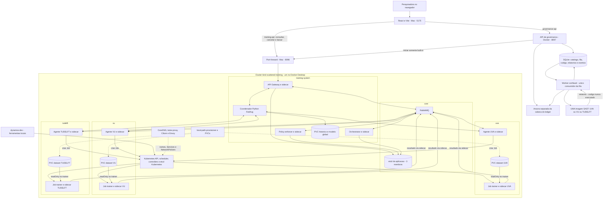
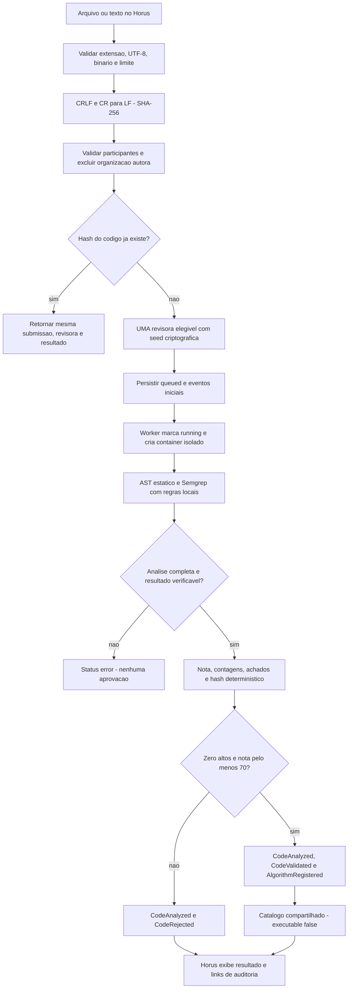
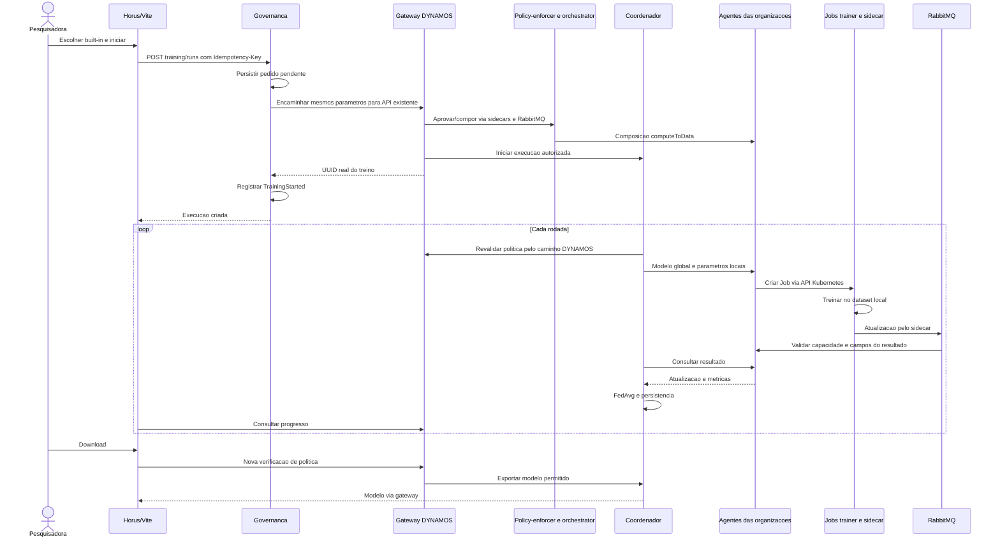
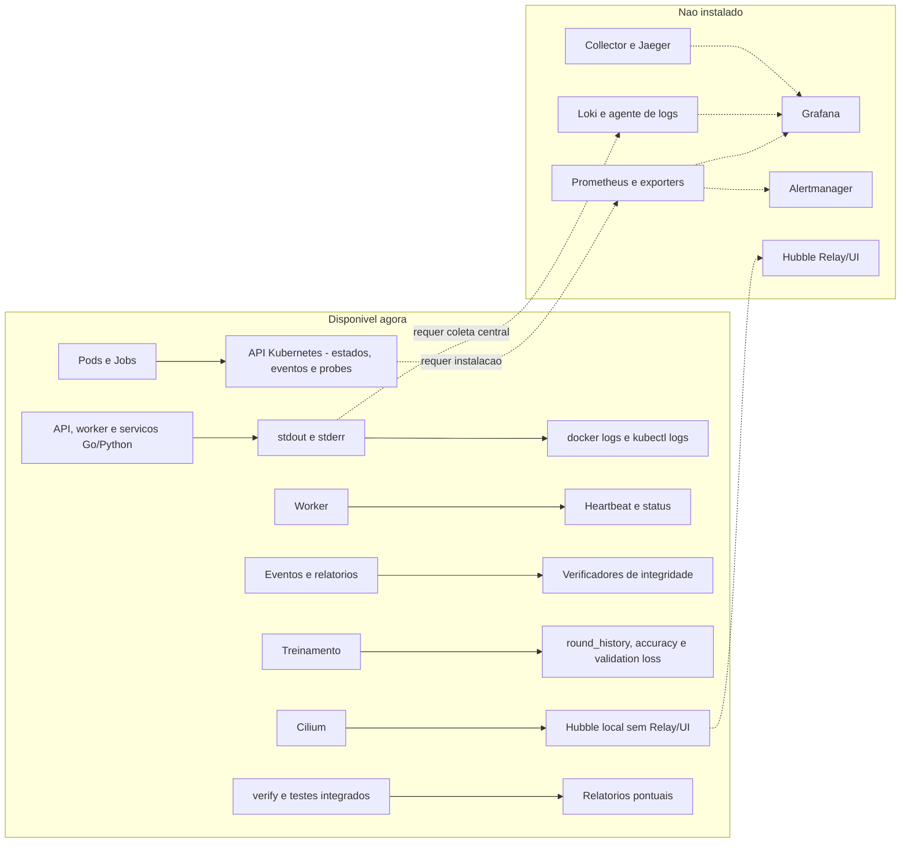

# Horus: guia completo do codigo, testes e observacao

**Referencia:** implementacao local consolidada em 02/11/2026.
**Raiz usada neste documento:** Scattered-Directive.

Este guia explica o codigo implementado, suas conexoes e como executar,
testar e observar o sistema. Nao pressupoe que todos os processos estejam
ligados. Configuracoes preservadas e funcionalidades futuras nao sao
apresentadas como componentes ja instalados.

## Sumario

1. [Estado atual](#1-estado-atual)
2. [Arquitetura e componentes](#2-arquitetura-e-componentes)
3. [Organizacao do codigo](#3-organizacao-do-codigo)
4. [Configuracao e persistencia](#4-configuracao-e-persistencia)
5. [Inicializacao e parada](#5-inicializacao-e-parada)
6. [Submissao, sorteio e SAST](#6-submissao-sorteio-e-sast)
7. [Treinamento federado](#7-treinamento-federado)
8. [Ledger e integridade](#8-ledger-e-integridade)
9. [Demonstracao manual](#9-demonstracao-manual)
10. [Observacao e monitoracao](#10-observacao-e-monitoracao)
11. [Endpoints](#11-endpoints)
12. [Testes automatizados e novos casos](#12-testes-automatizados-e-novos-casos)
13. [Diagnostico, recuperacao e backup](#13-diagnostico-recuperacao-e-backup)
14. [Limites conhecidos](#14-limites-conhecidos)
15. [Evidencias e checklist](#15-evidencias-e-checklist)

## 1. Estado atual

O sistema combina aprendizado federado DYNAMOS e governanca Horus. A
governanca analisa codigo e registra decisoes; o DYNAMOS autoriza e executa
o treinamento horizontal built-in. Sao controles diferentes.

| Capacidade | Situacao |
| --- | --- |
| Regressao logistica com FedAvg | Real, com UVA/VU/TUDELFT e dados sinteticos. |
| Jobs Kubernetes trainer + sidecar | Reais, um por organizacao em cada rodada. |
| Dados locais readOnly no trainer | Real; sem exportacao de CSV ao coordenador. |
| Identidade Meirylene Avelino / TUDelft | Configuracao no servidor, nao login OIDC. |
| Upload .py/.txt ou texto | Real; UTF-8 valido, sem binario, ate 1 MB. |
| Revisora diferente da organizacao autora | Sorteio real do servidor entre participantes selecionados. |
| Semgrep por organizacao | Containers Docker reais, offline, com regras/politica comuns. |
| Execucao de codigo submetido | Nao ocorre. O codigo e apenas texto para analise. |
| Catalogo de algoritmos aprovados | Real, persistente e compartilhado pela instancia local. |
| Treino de algoritmo novo aprovado | Bloqueado no frontend e no servidor; sandbox futura. |
| Ledger encadeado | SQLite real com ancora separada; nao blockchain. |
| Verify chain / Verify report | Reais. |
| TrainingStarted | Registrado para inicio pela ponte de governanca; clientes diretos de 8096 ficam fora dela. |
| Federated training / Ledger | Telas conectadas a APIs reais. |
| Dashboard | Ledger, eventos e heartbeat reais; outros dados continuam demonstrativos. |
| Besu/ExtremeXP | Codigo preservado; adaptador de auditoria nao ativado. |
| VFL/TTP/FABRIC original | Preservado, nao acionado pelo fluxo horizontal do Horus. |
| Prometheus/Grafana/Loki/collector/Jaeger | Nao instalados neste sandbox. |
| Hubble | Agente habilitado no Cilium, sem Relay/UI. |

As organizacoes sao namespaces no mesmo cluster/no local, nao datacenters
independentes. O catalogo e compartilhado nesta instalacao, nao federado
entre varias instalacoes com usuarios e identidades independentes.

O projeto antigo foi retirado da workspace e guardado em
`~/.Trash/DYNAMOS-antigo-2026-10-29`. Seus clusters ficaram parados, nao
apagados. O projeto novo tem Git e ferramentas proprios. Dados/modelos dos
clusters antigos nao foram migrados automaticamente para o novo.

## 2. Arquitetura e componentes

Desenhos deste guia: [arquitetura](diagrams/horus-guia-completo-1.svg),
[fluxo SAST](diagrams/horus-guia-completo-2.svg),
[sequencia do treino](diagrams/horus-guia-completo-3.svg) e
[observabilidade](diagrams/horus-guia-completo-4.svg).



### Ambientes e unidades

| Unidade | Papel |
| --- | --- |
| Mac | Navegador, Vite, Python dos launchers e port-forward. |
| Docker Desktop | Ambiente Linux de containers no Mac. |
| scattered-training-control-plane | Container que representa o no kind; nao e um trainer. |
| dynamos-dev | Docker CLI, kind, kubectl e Helm, fora do cluster. |
| horus-governance-api | API sem Docker socket; publica somente localhost:8097. |
| horus-governance-worker | Consumidor da fila com Docker socket; fronteira confiavel com privilegio operacional. |
| horus-sast-* | Analisador temporario sem rede, datasets ou socket. |
| Namespace | Separacao logica no mesmo cluster. |
| Deployment | Mantem Pods de servicos permanentes. |
| Pod | Containers que compartilham rede localhost. |
| Job | Tarefa que precisa terminar, como treino local de uma rodada. |
| Service | Nome/endereco estavel, resolvido por CoreDNS. |
| PVC | Volume persistente local; nao e backup nem replicacao entre organizacoes. |
| ServiceAccount/RBAC | Permissoes Kubernetes, distintas dos acordos de negocio. |
| Sidecar DYNAMOS | Ponte gRPC/RabbitMQ; nao e Linkerd nem ferramenta SAST. |

### Namespaces e Pods

| Namespace | Componentes |
| --- | --- |
| core | RabbitMQ e etcd-0/1/2 da aplicacao. |
| training-system | Gateway, policy-enforcer, orchestrator e coordenador. |
| uva, vu, tudelft | Um agente permanente, seed e Jobs por rodada. |
| kube-system | API Kubernetes, scheduler, controllers, etcd Kubernetes, CoreDNS, kube-proxy e Cilium/Envoy/operator. |
| local-path-storage | Provisionador dos volumes locais. |

A aplicacao de treinamento tem 11 Pods permanentes, sem contar infraestrutura
e Jobs: quatro em core, quatro em training-system e tres agentes. Servicos
Go/agentes possuem dois containers por Pod; o coordenador possui um. A API e
o worker de governanca sao containers Docker e nao entram nessa contagem.

O etcd de core guarda configuracao da aplicacao. O etcd de kube-system guarda
o estado do Kubernetes. Nao usar o segundo para consultar ou editar acordos.

## 3. Organizacao do codigo

Os caminhos seguintes sao relativos a raiz Scattered-Directive.

```text
Scattered-Directive/
  dev.sh                         ferramentas independentes
  horus-sandbox-frontend/
    src/pages/                   telas e fluxo visual
    src/components/              controles e paineis
    src/data/                    cliente de governanca e mocks legados
    src/types/                   contratos TypeScript
  horus-governance/
    app/                         API, fila, catalogo, ponte e ledger
    sast/                        Semgrep e runner Docker
    config/                      identidade, politica e organizacoes
    examples/                    scripts para tratar somente como texto
    tests/                       testes de contrato, API e integracao
    deploy/kubernetes/           template futuro, nao aplicado
    .local/                      dados privados da instancia
    compose.yaml                 API e worker locais
    tools.py                     CLI de build/start/stop/status/analise
  go/                            servicos DYNAMOS e sidecars
  python/federated-training/      coordenador e algoritmo horizontal
  charts/federated-training/      recursos Kubernetes do treinamento
  configuration/federated-training/ setup, isolamento e testes
  proto-files/                   protocolos gRPC/Protobuf
  extremexp_accesscontrol/        Flask/Web3 e contratos ABAC preservados
  fabric/                        notebooks e fluxo FABRIC original
  house_energy_consumption/      material do workload vertical original
  web/                           frontend original, distinto do Horus
  docs/                          guias e desenhos
```

### Frontend

| Arquivo | Responsabilidade |
| --- | --- |
| [App.tsx](../horus-sandbox-frontend/src/App.tsx) | Rotas, Sidebar, Topbar e area de conteudo. |
| [FederatedTraining.tsx](../horus-sandbox-frontend/src/pages/FederatedTraining.tsx) | Identidade, catalogo, inicio via governanca, progresso, cancelamento e download. |
| [AlgorithmSubmission.tsx](../horus-sandbox-frontend/src/components/AlgorithmSubmission.tsx) | Arquivo/texto, polling, achados, proveniencia e links ao ledger. |
| [Ledger.tsx](../horus-sandbox-frontend/src/pages/Ledger.tsx) | Filtros, paginacao, detalhe e verificadores. |
| [Dashboard.tsx](../horus-sandbox-frontend/src/pages/Dashboard.tsx) | Ledger/worker reais e componentes demonstrativos remanescentes. |
| [SandboxStatusPanel.tsx](../horus-sandbox-frontend/src/components/SandboxStatusPanel.tsx) | Apresenta status recebido; nao mede infraestrutura por conta propria. |
| [data/governance.ts](../horus-sandbox-frontend/src/data/governance.ts) | Cliente HTTP de /governance-api. |
| [types/governance.ts](../horus-sandbox-frontend/src/types/governance.ts) | Tipos de identidade, catalogo, submissao, relatorio, ledger e status. |
| [data/mock.ts](../horus-sandbox-frontend/src/data/mock.ts) | Dados ficticios usados fora do fluxo implementado. |
| [vite.config.ts](../horus-sandbox-frontend/vite.config.ts) | Dois proxies e tokens lidos apenas no servidor Vite. |

O browser nao recebe o bearer token no bundle. React exibe codigo/mensagens
como texto escapado, nao HTML interpretado. O Vite continua sendo servidor
local de desenvolvimento, nao autenticacao de producao.

### Governanca

| Arquivo e simbolo | Responsabilidade |
| --- | --- |
| [app/main.py](../horus-governance/app/main.py): create_app / BoundedBody | Rotas, bearer token, Origin, schemas, limite de corpo, upload e erros sanitizados. |
| [app/settings.py](../horus-governance/app/settings.py): Settings | Identidade do servidor, URL de treino, caminhos e token local. |
| [app/reviewer.py](../horus-governance/app/reviewer.py): select_reviewer | Valida participantes, exclui autora e faz sorteio. |
| [app/service.py](../horus-governance/app/service.py): Governance.submit | Normaliza, deduplica e persiste submissao/sorteio. |
| app/service.py: work_once / catalog / verify_submission | Consome fila, valida SAST, registra catalogo/eventos e verifica relatorios. |
| [app/worker.py](../horus-governance/app/worker.py) | Processo separado, lock, heartbeat e interrupcao. |
| [app/storage.py](../horus-governance/app/storage.py): Store | SQLite parametrizado, transacoes, lock e ancora. |
| [app/ledger.py](../horus-governance/app/ledger.py): LedgerBackend / SQLiteLedger | Interface substituivel, append, leitura e verificacao. |
| [app/training_bridge.py](../horus-governance/app/training_bridge.py): TrainingBridge | Inicio built-in, idempotencia e reconciliacao. |
| [sast/contracts.py](../horus-governance/sast/contracts.py) | Limites, normalizacao, JSON canonico, nota e hash. |
| [sast/analyze.py](../horus-governance/sast/analyze.py) | Parsing de sintaxe, Semgrep local e extracao sem snippets. |
| [sast/docker_runner.py](../horus-governance/sast/docker_runner.py) | Resolve imagem imutavel, aplica isolamento, limita tempo e remove container. |
| [config/policy.json](../horus-governance/config/policy.json) | Politica comum de nota e aprovacao. |
| [config/organizations.json](../horus-governance/config/organizations.json) | Imagens e futuros namespaces de analise. |
| [config/settings.example.json](../horus-governance/config/settings.example.json) | Identidade e configuracao inicial do servidor. |
| [sast/rules.yaml](../horus-governance/sast/rules.yaml) | Regras em sintaxe JSON, tambem valida em YAML. |

### Treinamento

| Local | Responsabilidade |
| --- | --- |
| [Gateway training.go](../go/cmd/api-gateway/training.go) | Rota ML, identidade, aprovacao, capacidades e intermedio com coordenador. |
| [Policy-enforcer](../go/cmd/policy-enforcer/generate_validation_response.go) | Acordos e permissoes de ML. |
| [Orchestrator training.go](../go/cmd/orchestrator/training.go) | Aprovacao de todas as organizacoes para computeToData. |
| [composition_request.go](../go/cmd/orchestrator/composition_request.go) | Composicao e distribuicao aos agentes. |
| [Agente training.go](../go/cmd/agent/training.go) | Registro online, capacidades, ConfigMaps, Jobs e validacao de resultados. |
| [pkg/training](../go/pkg/training/training.go) | Contrato e assinatura/verificacao de capacidades. |
| [Sidecar](../go/cmd/sidecar/) | Transporte gRPC/RabbitMQ e encerramento de sidecars temporarios. |
| [service.py](../python/federated-training/service.py) | Ciclo de rodadas, consulta aos agentes, cancelamento e persistencia. |
| [model.py](../python/federated-training/model.py) | Dataset, treino local, FedAvg e exportacao. |
| [integration.py](../python/federated-training/integration.py) | Aprovacao e envio do resultado via sidecar. |
| [Chart](../charts/federated-training/) | Deployments, seeds, Secrets, Services, PVCs, RBAC e NetworkPolicies. |
| [manage.py](../configuration/federated-training/manage.py) | Setup, status, verify e port-forward. |
| [verify.py](../configuration/federated-training/verify.py) | Probes reais de mounts, rede e RBAC. |

As pastas protegidas acima ja continham o fluxo horizontal adaptado; nao foram
alteradas na adicao posterior da governanca. VFL/TTP/FABRIC e ExtremeXP sao
fluxos preservados distintos, nao caminhos automaticamente acionados pelo Horus.

## 4. Configuracao e persistencia

### Portas e fronteiras

| Porta/nome | Onde | Uso |
| --- | --- | --- |
| 5175 | localhost no Mac | Vite/Horus e os dois proxies. |
| 8096 | localhost no Mac | Port-forward do Service api-gateway. |
| 8097 | localhost no Mac | API de governanca publicada pelo Compose. |
| 8080 | Interna ao cluster | HTTP entre gateway, coordenador e agentes. |
| 50051 | Local aos Pods Go | gRPC para sidecars DYNAMOS. |
| 5672 | RabbitMQ em core | Mensagens da aplicacao, nao painel web do broker. |
| 2379/2380 | etcd em core | Cliente/peers do etcd da aplicacao. |

Nao abrir portas internas indiscriminadamente. O navegador nao acessa
diretamente agentes/coordenador. Localhost nao e uma solucao de acesso remoto.

| Variavel | Finalidade |
| --- | --- |
| DOCKER_BIN | Caminho Docker; no worker aponta ao executavel Linux. |
| DYNAMOS_DEV_CONTAINER | Nome das ferramentas, padrao dynamos-dev. |
| SCATTERED_CONTAINER_ROOT | Mount nas ferramentas, padrao /workspace/Scattered-Directive. |
| HORUS_SETTINGS | Arquivo de identidade no processo de governanca. |
| HORUS_STATE_ROOT | Pasta do estado da governanca; /state nos containers. |
| HORUS_TRAINING_URL | URL de treino vista pelo processo da governanca. |
| HORUS_TRAINING_TOKEN_FILE | Token de treino, montado somente leitura. |
| HORUS_UID/GID/DOCKER_GID | Usuario/grupos usados pelo Compose; launcher preenche valores locais. |

O Compose monta explicitamente config/settings.example.json. Mudar apenas
variavel no shell do Mac nao altera esse mount. Para mudar identidade, editar
a configuracao do servidor e reiniciar governanca; pseudonimo deve ser opaco.

### Dados persistentes

| Local | Conteudo |
| --- | --- |
| horus-governance/.local/governance.sqlite3 | events, submissions, algorithms e training_requests. Submissions contem codigo e relatorios fora do ledger: dado sensivel. |
| horus-governance/.local/ledger-head.json | Numero/hash da cabeca esperada; separado do banco, mas nao do host. |
| horus-governance/.local/api-token | Token da governanca lido pelo Vite; nao publicar. |
| writer.lock / worker.lock | Serializacao das escritas e exclusao de workers concorrentes. |
| worker-status.json | Heartbeat aproximado do worker. |
| configuration/federated-training/.local/ | Credenciais, valores locais e relatorios do treinamento. Nao versionar. |
| PVC training-data de cada organizacao | Dataset sintetico; somente o trainer o monta readOnly. |
| PVC training-state dos agentes | Estado e resultados das rodadas locais. |
| PVC do coordenador | Historico por UUID e modelo global. |
| ConfigMap por rodada | Entrada e capacidade de resultado; nao imprimir valores em demonstracoes publicas. |

Governanca apenas le o token de treinamento. Se ele nao existir, start recusa
iniciar; o Compose nao deve criar esse caminho. Backup do Git nao inclui
automaticamente .local/ nem os dados dos PVCs.

## 5. Inicializacao e parada

### Preparacao em cada terminal no Mac

```bash
PROJECT="$HOME/Desktop/TUDelft/desenvolvimento/DYNAMOS_TUDelft_Test/Scattered-Directive"
cd "$PROJECT"
export DOCKER_BIN=/Applications/Docker.app/Contents/Resources/bin/docker
kc() { "$DOCKER_BIN" exec dynamos-dev kubectl --context kind-scattered-training "$@"; }
```

Adaptar PROJECT e Docker no Linux. Definir variaveis/funcao em cada terminal
novo. kc fixa o contexto em toda chamada, sem mudar o contexto global.
Requisitos: Docker Desktop/Compose, Python 3.10+ para governanca e Node.js 18+.
Os testes Go exigem versao compativel com go/go.mod.

Com 4 CPUs/8 GB, manter os clusters antigos parados. Tres clusters simultaneos
ja causaram saturacao/timeouts nesta maquina. Nao excluir dados para resolver isso.

### Primeira instalacao, somente quando necessaria

```bash
bash dev.sh
python3 configuration/federated-training/manage.py setup
```

O setup constroi imagens, cria o cluster, instala rede/servicos, prepara dados
e verifica isolamento. Pode baixar imagens/charts na instalacao. A analise SAST
posterior e offline; isso nao significa que o build inicial dispense internet.

**Nao repetir setup ou verify durante um treino.** O setup reinicia servicos;
verify controla temporariamente o gate enquanto testa probes. --skip-build
nao transforma setup em comando somente leitura. Nao editar networkVerified
manualmente para contornar uma verificacao falhada.

### Retomar ambiente instalado

```bash
bash dev.sh --no-rebuild
"$DOCKER_BIN" ps -a --format 'table {{.Names}}\t{{.Status}}'
```

Se scattered-training-control-plane existir e estiver parado:

```bash
"$DOCKER_BIN" start scattered-training-control-plane
kc wait --for=condition=Ready nodes --all --timeout=180s
kc get pods -A
```

Se ja estiver ligado, apenas conferir o inventario. dynamos-dev e o container
atual de ferramentas, nao o projeto antigo. Os comandos tools.py start e npm
abaixo sao do Mac, nao comandos para rodar dentro dele.

### Terminal 1: API de treinamento

Somente se ainda nao houver encaminhamento na porta:

```bash
python3 configuration/federated-training/manage.py forward
```

Esperado: Forwarding from 127.0.0.1:8096. Manter esse terminal aberto.

### Terminal 2: governanca em background

```bash
cd "$PROJECT/horus-governance"
python3 tools.py build
python3 tools.py start
python3 tools.py status
```

build constroi as quatro imagens SAST; repetir quando elas/regras/politica
mudarem. start constroi a API e inicia API/worker via Compose, sem ocupar o
terminal. A credencial do treinamento precisa existir antes. API nao monta
Docker socket; so o worker confiavel o monta.

### Terminal 3: frontend

```bash
cd "$PROJECT"
npm --prefix horus-sandbox-frontend ci
npm --prefix horus-sandbox-frontend run dev -- --strictPort
```

ci e necessario na primeira vez ou ao mudar dependencias, nao em toda sessao.
Manter Vite aberto. Nao iniciar copias se a porta estiver ocupada.
Abrir <http://127.0.0.1:5175/training> e <http://127.0.0.1:5175/ledger>.

### Prontidao e parada

```bash
curl -fsS http://127.0.0.1:5175/training-api/catalog | python3 -m json.tool
curl -fsS http://127.0.0.1:5175/governance-api/me | python3 -m json.tool
curl -fsS http://127.0.0.1:5175/governance-api/status | python3 -m json.tool
```

Esperado: isolamento verificado, identidade TUDELFT, ledger.valid=true e
worker_ready=true. /health sozinho nao prova esses quatro estados.

```bash
cd "$PROJECT/horus-governance"
python3 tools.py stop
```

stop nao remove .local/. Ctrl+C fecha Vite/port-forward/observadores em seus
terminais. Evitar interromper servicos durante treino/analise. Nao usar
down -v, kind delete, docker prune ou remover PVC/.local/ para apenas reiniciar.

## 6. Submissao, sorteio e SAST



### Entrada, identidade e sorteio

Extensoes aceitas: .py/.txt; limite de 1.048.576 bytes de codigo. O corpo HTTP
permite overhead, mas nao aumenta esse limite. UTF-8 invalido, controles binarios,
texto vazio e sintaxe invalida nao produzem aprovacao. O nome externo nao e
usado como caminho no scanner: o analisador cria seu arquivo temporario.
ast.parse constroi AST; nao faz execucao/importacao do programa.

A organizacao da autora vem de Settings, nunca do pedido. Com TUDELFT autora
e UVA/VU/TUDELFT selecionadas, elegiveis sao UVA e VU. Somente TUDELFT nao tem
revisora independente e e recusado.

O sorteio usa seed criptografica, elegiveis ordenadas e sha256-rank-v1. O evento
permite reproduzir a escolha; nao e protocolo descentralizado nem prova contra
um administrador malicioso que escolhe outra seed.

### Deduplicacao

code_hash e unico, inclusive sob envios concorrentes e queued/running. Um
reenvio conserva revisora/resultado. So quebras CRLF/CR sao normalizadas para
LF: espacos/comentarios e outras alteracoes continuam relevantes. A CLI de
analise avulsa pode repetir scans para comparar imagens, sem registrar catalogo.

### Isolamento e regras

| Controle Docker | Configuracao |
| --- | --- |
| Imagem | Inspecionada e iniciada por ID imutavel. |
| Rede/portas | network none, sem portas. |
| Usuario | UID/GID 10001, nao root. |
| Filesystem | Root readOnly; /tmp tmpfs de 128 MiB, noexec/nosuid/nodev. |
| Privilegios | Todas as capabilities removidas, no-new-privileges. |
| Recursos | 1 CPU, 768 MiB sem swap adicional e 128 processos. |
| Tempo | Timeout interno e prazo externo. |
| Mounts | Nenhum arquivo do host, dataset, token ou Docker socket. |
| Limpeza | Container removido no finally, inclusive apos erros tratados. |

O worker controla Docker e e confiavel; o scanner nao recebe esse privilegio.
Semgrep 1.145.0 e fixado por digest OCI. Regras sao locais, sem download no scan.
Os controles nao equivalem a Kata/gVisor, que nao foram instalados.

| Categoria de regra | Severidade |
| --- | --- |
| eval/exec/compile | Alta. |
| pickle.load/loads | Alta. |
| YAML inseguro | Alta. |
| subprocess e APIs os de processos | Alta. |
| Imports socket/requests/urllib/http/httpx/aiohttp | Media. |
| Escritas inseguras ou destino nao comprovado | Alta, conforme API/padrao reconhecido. |
| Credenciais literais em campos reconhecidos | Alta, sem valor encontrado na mensagem. |

Comentarios nosemgrep nao suprimem os achados. SAST tem falsos positivos e
negativos: nota alta nao prova ausencia de comportamento malicioso.

## 7. Treinamento federado



### Duas decisoes diferentes

Aprovacao SAST permite entrar no catalogo. O policy-enforcer decide permissoes
sobre dados/organizacoes/dataset/algoritmo/archetype. Codigo aprovado nao cria
automaticamente um acordo de uso de dados.

Somente logistic-regression-v1 segue a 8096. Novos algoritmos tem
executable=false e bloqueio no frontend e no TrainingBridge. A ponte nao
substitui o motor Go/Python existente nem muda seus parametros de aprendizado.

### Idempotencia e revogacao

O frontend envia UUID em Idempotency-Key. Mesmo pedido/chave retorna o treino
confirmado sem iniciar outro. Chave com parametros diferentes e recusada.
Timeout pode deixar unknown: nao reenviar cegamente. O operador consulta o
historico e pode reconciliar com UUID conhecido, conferindo parametros/horario.
Nao e transacao atomica entre SQLite e Kubernetes ou garantia exactly-once.

Clientes diretos de 8096 continuam possiveis e fora desse ledger. Revogacao e
observada na proxima fronteira de revalidacao, nao mata imediatamente um
trainer que ja roda. Cancelamento remove Jobs rastreados; nao retoma o treino
do ponto exato posteriormente.

### Algoritmo, rodadas e metricas

Cada organizacao tem 240 linhas sinteticas diferentes, quatro features e alvo
binario. Split local 80/20: 192 amostras de treino e 48 de validacao. O modelo
inicial tem coeficientes e intercepto zerados; o trainer usa SGDClassifier
com perda logistica. Duas epocas sao duas passagens locais por rodada.

$$
\theta_{r+1} = \sum_{k=1}^{K}\frac{n_k}{\sum_{j=1}^{K}n_j}\theta_{k,r}
$$

FedAvg pondera pelo numero de amostras; aqui cada organizacao pesa 1/3.
Accuracy e validation loss sao locais, nao teste independente de producao.
O coordenador recebe atualizacoes/metricas, nao CSVs ou predicoes individuais.

### Ciclo dos Jobs

Tres organizacoes e tres rodadas geram nove Jobs, normalmente tres por vez.
O mesmo nome de Job existe em namespaces diferentes. Cada Pod tem trainer
e sidecar e passa por:

```text
Pending -> ContainerCreating -> Running -> encerramento -> Completed
```

1/2 NotReady pode ocorrer enquanto um container ja saiu. 0/2 Completed e
normal; conferir Job Complete 1/1. O sidecar precisa terminar para concluir.
Prazo do Job: 180 segundos; TTL: 600 segundos apos finalizar. A limpeza de
Job/Pod/ConfigMap nao apaga dataset, historico ou modelo global nos PVCs.

Horus consulta aproximadamente a cada dois segundos, mas o contador muda por
rodada global concluida, nao por epoca. Nao ha streaming de gradientes/epocas.
Trainer pode ter stdout vazio: resultado e transmitido pelo sidecar/agente.

## 8. Ledger e integridade

### Identificadores

| Campo | Significado |
| --- | --- |
| code_hash | SHA-256 do texto normalizado. |
| report_hash | SHA-256 do relatorio canonico. |
| tx_id / record_hash | ID local de evento / hash encadeado; nao transacao Besu. |
| run_id | UUID real da execucao DYNAMOS. |

### Nota e determinismo

$$
S = \max(0,100-25H-10M-2L)
$$

H/M/L sao contagens altas/medias/baixas. Aprovacao exige H=0 e S>=70. Regras
atuais usam alta/media, embora o calculo suporte baixa. Um medio isolado nao
necessariamente reprova. A nota inicial 100 do built-in e baseline confiavel,
nao nova analise SAST de todo o runtime de aprendizado.

Relatorio contem hashes de codigo/regras/politica, versao Semgrep, nota,
contagens, achados ordenados e decisao/motivos. Cada achado tem rule_id, linha,
coluna, severidade e mensagem fixa, sem snippet ou valor de token encontrado.

JSON canonico usa chaves ordenadas, separadores compactos, UTF-8 e nenhum
NaN/Infinity. Rules hash usa bytes exatos do arquivo; policy hash usa JSON
canonico. Organizacao, imagem, horarios e caminhos temporarios ficam fora do
conteudo hashado. Proveniencia e separada e distingue digest de repositorio
de ID local Docker. Mesmos texto/regras/politica/motor geram mesmo report_hash.

### Eventos e verificadores

Envelope: version, sequence, tx_id local-*, event_type, recorded_at, payload,
previous_hash e record_hash. O hash exclui apenas o proprio record_hash.

| Evento | Conteudo permitido |
| --- | --- |
| CodeSubmitted | code_hash, pseudonimo e organizacao da autora. |
| ReviewerSelected | code_hash, revisora, elegiveis, excluida, seed e selection_version. |
| CodeAnalyzed | code_hash, revisora, imagem/ID/digest/tipo, hashes regras/politica, Semgrep, report_hash, nota e contagens. |
| CodeValidated / CodeRejected | code_hash, report_hash e decision. |
| AlgorithmRegistered | algorithm_id, hashes quando aplicaveis, nota, origem e executable; inclui built-in. |
| TrainingStarted | run_id, algorithm_id e organizations. |

Nome pessoal, fonte e lista de achados nao vao ao payload. O timestamp do
evento participa da cadeia; o relatorio SAST deterministico e outro objeto.

Verify chain recalcula hashes/sequencia, referencias e ancora. Verify report
compara o relatorio salvo com CodeAnalyzed de cadeia verificada. Leitura normal
do relatorio tambem verifica integridade. Hash fornecido por um atacante junto
do relatorio nao autentica nada sem referencia confiavel.

## 9. Demonstracao manual

### Abrir observadores antes de Start training

Com kc definido, em terminais diferentes:

```bash
kc get pods -A -w
```

```bash
kc get jobs -A -l app=federated-training -w
```

```bash
kc logs deployment/training-agent -n uva -c agent --tail=20 -f
```

Trocar uva por vu/tudelft para outra organizacao. Ctrl+C fecha observacao,
nao treinamento. O label de Jobs de rodada nao inclui necessariamente seed;
usar kc get jobs -A sem filtro para inventario completo.

### Cenarios e evidencias

| Passo | Acao | Esperado |
| --- | --- | --- |
| 1 | Abrir /training. | Identidade do servidor, isolamento verificado, built-in no catalogo. |
| 2 | Selecionar UVA/VU/TUDELFT e enviar horus-governance/examples/clean.py. | queued/running, depois approved, 100 e sem achados. |
| 3 | Conferir sorteio. | TUDELFT excluida; revisora UVA ou VU. |
| 4 | Reenviar mesmo texto, inclusive alterando apenas CRLF/LF. | Mesmo hash, revisora e resultado; sem outro CodeAnalyzed. |
| 5 | Alterar um caractere real. | Outro code_hash e novo fluxo. |
| 6 | Enviar examples/unsafe.py somente como texto. | rejected, 0, quatro altos e um medio; token falso ausente do relatorio. |
| 7 | Escolher novo algoritmo aprovado. | Catalog only, aviso e Start training desabilitado. |
| 8 | Voltar ao built-in, tres rodadas/duas epocas. | Inicio pela governanca e UUID real. |
| 9 | Acompanhar Pods e Horus. | Tres Jobs por rodada, nove no total, resultados nos agentes, progresso 3/3. |
| 10 | Baixar modelo. | Modelo global autorizado, sem CSV ou predicoes individuais. |
| 11 | Abrir Analysis transaction. | Dados, record_hash e previous_hash. |
| 12 | Buscar code_hash e filtrar tipo/pagina. | Historia daquela submissao. |
| 13 | Verify chain / Verify report. | Resultado valido; report requer analise concluida. |
| 14 | Buscar TrainingStarted. | Mesmo UUID do treino governado. |
| 15 | Abrir Dashboard. | Ledger/worker reais; demais status identificados demo. |

Nao executar unsafe.py para testar upload. Nao matar processos para atrasar
uma demonstracao. Para testar cancelamento, iniciar OUTRA execucao e clicar
Cancel enquanto ativa. O estado failed no teste de revogacao pode ser
intencional: distinguir negacao esperada de falha operacional.

### Correlacionar UUID e Jobs

Copiar o UUID real do Horus, com kc definido no terminal:

```bash
RUN_ID='COLE-O-UUID-REAL'
JOB_PREFIX=$(python3 -c 'import sys,uuid; print("training-" + uuid.UUID(sys.argv[1]).hex[:16])' "$RUN_ID")
JOB="${JOB_PREFIX}-r1"
kc get jobs -A --field-selector "metadata.name=$JOB"
kc get pods -n uva -l "job-name=$JOB" -o wide
kc describe job "$JOB" -n uva
kc logs "job/$JOB" -n uva -c trainer --tail=80
kc logs "job/$JOB" -n uva -c sidecar --tail=80
```

Usar r2/r3 para outras rodadas, vu/tudelft para outra organizacao. Nao reutilizar
nomes de Pods antigos. Depois do TTL, criar nova execucao para observar novamente.

```bash
curl -fsS "http://127.0.0.1:5175/training-api/runs/$RUN_ID" | python3 -m json.tool
curl -fsS "http://127.0.0.1:5175/training-api/runs/$RUN_ID/model" | python3 -m json.tool
```

Historico contem round_history, Jobs e metricas. Modelo so deve estar disponivel
apos conclusao e autorizacao. Treino built-in e ligado por algorithm_id no
ledger; nao inventar um code_hash de submissao para esse algoritmo.

## 10. Observacao e monitoracao



### Docker e Kubernetes

```bash
"$DOCKER_BIN" ps --format 'table {{.Names}}\t{{.Status}}'
"$DOCKER_BIN" logs --tail=100 horus-governance-api
"$DOCKER_BIN" logs --tail=100 horus-governance-worker
"$DOCKER_BIN" ps --filter name=horus-sast
"$DOCKER_BIN" stats --no-stream
kc get deployments,statefulsets,daemonsets -A
kc get services,pvc -A
kc get events -A --sort-by=.lastTimestamp
```

Acrescentar -f a logs para acompanhar. Scanners podem sumir antes do comando
manual: normal apos o resultado. Imagem instalada nao e container em execucao.
docker stats mostra containers Docker, incluindo o NO kind, nao cada Pod.
manage.py status filtra labels e nao substitui kc get pods -A para inventario.

```bash
kc logs deployment/api-gateway -n training-system -c api-gateway --tail=100
kc logs deployment/policy-enforcer -n training-system -c policy-enforcer --tail=100
kc logs deployment/orchestrator -n training-system -c orchestrator --tail=100
kc logs deployment/training-coordinator -n training-system -c coordinator --tail=100
kc logs deployment/training-agent -n tudelft -c agent --tail=100
```

No agente, procurar Training result received through DYNAMOS sidecar e o
prefixo do Job. Combinar logs, estado e historico, sem exigir linha por epoca.
--previous mostra logs da instancia anterior de um container reiniciado.

### Broker e descoberta

```bash
kc exec deployment/rabbitmq -n core -- rabbitmq-diagnostics -q ping
kc exec deployment/rabbitmq -n core -- rabbitmqctl -q list_queues name messages_ready messages_unacknowledged consumers
kc exec etcd-0 -n core -- /usr/local/bin/etcdctl --endpoints=http://127.0.0.1:2379 endpoint health --cluster
kc exec etcd-0 -n core -- /usr/local/bin/etcdctl --endpoints=http://127.0.0.1:2379 get /agents/online/ --prefix --keys-only
```

Filas incluem UVA-in, VU-in, TUDELFT-in, api-gateway-in, orchestrator-in e
policyEnforcer-in. Zero mensagens pode significar consumo rapido, nao falha.
Nao purgar filas, imprimir acordos/capacidades ou reiniciar broker so para observar.

### Isolamento sem exportar o dataset

Enquanto o Job da secao 9 ainda existir:

```bash
kc get job "$JOB" -n uva -o jsonpath='{.spec.template.spec.containers[*].name}{"\n"}'
kc get job "$JOB" -n uva -o jsonpath='{.spec.template.spec.automountServiceAccountToken}{"\n"}'
kc get job "$JOB" -n uva -o jsonpath='{range .spec.template.spec.containers[?(@.name=="trainer")].volumeMounts[*]}{.name}{": readOnly="}{.readOnly}{"\n"}{end}'
kc get networkpolicy -A
kc auth can-i get secrets -n uva --as system:serviceaccount:uva:training-agent
kc auth can-i get persistentvolumeclaims -n vu --as system:serviceaccount:uva:training-agent
```

Esperado: trainer/sidecar, automount=false, dataset readOnly=true e RBAC no.
Um no pode retornar exit code diferente de zero: e a negacao esperada.
Nao usar cat no dataset ou imprimir Secrets/ConfigMaps como demonstracao.

Workers de treino podem falar com DNS, agente local e RabbitMQ conforme as
NetworkPolicies; sao diferentes dos scanners sem rede. Agentes tem acesso
maior para criar Jobs e acessar broker/etcd/API. Probes nao provam isolamento
absoluto de administradores ou de todas as filas.

### Governanca e sinais ausentes

```bash
curl -fsS http://127.0.0.1:5175/governance-api/status | python3 -m json.tool
curl -fsS -X POST http://127.0.0.1:5175/governance-api/ledger/verify | python3 -m json.tool
curl -fsS 'http://127.0.0.1:5175/governance-api/ledger/events?event_type=TrainingStarted&limit=20' | python3 -m json.tool
```

Para um hash real que ja tenha relatorio:

```bash
CODE_HASH='COLE-O-SHA256-REAL'
curl -fsS "http://127.0.0.1:5175/governance-api/submissions/$CODE_HASH" | python3 -m json.tool
curl -fsS -X POST "http://127.0.0.1:5175/governance-api/reports/$CODE_HASH/verify" | python3 -m json.tool
```

worker_ready admite heartbeat de ate 180 segundos: pode ficar true algum tempo
apos parada. Nao comprova que Docker ou treino estejam saudaveis. Pod Ready
nao comprova autorizacao de negocio. verify.py e testes sao pontuais, nao SOC.

OpenCensus esta no Go, mas collector.core.svc.cluster.local:55678 nao foi
instalado; nao ha traces ponta a ponta armazenados apenas por existir a variavel.
Nao ha metrics-server para kubectl top. Accuracy nao e CPU/memoria; graficos
mock nao sao metricas Prometheus. Nao ha retencao de logs central no Loki.

Evidencias seguras: versao Git, digest das imagens, motor, hashes de regras/
politica/codigo/relatorio, tx_id, seed/revisora, UUID do treino, estado e Jobs.
Nao publicar fonte, nomes, tokens, Secrets, capacidades ou CSV dos datasets.

## 11. Endpoints

Rotas relativas a /governance-api no Vite ou a 8097 diretamente. A API direta
precisa de bearer token, exceto /health. Exemplos usam proxy para nao exibir
credenciais. Swagger/OpenAPI publicos nao estao habilitados.

| Metodo | Rota | Papel |
| --- | --- | --- |
| GET | /health | Processo responde; nao comprova toda a stack. |
| GET | /me | Identidade imposta pelo servidor. |
| GET | /status | Cadeia, backend e heartbeat. |
| GET | /algorithms | Catalogo e executable. |
| GET | /submissions | Ate 50 submissões recentes, sem codigo fonte. |
| POST | /submissions | JSON code/organizations ou multipart file/organizations. |
| GET | /submissions/{code_hash} | Status, sorteio, relatorio, proveniencia e tx_ids. |
| POST | /reports/{code_hash}/verify | Relatorio versus CodeAnalyzed. |
| GET | /ledger/events | event_type/code_hash, offset e limit de 1 a 100. |
| GET | /ledger/events/{tx_id} | Detalhe verificado. |
| POST | /ledger/verify | Cadeia e ancora. |
| POST | /training/runs | Inicio built-in; requer header Idempotency-Key UUID. |
| GET | /training/requests/{id} | Estado da solicitacao idempotente. |
| POST | /training/requests/{id}/reconcile?run_id={uuid} | Reconciliacao explicita de inicio incerto. |

Campos extras como researcher_org/reviewer sao recusados. Organizations e
selecao de participantes, nao substituicao da identidade. Em multipart esse
campo e um array JSON. Nova submissao retorna 202; duplicata 200 com reused.
Para decisao ler status/decision, nao inferir aprovacao de HTTP 200.

CLI exit 0 significa analise concluida, mesmo se rejected; erro retorna 2.
No proxy /training-api permanecem catalog, runs, runs/{id}, cancelamento e
modelo da API existente. Eles nao foram transferidos para outro motor.

## 12. Testes automatizados e novos casos

### Preparacao

```bash
cd "$PROJECT/horus-governance"
python3 -m venv .venv
.venv/bin/pip install -r requirements.lock
.venv/bin/python -m unittest discover -s tests -v
```

Sem flags, testes Docker/live sao pulados explicitamente. OK com skipped nao
comprova que o ambiente completo foi exercitado.

| Nivel/gate | Ambiente e efeito |
| --- | --- |
| test_ledger / test_governance / test_api / test_training_bridge | Estado temporario e upstream simulado; nao altera ledger ativo ou cria treino. |
| test_sast sem gate | Contratos de texto, nota e hash, sem Semgrep real. |
| HORUS_SAST_DOCKER_TESTS=1 | Scanners reais sem rede nas tres organizacoes; containers removidos. |
| HORUS_GOV_LIVE_TESTS=1 | API/Vite/worker reais; persiste submissões/eventos locais, reutiliza duplicatas. |
| HORUS_GOV_LIVE_TRAINING=1 junto de LIVE_TESTS | Cria treino real, nove Jobs e evento TrainingStarted. |
| manage.py verify | Probes reais e controle temporario do gate; sem treino ativo. |
| test_integrated.py do treinamento | Revogacao temporaria de acordo e treino; sem outras execucoes. |

### SAST e uso real

```bash
python3 tools.py build
HORUS_SAST_DOCKER_TESTS=1 .venv/bin/python -m unittest discover -s tests -v
```

Com servicos/Vite rodando, governanca real sem treino:

```bash
HORUS_GOV_LIVE_TESTS=1 .venv/bin/python -m unittest discover -s tests -p test_live.py -v
```

Para criar tambem treino real de tres rodadas:

```bash
HORUS_GOV_LIVE_TESTS=1 HORUS_GOV_LIVE_TRAINING=1 \
  .venv/bin/python -m unittest discover -s tests -p test_live.py -v
```

O teste de treino pula se detectar outro ativo. Nao remover banco para um
teste parecer novo; usar outra entrada revisada ou instancia com estado proprio.

### Treinamento existente e build

Voltar a raiz, sem treinos ativos para os comandos de isolamento/revogacao:

```bash
cd "$PROJECT"
python3 -m unittest discover -s configuration/federated-training -p 'test_manage.py' -v
python3 configuration/federated-training/manage.py verify
python3 configuration/federated-training/test_integrated.py
```

O teste integrado altera/restaura acordo sintetico em finally. Se for morto
abruptamente, conferir o acordo antes de voltar a demonstrar. test_run.py pode
testar treino diretamente em 8096, mas nao gera TrainingStarted da governanca.

```bash
python3 -m venv /tmp/scattered-training-tests
/tmp/scattered-training-tests/bin/pip install -r python/federated-training/requirements.txt
/tmp/scattered-training-tests/bin/python -m unittest discover -s python/federated-training -p 'test_*.py' -v
```

```bash
cd "$PROJECT/go"
go test ./pkg/training ./cmd/agent ./cmd/api-gateway ./cmd/orchestrator ./cmd/policy-enforcer ./cmd/sidecar
cd "$PROJECT"
npm --prefix horus-sandbox-frontend run build
```

Build/typecheck nao substitui navegador. Aviso de bundle maior que 500 kB e
distinto de erro de compilacao.

### Como criar seus casos

| Arquivo | Exemplos |
| --- | --- |
| tests/test_sast.py | Regra/alias, segredo redigido, Unicode/binario, determinismo e isolamento. |
| tests/test_governance.py | Elegiveis, dedup concorrente, error, catalogo e relatorio adulterado. |
| tests/test_ledger.py | Edicao, exclusao, referencia anterior, ancora e campos proibidos. |
| tests/test_api.py | JSON/multipart, extensao, limite, identidade, Origin e autenticacao. |
| tests/test_training_bridge.py | Timeout, repeticao de chave, parametros diferentes e reconciliacao. |
| tests/test_live.py | Uso de servicos reais, polling limitado, modelo e evento. |

Exemplo para acrescentar a classe GovernanceTests existente:

```python
def test_author_organization_only_has_no_reviewer(self):
    with self.assertRaises(ValueError):
        self.service.submit(b"weight = 1\n", ["TUDELFT"])
```

Exemplo para a classe com gate Docker/import de analyze_in_docker ja existente:

```python
def test_dynamic_evaluation_is_rejected(self):
    result = analyze_in_docker(b'eval("1 + 1")\n', "UVA")
    self.assertEqual(result["report"]["decision"], "rejected")
```

Codigo potencialmente inseguro e sempre bytes/texto, nunca importado/executado
pelo teste. Usar TemporaryDirectory para alterar banco/ancora; nao corromper
o ledger real. Casos adicionais: .exe renomeado, 1 MB + 1 byte, invalid UTF-8,
campos extras, nosemgrep e repeticao simultanea.

Trecho para integrar ao seu runner Playwright, nao um npm script ja instalado:

```javascript
await page.goto("http://127.0.0.1:5175/training");
await page.getByLabel("Python code", { exact: true }).fill("weight = 1\n");
await page.getByRole("button", { name: "Submit for validation", exact: true }).click();
await page.getByText("Analysis: approved", { exact: false }).waitFor();
```

Testar texto/arquivo, aprovar/reprovar/reutilizar, algoritmo novo bloqueado,
links, filtros, verificadores e celular. Esperar estado esperado, nao pausas
fixas. Para historicos, getByRole('combobox', {name: ...}) e um seletor util.
Nao ha suite Playwright completa versionada; a conferencia visual anterior
foi executada pelo navegador integrado do ambiente.

## 13. Diagnostico, recuperacao e backup

| Sintoma | Conferir |
| --- | --- |
| Docker indisponivel | Desktop ligado/executavel correto; neste Mac evitar alias para Podman. |
| Porta ocupada | Processo existente; nao iniciar copias nem matar desconhecidos. |
| Proxy 500 / API unavailable | Vite correto, port-forward 8096 e servico 8097. |
| HTTP 401 | Credencial ausente/incorreta; nao remover autenticacao. |
| HTTP 403 | Origin ou politica/capacidade negada. |
| HTTP 409 | Integridade ou chave pendente/incerta; ler detalhe e estado. |
| HTTP 413 | Corpo HTTP excedido; codigo tambem tem limite proprio. |
| HTTP 422 | Extensao, UTF-8, parametros, campo extra, sem revisora ou algoritmo nao executavel. |
| queued nao progride | Heartbeat/logs do worker e imagens SAST. |
| error na submissao | Erro/timeout/interrupcao; diferente de rejected pela politica. |
| Sem novo scanner ao reenviar | Deduplicacao esperada. |
| Historico presente e Pod NotFound | TTL pode ter removido o Job. |
| Pending | describe para recursos, volume e agendamento. |
| CrashLoopBackOff | Logs do container e --previous. |
| ImagePullBackOff | Imagem/importacao kind, sem substituicao arbitraria. |
| DeadlineExceeded | Prazo; investigar saturacao/inicializacao. |
| training-seed falhou | Logs antes de recriar somente Job; nao apagar dataset/PVC. |
| Isolation unverified | Verificar sem treino; nao alterar gate manualmente. |
| Verify falhou | Preservar evidencia, parar operacoes e restaurar backup confiavel. |

Observacao de portas no Mac:

```bash
lsof -nP -iTCP:5175 -sTCP:LISTEN
lsof -nP -iTCP:8096 -sTCP:LISTEN
lsof -nP -iTCP:8097 -sTCP:LISTEN
```

Para reiniciar governanca, esperar analises/treinos antes de stop/start.
Analise interrompida e marcada error no proximo inicio; nao e aprovada nem
reexecutada automaticamente. Dedup impede nova revisao silenciosa do mesmo texto.

### Backup

Preservar .local/ da governanca e treinamento, PVCs/modelos e configuracao/
versao do experimento. Git/imagem Docker/modelo baixado nao substituem tudo isso.

Backup de governanca, somente apos terminar operacoes e parar API/worker:

```bash
cd "$PROJECT/horus-governance"
python3 tools.py stop
BACKUP="$HOME/Horus-private-backups/$(date +%Y%m%d-%H%M%S)"
mkdir -p "$BACKUP"
chmod 700 "$BACKUP"
cp -R .local "$BACKUP/governance-local"
python3 tools.py start
```

O backup contem fonte e tokens: manter privado e fora do Git. Banco e ancora
devem corresponder ao mesmo snapshot. Backup/exportacao de PVC requer
procedimento proprio; nao ha comando unico de backup completo do cluster.

Nao restaurar sobre instancia ativa. Queda entre commit e escrita da ancora
pode causar recusa fail-closed. Nao ha reparo que aceite automaticamente outro
head; reescrever a ancora para deixar o botao verde invalida a evidencia.

### Inicio incerto de treino

1. Nao gerar novas chaves nem reenviar cegamente.
2. Consultar request_id exibido e GET /training/requests/{id}.
3. Conferir historico e identificar UUID real, se criado.
4. Operador pode reconciliar com esse UUID; parametros/horario sao conferidos.
5. Sem evidencia suficiente, manter incerto e investigar.

## 14. Limites conhecidos

- Codigo submetido e persistido fora do ledger; nao afirmar que so seu hash
  existe no sistema. Relatorio sem snippets ainda revela estrutura do codigo.
- Ledger e local. Administrador que reescreva banco E ancora nao e impedido;
  protecao mais forte exige ancoramento externo/Besu e outro modelo de confianca.
- Tokens locais nao sao OIDC/autenticacao multiusuario/TLS de producao.
- Clientes diretos de 8096 ficam fora do ledger; nao ha auditoria obrigatoria
  global, atomicidade distribuida ou exactly-once.
- SAST pode ter falso positivo/negativo com reflexao, obfuscacao, dependencias
  e destinos dinamicos. Nota 100 nao prova sigilo ou seguranca de execucao.
- Novos algoritmos continuam bloqueados; nao adicionar import/exec como atalho.
- Atualizar regras/politica exige estrategia de revalidacao do catalogo antigo.
- Limite de fila e serializacao nao sao quotas/rate limiting distribuidos.
- Metricas e modelos podem revelar informacoes; secure aggregation e
  differential privacy nao foram implementadas.
- Tres membros etcd no mesmo no local nao toleram perda desse no.
- O template SAST Kubernetes nao foi aplicado. PIDs exigem kubelet/runtime;
  emptyDir nao garante os mesmos flags do tmpfs Docker. ConfigMaps tem overhead.
- VFL/TTP/FABRIC e ExtremeXP continuam fluxos separados.
- Falta monitoracao central, alertas, retencao de logs e tracing operacional.

## 15. Evidencias e checklist

Resultados anteriores, nao nova execucao completa feita para escrever o guia:

- Treino horizontal real com tres organizacoes/rodadas, sidecars, RabbitMQ,
  isolamento, negacao antes da execucao e apos revogacao.
- Governanca: 35 testes de backend/SAST passaram; dois testes reais de uso/
  treinamento passaram separadamente com gates explicitos.
- Limpo aprovado com 100; inseguro reprovado com 0 sem token no relatorio;
  hashes iguais nas tres organizacoes.
- Treino governado de referencia: 03702e1f-181b-4116-b513-b01a54338ce5,
  tres rodadas, modelo global e um TrainingStarted.
- Interface: texto/arquivo, exclusao de TUDelft, bloqueio de algoritmo novo,
  links, verificadores e layout desktop/celular.

Pods antigos podem ja ter sumido pelo TTL. Teste live de governanca usa API/
historico/eventos como evidencia e nao precisa gerar arquivo separado de
relatorio. Relatorios antigos do treino ficam em sua .local/.

### Checklist de apresentacao

- [ ] Distinguir funcionalidade real, demo e futura.
- [ ] Confirmar Docker, contexto, servicos permanentes, proxies e worker.
- [ ] Mostrar identidade e revisora diferente da autora.
- [ ] Submeter limpo/inseguro sem executa-los e demonstrar dedup.
- [ ] Conferir nota, hashes, proveniencia e historia do codigo.
- [ ] Verificar cadeia/relatorio sem revelar tokens ou fonte sensivel.
- [ ] Mostrar algoritmo novo no catalogo com execucao bloqueada.
- [ ] Iniciar built-in, relacionar UUID a nove Jobs e observar tres rodadas.
- [ ] Conferir resultado via sidecar/agentes e modelo global.
- [ ] Relacionar UUID a TrainingStarted; explicar clientes diretos de 8096.
- [ ] Mostrar mounts/RBAC/rede e broker/etcd saudaveis.
- [ ] Encerrar observadores sem excluir cluster/dados.

### Documentacao complementar

- [Resumo de governanca e testes](governanca-estrutura-e-testes.md).
- [Arquitetura detalhada do cluster](arquitetura-atual.md).
- [Roteiro de observacao de Pods](passo-a-passo-observar-treinamento.md).
- [Operacao do treinamento](horus-federated-training.md).
- [README de governanca e SAST](../horus-governance/README.md).
- [Template Kubernetes SAST e limites](../horus-governance/deploy/kubernetes/README.md).
- [ExtremeXP original](../extremexp_accesscontrol/README.md).

Use este guia como mapa e procedimento, e o codigo/testes vinculados como
fonte de verdade dos detalhes de implementacao.