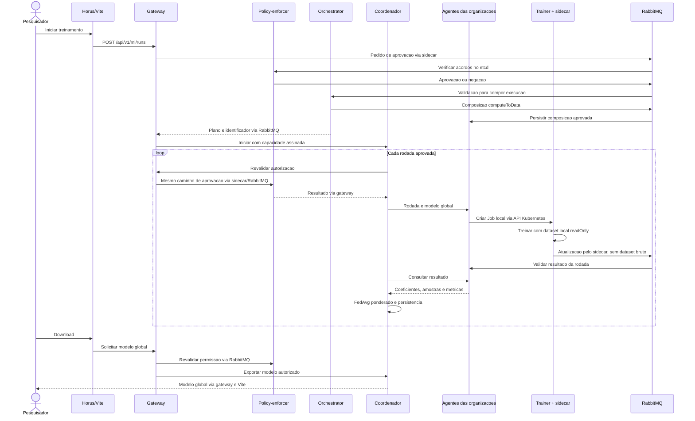
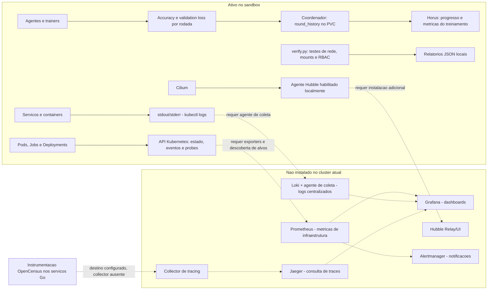

# Arquitetura atual do Scattered Directive

Estado conferido em 29/10/2026 no cluster `kind-scattered-training`.
Este documento descreve o sandbox horizontal em execucao, nao um deployment
FABRIC de producao. O VFL/TTP original continua no repositorio, mas nao e
acionado pela tela de treinamento do Horus.

Desenhos renderizados:
[visao geral](diagrams/scattered-atual-1.svg),
[sequencia do treinamento](diagrams/scattered-atual-2.svg) e
[monitoracao](diagrams/scattered-atual-3.svg).

## 1. Visao geral

```mermaid
flowchart TB
    Pessoa[Pesquisador no navegador] --> Horus[Horus React /training - localhost:5175]
    Horus --> Vite[Proxy Vite - token local no servidor]
    Vite --> PF[Port-forward - localhost:8096]
    Tools[Container dynamos-dev - ferramentas locais]

    subgraph K[Cluster kind-scattered-training - um no kind no Docker Desktop]
        subgraph Sistema[Namespace training-system]
            Gateway[API Gateway Go + sidecar DYNAMOS]
            Policy[Policy-enforcer Go + sidecar DYNAMOS]
            Orch[Orchestrator Go + sidecar DYNAMOS]
            Coord[Coordenador Python - FedAvg]
            Estado[(PVC: historico e modelo global)]
        end
        subgraph Core[Namespace core]
            MQ[RabbitMQ - mensagens de controle e resultados]
            Etcd[(etcd da aplicacao - 3 membros)]
        end
        subgraph OrgU[Namespace uva]
          AgenteU[Agente UVA + sidecar DYNAMOS]
          JobU[Job UVA: trainer + sidecar DYNAMOS]
          DatasetU[(PVC training-data UVA)]
          LocalU[(PVC training-state UVA)]
        end
        subgraph OrgV[Namespace vu]
          AgenteV[Agente VU + sidecar DYNAMOS]
          JobV[Job VU: trainer + sidecar DYNAMOS]
          DatasetV[(PVC training-data VU)]
          LocalV[(PVC training-state VU)]
        end
        subgraph OrgT[Namespace tudelft]
          AgenteT[Agente TUDELFT + sidecar DYNAMOS]
          JobT[Job TUDELFT: trainer + sidecar DYNAMOS]
          DatasetT[(PVC training-data TUDELFT)]
          LocalT[(PVC training-state TUDELFT)]
        end
        subgraph Infra[Namespace kube-system]
          K8s[kube-apiserver - API Kubernetes]
          Scheduler[kube-scheduler - escolhe o no]
          Controller[kube-controller-manager - reconcilia Jobs e Deployments]
          KE[(etcd do Kubernetes)]
            DNS[CoreDNS - 2 replicas - nomes dos Services]
          Proxy[kube-proxy - encaminhamento dos Services]
          Cilium[Cilium agent + operator + Envoy]
          Hubble[Hubble local - sem Relay/UI]
        end
        subgraph Storage[Namespace local-path-storage]
          Provisioner[local-path-provisioner - volumes no no local]
        end
        subgraph Objetos[Objetos distribuidos nos namespaces]
          Config[ConfigMaps - configuracao e entradas das rodadas]
          Secrets[Secrets - API, assinatura e RabbitMQ]
          RBAC[ServiceAccounts, Roles e RoleBindings]
          Services[Services - enderecos estaveis]
          Seed[Jobs training-seed - um por organizacao no setup]
        end
    end

    PF --> Gateway
    Tools -->|kubectl e Helm| K8s
    Gateway <-->|aprovacao e composicao pelos sidecars| MQ
    MQ <--> Policy
    MQ <--> Orch
    MQ <--> AgenteU
    MQ <--> AgenteV
    MQ <--> AgenteT
    Policy -->|consulta acordos| Etcd
    Orch -->|configuracao e descoberta de agentes| Etcd
    Gateway -->|persiste autorizacao vinculada a execucao| Etcd
    AgenteU -->|registro e composicao| Etcd
    AgenteV -->|registro e composicao| Etcd
    AgenteT -->|registro e composicao| Etcd
    Gateway <-->|HTTP interno autorizado| Coord
    Coord <-->|HTTP: rodadas| AgenteU
    Coord <-->|HTTP: rodadas| AgenteV
    Coord <-->|HTTP: rodadas| AgenteT
    Coord --> Estado
    AgenteU -->|cria Jobs| K8s
    AgenteV -->|cria Jobs| K8s
    AgenteT -->|cria Jobs| K8s
    K8s --> JobU
    K8s --> JobV
    K8s --> JobT
    DatasetU -->|readOnly no trainer| JobU
    DatasetV -->|readOnly no trainer| JobV
    DatasetT -->|readOnly no trainer| JobT
    JobU -->|resultado via sidecar| MQ
    JobV -->|resultado via sidecar| MQ
    JobT -->|resultado via sidecar| MQ
    AgenteU --> LocalU
    AgenteV --> LocalV
    AgenteT --> LocalT
    K8s --> KE
    Scheduler -.-> K8s
    Controller -.-> K8s
    DNS -.->|resolucao de nomes| Coord
    Proxy -.->|Services| Coord
    Cilium --> Hubble
    Cilium -.->|NetworkPolicies| JobU
    Cilium -.->|NetworkPolicies| JobV
    Cilium -.->|NetworkPolicies| JobT
    Provisioner -.-> DatasetU
    Provisioner -.-> DatasetV
    Provisioner -.-> DatasetT
    Provisioner -.-> Estado
    Provisioner -.-> LocalU
    Provisioner -.-> LocalV
    Provisioner -.-> LocalT
    Config -.-> Orch
    Config -.->|entrada local| JobU
    Config -.->|entrada local| JobV
    Config -.->|entrada local| JobT
    Secrets -.->|API e assinatura| Gateway
    Secrets -.->|credenciais de controle| AgenteU
    Secrets -.->|credenciais de controle| AgenteV
    Secrets -.->|credenciais de controle| AgenteT
    RBAC -.->|permissoes dos agentes| K8s
    Services -.->|descoberta e acesso| Coord
    Seed --> DatasetU
    Seed --> DatasetV
    Seed --> DatasetT
```



Os blocos com `+ sidecar` sao Pods com dois containers. O sidecar DYNAMOS
e um componente da aplicacao: faz a ponte gRPC/RabbitMQ. Nao e um proxy
Linkerd nem um coletor de monitoracao. O coordenador e um Pod separado.

## 2. Responsabilidade de cada componente

| Componente | Responsabilidade e limite |
| --- | --- |
| Horus | Seleciona organizacoes, algoritmo, rodadas e epocas; mostra progresso, metricas locais e historico; solicita cancelamento e download. Apenas `/training` esta ligada a API real. |
| Vite | Serve a interface em desenvolvimento e encaminha `/training-api` ao gateway. Le o token local no servidor; o token nao fica embutido no bundle. Nao e autenticacao de producao. |
| Port-forward | Expoe apenas o gateway em localhost. Precisa permanecer em execucao; nao e um ingress de producao. |
| API Gateway Go | Valida a identidade do sandbox, parametros e autorizacao; inicia a execucao aprovada e intermedeia acesso ao coordenador. Revalida a politica antes do download. |
| Policy-enforcer | Consulta acordos no etcd. Exige permissao de tipo de pedido, dataset, algoritmo e computeToData para todas as organizacoes escolhidas. Aprovacao parcial nao inicia treinamento. |
| Orchestrator Go | Resolve agentes online, fixa computeToData para o pedido horizontal e distribui a composicao aprovada por RabbitMQ. O caminho VFL/TTP original e preservado separadamente. |
| Coordenador Python | Controla o ciclo de rodadas, consulta agentes e agrega atualizacoes por FedAvg ponderado pelo numero de amostras. Guarda historico e artefato global. Revalida a aprovacao entre rodadas e na exportacao. |
| Agente Go | Representa uma organizacao. Mantem registro online no etcd, confere composicao e capacidade assinada, cria o Job local, recebe resultados, valida campos e controla cancelamento. |
| Trainer Python | Le somente o dataset da sua organizacao, treina regressao logistica local e devolve coeficientes e metricas. Nao recebe token da API Kubernetes. |
| Sidecar DYNAMOS | Transporte gRPC local para RabbitMQ. No Job temporario, confirma a publicacao do resultado e encerra para o Job poder concluir. |
| RabbitMQ | Transporta aprovacao, composicao e resultados. Nao armazena os datasets nem calcula FedAvg. Credenciais compartilhadas do sandbox nao garantem isolamento por fila. |
| etcd da aplicacao | Guarda acordos, configuracao, agentes online, composicoes e autorizacoes aprovadas. Tres membros no mesmo no local nao significam tolerancia a perda desse no. |
| etcd do Kubernetes | Guarda o estado do proprio cluster em kube-system. E distinto dos tres membros do etcd da aplicacao. |
| Kubernetes | Agenda Pods, executa Jobs, monta PVCs, aplica RBAC e acompanha disponibilidade. Agentes so podem operar recursos permitidos no seu namespace. |
| Cilium e Envoy | Implementam a rede e as politicas de isolamento. Sua presenca nao substitui autorizacao de negocio nem garante sigilo das atualizacoes de modelo. |
| PVCs | Mantem datasets por organizacao, estado dos agentes e historico/modelo do coordenador. O armazenamento local nao substitui backup externo. |
| Job training-seed | Prepara dados sinteticos deterministas. Em retomadas valida e reutiliza um arquivo existente sem sobrescrever dados; rejeita arquivo invalido ou incompleto. |
| dynamos-dev | Container local de ferramentas, fora do cluster. Tem Docker CLI, kind, kubectl e Helm; nao treina nem recebe pedidos do pesquisador. |
| CoreDNS | Resolve nomes como training-agent.uva.svc.cluster.local e rabbitmq.core.svc.cluster.local. Nao transporta os resultados de treinamento. |
| kube-proxy | Implementa encaminhamento de Services nesta configuracao, com kubeProxyReplacement=false no Cilium. |
| kube-scheduler | Escolhe em qual no um Pod sera executado; o sandbox tem somente um no. |
| kube-controller-manager | Reconcilia objetos: mantem replicas e acompanha Jobs. Nao decide politica de uso de dados. |
| kubelet e runtime | No no kind, iniciam e acompanham os containers dos Pods. Nao sao um trainer nem um Pod de aplicacao separado. |
| local-path-provisioner | Cria os volumes locais solicitados pelos PVCs. Nao replica datasets para outros nos. |
| ServiceAccounts e RBAC | Definem permissoes Kubernetes dos agentes; trainers nao montam credencial da API Kubernetes. Nao substituem acordos de negocio no etcd. |
| Secrets e ConfigMaps | Secrets guardam credenciais/capacidades do sandbox; ConfigMaps fornecem configuracao e entrada das rodadas. Evitar imprimir seus valores ao demonstrar o sistema. |

Para acompanhar cada etapa com comandos, resultados esperados e diagnostico,
seguir o [roteiro completo de observacao](passo-a-passo-observar-treinamento.md).

## 3. Uma execucao, passo a passo



O coordenador nao e exposto diretamente ao navegador. Revogacao e observada
nas fronteiras de revalidacao, nao garante interrupcao imediata de um trainer
que ja esta executando. Cancelamento remove os Jobs rastreados.

## 4. Monitoracao: o que existe hoje



| Sinal | Estado real e significado |
| --- | --- |
| Logs | Disponiveis por container em `kubectl logs`. Sem Loki, coleta central ou retencao de longo prazo configurada. |
| Saude | Kubernetes acompanha Pods/Jobs; probes identificam disponibilidade dos endpoints configurados. Um Pod Ready nao prova que todas as politicas de negocio estao corretas. |
| Metricas de ML | Horus mostra accuracy e validation loss locais, numero de rodadas e estado da execucao. Esses numeros nao sao metricas de CPU/memoria nem medicao de privacidade. |
| Metricas de infraestrutura | `docker stats` permite inspecao local. Nao ha Prometheus, node-exporter ou kube-state-metrics instalados pelo chart federado. `kubectl top` depende de metrics-server, que nao esta instalado neste cluster. |
| Traces | O Go usa OpenCensus e propagacao de contexto. `OC_AGENT_HOST` aponta a `collector.core.svc.cluster.local:55678`, mas esse collector nao existe no cluster atual. Nao ha armazenamento/consulta de traces ponta a ponta. |
| Fluxos de rede | `enable-hubble=true` foi conferido no ConfigMap do Cilium. Nao ha Relay/UI instalados nem dashboard Hubble exposto; nao confundir agente habilitado com monitoracao grafica completa. |
| Isolamento | `verify.py` testa leitura local, bloqueio de escrita e de trafego entre organizacoes, ausencia de token Kubernetes e limites RBAC. Gera `isolation-report.json`; nao e monitor continuo. |
| Politicas | `test_integrated.py` testa aprovacao, tres rodadas, sidecars, RabbitMQ e revogacao. Gera `integration-report.json`; nao e um sistema de alertas continuo. |

Prometheus, Grafana, Loki e Jaeger possuem arquivos legados de configuracao
em `charts/core/`. Isso nao significa que estejam instalados. Existem inclusive
nodeSelectors para `dynamos` que nao correspondem ao no atual; nao aplicar esses
arquivos sem adaptar e validar recursos, RBAC, alvos e armazenamento.

### Papel dos componentes de monitoracao ainda nao instalados

- Prometheus coletaria series temporais de recursos e servicos; exporters e
  alvos de scrape precisam ser configurados. Nao presumir que todo servico Go
  ja possui endpoint Prometheus util.
- kube-state-metrics exporia estado de objetos Kubernetes; node-exporter,
  dados do no; kubelet/cAdvisor, uso de recursos dos containers.
- Grafana apresentaria os dados de Prometheus, Loki e Jaeger; nao e o coletor.
- Um agente de logs encaminharia stdout/stderr ao Loki para busca centralizada.
- Um collector compativel com OpenCensus receberia spans e os encaminharia ao
  backend de tracing, como Jaeger. Instrumentacao sozinha nao entrega esse fluxo.
- Alertmanager encaminharia alertas definidos no Prometheus para canais escolhidos.
- Hubble Relay/UI permitiria agregar e consultar visualmente fluxos da rede Cilium.

Essa camada nao foi instalada como parte deste desenho.

## 5. Comandos de inspecao

Executar na raiz do Scattered-Directive no Mac, com Docker Desktop ativo:

```bash
bash dev.sh
python3 configuration/federated-training/manage.py status
```

No Mac, com Docker Desktop:

```bash
/Applications/Docker.app/Contents/Resources/bin/docker exec dynamos-dev \
  kubectl --context kind-scattered-training get pods,jobs -A
/Applications/Docker.app/Contents/Resources/bin/docker exec dynamos-dev \
  kubectl --context kind-scattered-training logs deployment/training-agent -n uva -c agent --tail=100
/Applications/Docker.app/Contents/Resources/bin/docker exec dynamos-dev \
  kubectl --context kind-scattered-training logs deployment/api-gateway -n training-system -c api-gateway --tail=100
```

Arquitetura validada com dados sinteticos; nao implementa OIDC, TLS de producao,
secure aggregation ou differential privacy. A precisao do modelo nao demonstra
sigilo dos dados, e o cluster de no unico nao oferece alta disponibilidade.