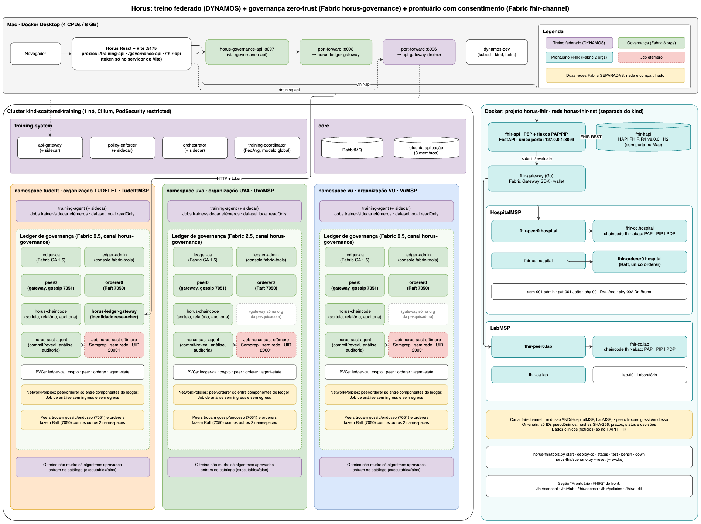

# Como subir tudo e testar (Horus completo)

O Horus tem três partes. Elas são independentes, mas aparecem juntas no mesmo
front-end:

| Parte | Onde roda | Ledger | Documento detalhado |
|---|---|---|---|
| **Treino federado** (DYNAMOS) | cluster kind `scattered-training` | — | [passo-a-passo-observar-treinamento.md](passo-a-passo-observar-treinamento.md) |
| **Governança zero-trust** (SAST local + sorteio) | os mesmos namespaces `uva`, `vu`, `tudelft` do kind | Fabric `horus-governance` (3 organizações) | [ledger-fabric-e-sast-local.md](ledger-fabric-e-sast-local.md) |
| **Prontuário com consentimento** (FHIR + ABAC) | Docker, rede `horus-fhir-net` | Fabric `fhir-channel` (2 organizações, rede **separada**) | [fhir-consentimento.md](fhir-consentimento.md) |

Desenho completo para o draw.io:
[drawio/horus-arquitetura-completa.drawio](diagrams/drawio/horus-arquitetura-completa.drawio).
Ele tem 3 páginas: visão geral, módulo FHIR e "como subir e testar". Prévias:
[1](diagrams/horus-arquitetura-completa-1.png),
[2](diagrams/horus-arquitetura-completa-2.png) e
[3](diagrams/horus-arquitetura-completa-3.png).

Para abrir o desenho, use app.diagrams.net (Arquivo → Abrir do dispositivo),
o app draw.io desktop ou a extensão "Draw.io Integration" do VS Code.



## Antes de começar

- Docker Desktop aberto, com 4 CPUs e 8 GB. O kind usa ≈3 GB e a pilha FHIR
  ≈0,9 GB.
- Python 3, Node e npm (o `node_modules` do front já está instalado) e Go 1.23.
- Em cada terminal, partindo da raiz do projeto:

```bash
cd "/Users/meiryleneavelino/Desktop/TUDelft/desenvolvimento/Projeto Meiry"
D=/Applications/Docker.app/Contents/Resources/bin/docker
k() { "$D" exec dynamos-dev kubectl --context kind-scattered-training "$@"; }
```

Se um `forward` responder `address already in use`, ele **já está ligado**.
Confira com `curl` e siga em frente.

## Subir (em ordem)

### 1. Ferramentas e cluster

```bash
bash dev.sh --no-rebuild
"$D" start scattered-training-control-plane
k wait --for=condition=Ready nodes --all --timeout=180s
k get pods -A
```

**Esperado:** o nó aparece como `Ready`. Em `training-system`, `core`,
`uva`, `vu` e `tudelft` os pods estão `Running`. Os Jobs `ledger-enroll`
aparecem como `Completed`.

### 2. Treino federado

```bash
python3 configuration/federated-training/manage.py verify
python3 configuration/federated-training/manage.py forward   # :8096, deixe este terminal aberto
```

### 3. Ledger de governança e API (em `horus-governance/`)

```bash
cd horus-governance
python3 tools.py ledger setup --skip-build     # 1ª vez, ou depois de "ledger down --purge": sem --skip-build
python3 tools.py ledger forward --background   # :8098
python3 tools.py ledger verify                 # mesma altura e hash nos 3 peers
python3 tools.py start                         # API :8097
cd ..
```

### 4. Prontuário FHIR (em `horus-fhir/`)

```bash
cd horus-fhir
python3 tools.py start          # CAs, identidades, orderer, peers, canal, HAPI (+ chaincode, gateway e API se já implantados)
python3 tools.py deploy-cc      # só na 1ª vez ou depois de "down": chaincode + gateway + API (:8099)
python3 scenario.py --reset     # dados de demonstração (passos 0-6)
python3 tools.py status
cd ..
```

O `start` **avisa** se o kind estiver ligado, por causa da memória, mas não
desliga nada.

### 5. Front-end

```bash
npm --prefix horus-sandbox-frontend run dev -- --strictPort
```

Abra http://127.0.0.1:5175. No menu:
- **Federated training** e **Ledger**: sandbox e governança;
- **Prontuário (FHIR)**: consentimento, laboratório, acesso, políticas e
  auditoria.

## Testar cada parte

### Treino federado

```bash
python3 configuration/federated-training/manage.py verify
python3 configuration/federated-training/test_run.py
k get pods -A -w          # em outro terminal, enquanto inicia um treino na tela /training
```

### Governança (SAST local + Fabric de 3 organizações)

```bash
cd horus-governance
(cd ledger && go test ./...)
.venv/bin/python -m unittest discover -s tests -v
HORUS_GOV_LIVE_TESTS=1 .venv/bin/python -m unittest tests.test_live -v
python3 tools.py ledger verify
```

Para ver a análise acontecer:
1. Deixe rodando `k get pods -A -l app=horus-sast -w`.
2. Envie pela tela **Training** um arquivo **novo**, por exemplo
   `{ cat examples/clean.py; echo "# teste $(date +%s)"; } > ~/Desktop/clean-teste.py`.

O mesmo arquivo de antes tem o mesmo hash: o resultado é reaproveitado e
nenhum Job nasce.

### Prontuário FHIR

Guia detalhado, etapa por etapa, com saídas esperadas e problemas comuns:
**[guia-de-testes-fhir.md](guia-de-testes-fhir.md)**. A parte FHIR não precisa
do kind ligado.

```bash
cd horus-fhir
python3 tools.py test                  # Go + pytest unitário (na imagem) + reset + pytest de integração (no Mac)
python3 tools.py test-isolation        # liga/desliga a rede FHIR e prova que nada fora dela mudou
python3 scenario.py --reset --revoke   # passos 0-6 + revogação; saída 0 = tudo como esperado
python3 tools.py bench                 # latência e vazão (≈8 min); deixa um cenário limpo no fim
```

Na tela http://127.0.0.1:5175/fhir/access:
1. Escolha a persona **Dra. Ana**.
2. Abra o Exame A: **PERMITIDO**.
3. Abra o Exame B: **NEGADO (NO_CONSENT)**.
4. Troque para **Dr. Bruno** e abra o Exame A: **NEGADO (WRONG_GRANTEE)**.

Em `/fhir/audit`, use "Verificar hash" e "Verificar tx".

## Observar

| O quê | Comando ou tela |
|---|---|
| Todos os pods do kind | `k get pods -A` |
| Ledger de governança | `python3 horus-governance/tools.py ledger status` · tela **Ledger** |
| Rede FHIR | `python3 horus-fhir/tools.py status` · `docker logs -f fhir-api` · tela **/fhir/audit** |
| Evidências do FHIR | `horus-fhir/.local/scenario-last.json` · `horus-fhir/.local/bench-*.json` |

## Desligar

```bash
python3 horus-fhir/tools.py stop               # "down" apaga tudo que é fhir- (rede, volumes, credenciais)
python3 horus-governance/tools.py stop         # API :8097
python3 horus-governance/tools.py ledger down  # pods do ledger; os dados ficam ("--purge" apaga)
"$D" stop scattered-training-control-plane     # cluster inteiro
```

Para pausar só por memória, basta `python3 horus-fhir/tools.py stop`; o kind
continua de pé.
