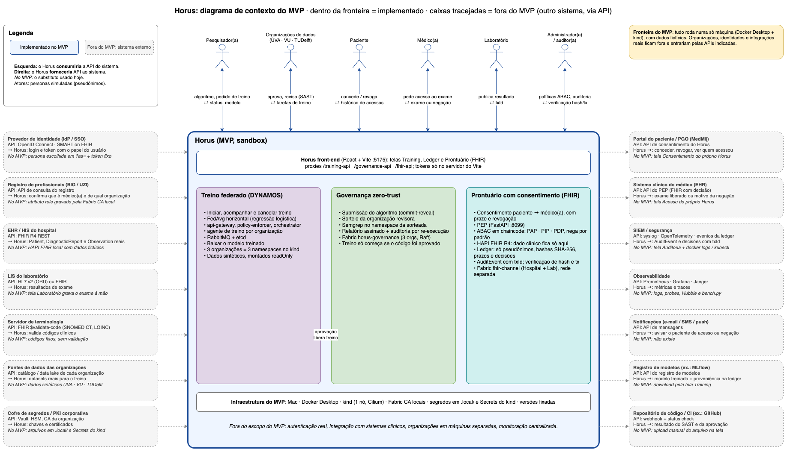

# Diagrama de contexto do Horus (MVP)

O diagrama mostra o Horus como **uma caixa só** e, em volta dela, quem
conversa com ele. A fronteira separa o que o MVP **implementa** do que fica
**fora do MVP**, entregue por outro sistema por meio de uma API.

- Arquivo editável: [drawio/horus-diagrama-de-contexto.drawio](diagrams/drawio/horus-diagrama-de-contexto.drawio)
  (abra em app.diagrams.net, no draw.io desktop ou na extensão do VS Code).
- Prévia:

## Como ler

| Elemento | Significado |
|---|---|
| Caixa azul (fronteira) | O sistema Horus no MVP: tudo que está dentro foi implementado e roda localmente. |
| Bonecos no topo | Atores humanos. No MVP são personas simuladas, com IDs pseudônimos. |
| Setas azuis sólidas | Fluxos implementados (⇄ = ida e volta). |
| Caixas cinza tracejadas | Sistemas externos, **fora do MVP**. |
| Lado esquerdo | APIs que o Horus **consumiria** (entrada). |
| Lado direito | APIs que o Horus **forneceria** (saída). |
| *No MVP: ...* | O substituto usado hoje no lugar do sistema externo. |

## Dentro do MVP

| Bloco | O que faz |
|---|---|
| Front-end | Telas Training, Ledger e Prontuário (FHIR), com proxies e tokens só no servidor do Vite. |
| Treino federado (DYNAMOS) | FedAvg horizontal entre UVA, VU e TUDelft (namespaces do kind), com dados sintéticos. |
| Governança zero-trust | Commit-reveal, sorteio da organização revisora, Semgrep local e auditoria, no Fabric `horus-governance`. |
| Prontuário com consentimento | PEP + ABAC em chaincode, HAPI FHIR e Fabric `fhir-channel`. Na ledger só ficam pseudônimos, hashes e decisões. |

## Fora do MVP (via API de outro sistema)

| Sistema externo | Direção | API | Substituto no MVP |
|---|---|---|---|
| Provedor de identidade (IdP/SSO) | consome | OpenID Connect, SMART on FHIR | persona em `?as=` + token fixo |
| Registro de profissionais (BIG/UZI) | consome | consulta ao registro | atributo `role` da Fabric CA local |
| EHR/HIS do hospital | consome | FHIR R4 REST | HAPI FHIR local com dados fictícios |
| LIS do laboratório | consome | HL7 v2 (ORU) ou FHIR | tela Laboratório |
| Servidor de terminologia | consome | `$validate-code` (SNOMED CT, LOINC) | códigos fixos |
| Fontes de dados das organizações | consome | catálogo / data lake | dados sintéticos |
| Cofre de segredos / PKI | consome | Vault, HSM, CA corporativa | `.local/` e Secrets do kind |
| Portal do paciente / PGO (MedMij) | fornece | API de consentimento | tela Consentimento |
| Sistema clínico do médico | fornece | API do PEP | tela Acesso |
| SIEM / segurança | fornece | syslog, OpenTelemetry | tela Auditoria + logs |
| Observabilidade | fornece | Prometheus, Grafana, Jaeger | logs, probes, Hubble, `bench.py` |
| Notificações | fornece | API de mensagens | não existe |
| Registro de modelos (MLflow) | fornece | API do registro | download pela tela Training |
| Repositório de código / CI | fornece | webhook + status check | upload manual do arquivo |

Os nomes de produtos (MedMij, BIG, UZI, MLflow, GitHub) são exemplos de onde a
integração entraria. Nenhum deles foi escolhido nem testado.
