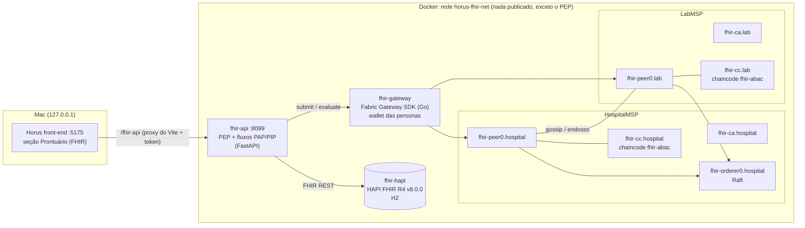
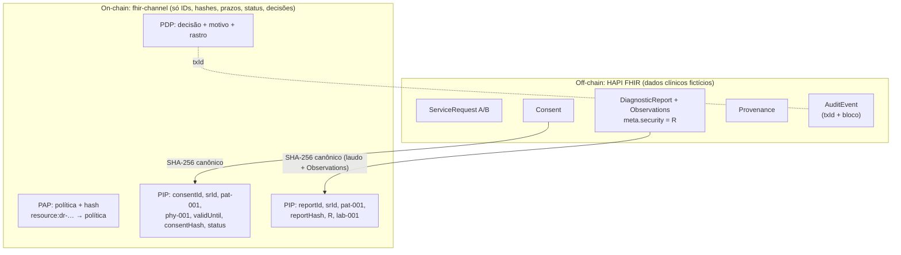
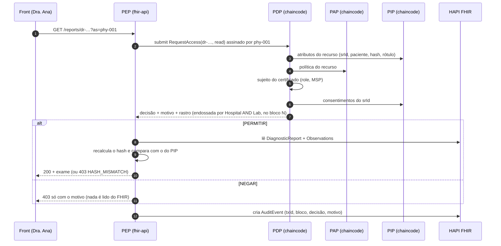
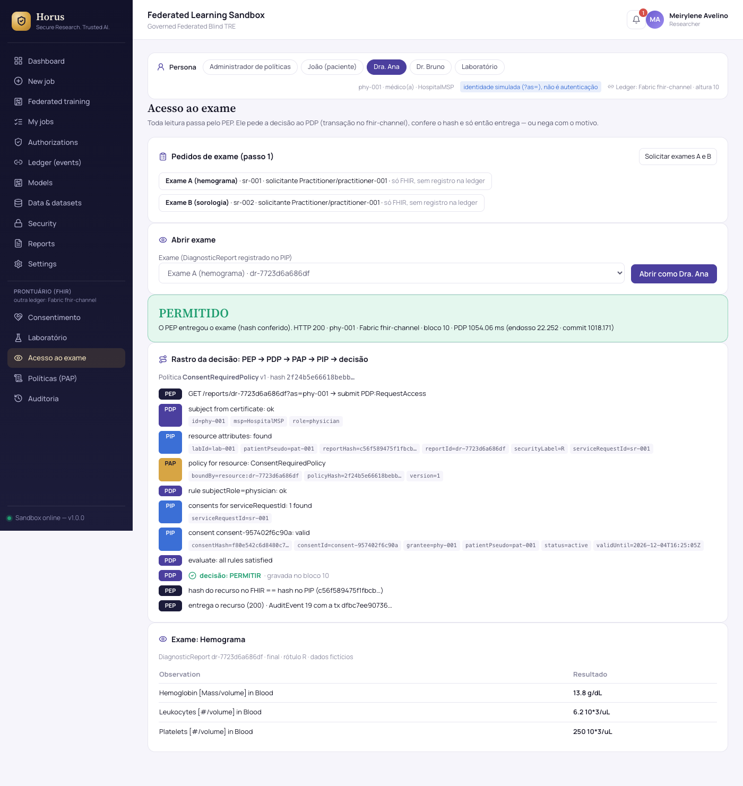
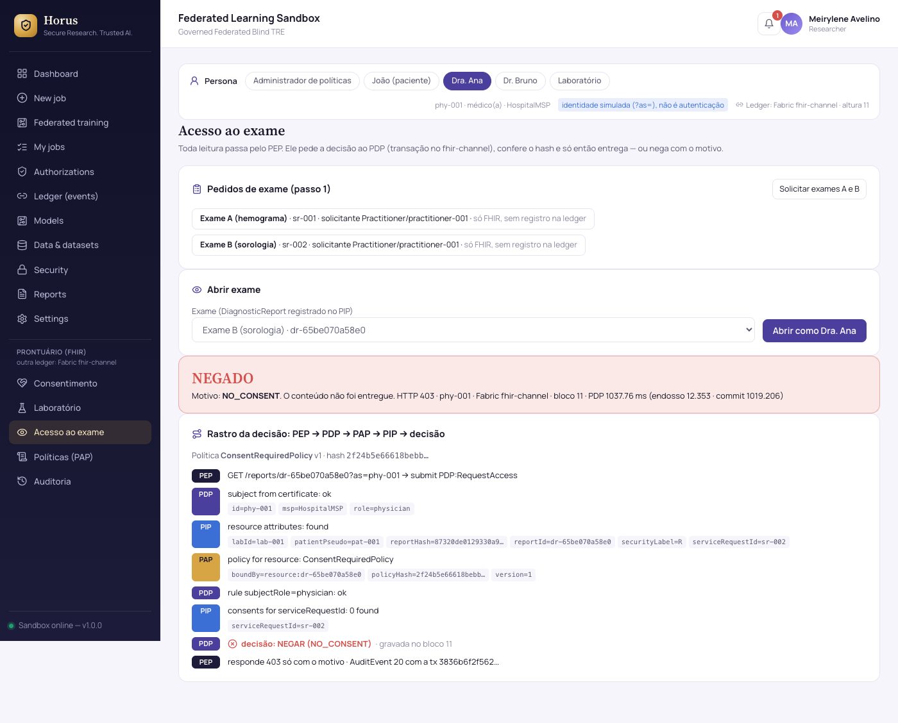
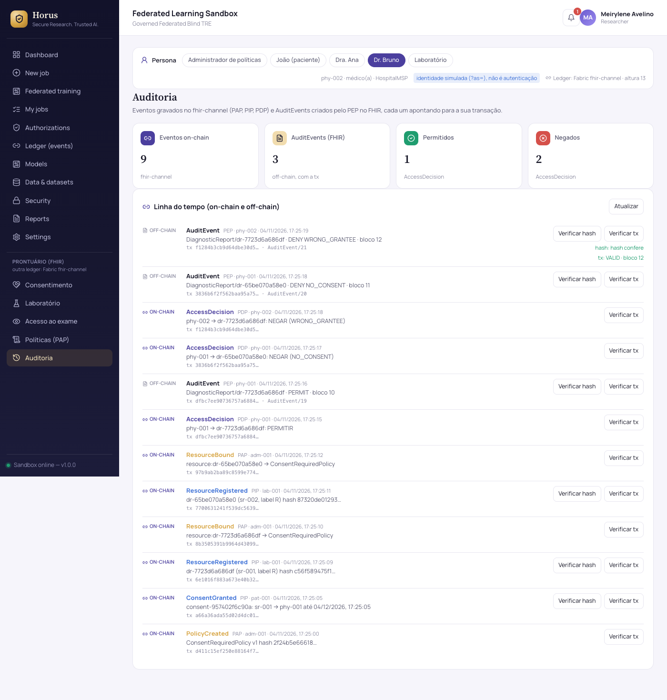

# Prontuário com consentimento: FHIR + ABAC + Hyperledger Fabric (horus-fhir)

Este documento explica o módulo `horus-fhir`: controle de acesso a exames com
consentimento do paciente, recursos HL7 FHIR R4 e ABAC no modelo XACML (PEP,
PDP, PAP e PIP), com os componentes de decisão como smart contracts
(chaincode) numa **rede Hyperledger Fabric nova e separada**.

Todos os dados são **fictícios**. **Nenhum dado clínico vai para a blockchain.**

Diagramas renderizados:
- [arquitetura](diagrams/fhir-consentimento-1.svg);
- [o que fica on-chain e off-chain](diagrams/fhir-consentimento-2.svg);
- [sequência de um acesso](diagrams/fhir-consentimento-3.svg).

Código: [horus-fhir/](../horus-fhir/README.md).

**Para testar etapa por etapa:** [guia-de-testes-fhir.md](guia-de-testes-fhir.md).

## 1. Visão geral

O cenário tem cinco personas:

| Persona | Papel | Organização |
|---|---|---|
| João | paciente | HospitalMSP |
| Dra. Ana | médica | HospitalMSP |
| Dr. Bruno | médico | HospitalMSP |
| Administrador de políticas | admin | HospitalMSP |
| Laboratório | laboratório | LabMSP |

A história do cenário:
1. A Dra. Ana pede dois exames para o João: **A (hemograma)** e **B (sorologia)**.
2. O João consente **só a Dra. Ana, só o exame A, por 30 dias**.
3. O laboratório grava os dois resultados marcados como **restritos (R)**.

Quando a Dra. Ana tenta abrir os exames:
- **Exame A:** o acesso é **permitido**.
- **Exame B:** o acesso é **negado (NO_CONSENT)**.

Se o Dr. Bruno tenta abrir o exame A, também é **negado (WRONG_GRANTEE)**.
Cada decisão fica gravada na ledger e também num `AuditEvent` no FHIR.

O controle de acesso **não é "gravar na blockchain e conferir"**. Toda leitura
passa por quatro componentes, cada um com uma responsabilidade:

| Componente | Onde roda | Responsabilidade |
|---|---|---|
| **PEP** (Enforcement) | `fhir-api`, fora da blockchain, na frente do FHIR | Intercepta toda leitura de exame, pede a decisão ao PDP e a aplica: entrega o recurso (200) ou nega (403). Nunca decide sozinho. Confere o hash do conteúdo. |
| **PDP** (Decision) | chaincode `fhir-abac`, contrato `PDP` | `RequestAccess`: pede a política ao PAP e os atributos ao PIP, avalia e **grava a decisão** (permitir ou negar) com o motivo |
| **PAP** (Administration) | chaincode, contrato `PAP` | Guarda as políticas (JSON declarativo) e a ligação recurso → política. Só `role=admin` grava. |
| **PIP** (Information) | chaincode, contrato `PIP` | Atributos do consentimento (paciente, beneficiário, exame, prazo, status, hash) e do recurso (hash, rótulo, laboratório, paciente). Os atributos do sujeito vêm do certificado. |

## 2. Arquitetura



Pontos importantes:

- **Rede nova e separada.** Os nomes têm prefixo `fhir-`, a rede Docker é
  `horus-fhir-net` e há volumes próprios. O ledger de governança (no cluster
  kind) não é tocado. O teste `tools.py test-isolation` compara antes e
  depois.
- **Canal e chaincode.**
  - Canal `fhir-channel`, com o chaincode `fhir-abac` 0.1.0.
  - **Endosso `AND(HospitalMSP.peer, LabMSP.peer)` em toda gravação:** os
    dois peers executam a transação e conferem papel e MSP de quem chama.
  - Há um único orderer Raft, que pertence ao HospitalMSP. Ele ordena as
    transações, mas não consegue forjá-las.
- **PAP, PIP e PDP são três contratos num mesmo chaincode.** Cada um fica no
  seu pacote Go, e o PDP só lê o PAP e o PIP por interfaces de leitura. Assim
  há um único ciclo de vida, a decisão é atômica numa transação e não há
  chamadas `InvokeChaincode` extras.
- **O FHIR não é alcançável do Mac nem do navegador.** O único caminho é o PEP.
- **Identidade simulada.** O parâmetro `?as=<persona>` escolhe qual
  certificado da wallet assina. **Isto não é autenticação** (no futuro: SMART
  on FHIR ou Keycloak).

## 3. Identidades e papéis

Cada persona é uma identidade da Fabric CA da sua organização. O papel vai
**no certificado**, como `role=<papel>`, e o chaincode o lê com
`GetClientIdentity().GetAttributeValue`.

| ID (pseudônimo) | Persona | MSP | `role` |
|---|---|---|---|
| `adm-001` | Administrador de políticas | HospitalMSP | `admin` |
| `pat-001` | João | HospitalMSP | `patient` |
| `phy-001` | Dra. Ana | HospitalMSP | `physician` |
| `phy-002` | Dr. Bruno | HospitalMSP | `physician` |
| `lab-001` | Laboratório | LabMSP | `lab` |

- **Os IDs são pseudônimos.** O certificado de quem assina fica gravado em
  todo bloco. A ligação "pseudônimo ↔ pessoa FHIR" fica só no middleware, em
  `middleware/config/personas.json`.
- **Cada papel está preso ao seu MSP.** `admin`, `patient` e `physician` só
  valem se vierem do HospitalMSP; `lab`, só do LabMSP. Qualquer CA pode
  escrever qualquer atributo, então um `role=admin` emitido pela CA do
  laboratório é ignorado.

## 4. Mapeamento FHIR ↔ contrato

| Recurso FHIR (fica só no HAPI) | O que vai para a ledger | Componente | Quem assina |
|---|---|---|---|
| — (passo 0) | Política `ConsentRequiredPolicy` (JSON) + `policyHash` | PAP `CreatePolicy` | `adm-001` |
| `ServiceRequest` `sr-001` (A), `sr-002` (B) | nada (passo 1) | — | — |
| `Consent` (status, `provision.actor` = médico, `provision.data` = ServiceRequest, `provision.period.end`) | `consentId`, `serviceRequestId`, `patientPseudo`, `grantee`, `validUntil`, `consentHash`, `status` | PIP `PutConsent` / `RevokeConsent` | `pat-001` (só o próprio paciente) |
| `DiagnosticReport` + `Observation`s (com `meta.security` = R) e `Provenance` | `reportId`, `serviceRequestId`, `patientPseudo`, `reportHash` (do laudo **e** das Observations), `securityLabel`, `labId` | PIP `PutResource` | `lab-001` |
| — | `resource:<reportId>` → `ConsentRequiredPolicy` | PAP `BindResource` | `adm-001` |
| — (cada leitura) | Decisão: quem pediu, recurso, política e versão, permitido, motivo e rastro (só IDs, hashes e status) | PDP `RequestAccess` | a persona que lê |
| `AuditEvent` (criado pelo PEP) | nada novo; o AuditEvent **aponta** para o `txId` e o bloco da decisão | — | — |

**Como o hash é calculado.** É o SHA-256 do JSON canônico: chaves em ordem,
sem espaços, UTF-8. Ele é calculado sobre o recurso **lido de volta** do
HAPI, sem `meta.versionId`, `meta.lastUpdated`, `meta.source` e `text`, que
o servidor muda sozinho. O hash do laudo junta o DiagnosticReport com as
Observations, porque os valores do exame ficam nas Observations.

**IDs opacos.** Os IDs que aparecem na blockchain (`sr-001`, `dr-…`,
`consent-…`) não dizem que exame é.

**A política** (declarativa, trocável com `UpdatePolicy` sem reimplantar o
PDP):

```json
{"actions": ["read"],
 "rules": [{"type": "subjectRole", "value": "physician"},
           {"type": "consent", "checks": ["exists", "grantee", "patient", "active", "notExpired"]}]}
```

Os motivos de negação são códigos fixos:

| Código | Quando |
|---|---|
| `UNKNOWN_RESOURCE` | o recurso não está no PIP |
| `NO_POLICY` | nenhuma política ligada ao recurso (negar por padrão) |
| `ACTION_NOT_ALLOWED` | a ação não está na política |
| `NOT_PHYSICIAN` | quem pede não é médico |
| `NO_CONSENT` | não há consentimento para aquele exame |
| `WRONG_GRANTEE` | há consentimento, mas para outro médico |
| `PATIENT_MISMATCH` | o consentimento é de outro paciente |
| `REVOKED` | o consentimento foi revogado |
| `EXPIRED` | o prazo passou; é conferido com o **tempo da transação** (`GetTxTimestamp`), nunca com o relógio local |

A ligação por recurso vale antes da ligação por rótulo (`label:R`), que
existe como reserva.



## 5. Sequência de um acesso (passos 4 e 5)



`RequestAccess` é uma transação **submit**: endossa, ordena e grava. Por isso
**a negação também fica registrada**. Uma consulta `evaluate` não deixaria
registro.

Se a ledger estiver fora do ar, o PEP nega (`LEDGER_UNAVAILABLE`). Se o
conteúdo do FHIR tiver sido alterado, o PDP permite, mas o PEP recusa com
`HASH_MISMATCH`.

## 6. Como rodar

Antes de começar, tenha:
- **Docker Desktop**;
- **Go 1.23** (o build é offline, a partir do cache de módulos);
- **Python 3**;
- o **front-end Horus** (`npm run dev` em `horus-sandbox-frontend`).

Todos os comandos rodam a partir de `horus-fhir/`:

```bash
python3 tools.py start          # CAs, identidades, orderer, peers, canal, HAPI (+ chaincode, gateway e API se já implantados)
python3 tools.py deploy-cc      # 1ª vez: chaincode (package, install, approve x2, commit) + gateway + API
python3 scenario.py --reset     # cenário 0-6 num canal limpo (--revoke: extra com revogação)
python3 tools.py status         # contêineres + altura do canal nos dois peers
python3 tools.py stop | down    # parar / apagar só os recursos fhir-
python3 tools.py reset-demo     # recomeçar do zero
```

O `start` **avisa** se o kind ou a API de governança estiverem ligados (eles
dividem a mesma memória), mas não os desliga.

No navegador, abra http://127.0.0.1:5175/fhir/access. O menu
**Prontuário (FHIR)** tem cinco telas:
- `/fhir/consent`: consentimento;
- `/fhir/lab`: laboratório;
- `/fhir/access`: acesso ao exame, com o rastro da decisão;
- `/fhir/policies`: políticas do PAP;
- `/fhir/audit`: auditoria, com "Verificar hash" e "Verificar tx".

O seletor de persona fica no topo das telas FHIR.







Outras telas: [consentimento](images/fhir-ui-consent.png),
[laboratório](images/fhir-ui-lab.png), [políticas](images/fhir-ui-policies.png),
[Dr. Bruno negado](images/fhir-ui-access-bruno-A.png) e
[serviço FHIR indisponível](images/fhir-ui-unavailable.png).

## 7. Como observar

```bash
docker ps --filter label=com.docker.compose.project=horus-fhir   # 11 contêineres fhir-*
docker logs -f fhir-api                                           # cada GET /reports
docker logs -f fhir-peer0.lab 2>&1 | grep -i "committed block"   # blocos chegando ao Lab
python3 tools.py status                                           # altura igual nos dois peers
cat .local/scenario-last.json                                     # evidência do último cenário
```

Pela API (token em `horus-fhir/.local/api-token`):
- **`GET /audit`:** a linha do tempo.
- **`GET /verify/report/{id}` e `/verify/consent/{id}`:** recalculam o hash
  no FHIR e comparam com o da blockchain. No consentimento, procuram a versão
  certa no histórico, mesmo depois da revogação.
- **`GET /transactions/{txId}`:** a validação (`VALID`) e o bloco.

## 8. Testes

| Comando | O que prova |
|---|---|
| `go test ./...` em `chaincode/` (13 testes) | Os 7 casos do cenário pedidos (permitir; negar por outro exame, outro médico, prazo vencido, revogado, sem política e não-paciente gravando consentimento), mais estes extras: consentimento de outro paciente; papel emitido pelo MSP errado; negação gravada; política por rótulo; troca de política; validações |
| `go test` em `gateway/` | Token, só funções `PAP:`/`PIP:`/`PDP:`, erros do chaincode → 403/409/422, nomes de persona |
| pytest unitário (17), dentro de `fhir-api:0.1.0-test`, sem rede | Hash canônico; o PEP nega sem ler o FHIR; adulteração → `HASH_MISMATCH`; ledger fora → nega; token obrigatório; persona inválida; **nenhuma rota repassa ao FHIR**; checagem de papel antes de gravar no FHIR; ordem FHIR → PIP → PAP; verificação depois da revogação |
| pytest de integração (20), no Mac, contra a pilha real | Cenário completo; negações só com o motivo e auditadas; persona errada recusada pelo chaincode; prazo gravado; adulteração; revogação; **o PEP não pode ser contornado** (só `127.0.0.1:8099` publicada; portas 8090, 8080, 7050, 7051, 7053, 7054 e 9999 fechadas; a API não repassa ao FHIR; o Vite só aponta para o PEP) |
| `tools.py test-isolation` | Ligar e desligar a rede FHIR não muda nenhum contêiner, volume, rede ou pod fora dela |
| `scenario.py` | Os passos 0 a 6, com saída 0 só se todas as decisões forem as esperadas |

Tudo de uma vez, incluindo `reset-demo` antes da integração:
`python3 tools.py test`.

## 9. Medições

`python3 tools.py bench` faz quatro coisas:
1. roda o cenário;
2. mede de dentro do `fhir-api` (`app/bench.py`) e do Mac;
3. grava `.local/bench-<data>.json`;
4. deixa um cenário limpo no fim.

Medido em 04/11/2026 16:50 UTC · Docker 4 CPUs / 7.75 GiB · kind ligado: sim · altura 13 → 181

**RequestAccess (PDP, submit até o commit)**

| medida | n | média (ms) | p50 | p95 | máx |
|---|---|---|---|---|---|
| PERMIT · endosso (Hospital AND Lab) | 30 | 9.56 | 8.84 | 18.08 | 18.68 |
| PERMIT · envio ao orderer | 30 | 1.64 | 1.42 | 2.78 | 4.49 |
| PERMIT · espera do commit | 30 | 1014.1 | 1013.01 | 1026.96 | 1030.99 |
| PERMIT · total | 30 | 1025.3 | 1024.4 | 1037.92 | 1038.15 |
| DENY · total | 30 | 1024.0 | 1021.69 | 1039.24 | 1045.79 |

**Consultas separadas (evaluate, sem transação)**

| medida | n | média (ms) | p50 | p95 | máx |
|---|---|---|---|---|---|
| PAP:GetPolicyForResource | 50 | 1.61 | 1.48 | 2.33 | 3.29 |
| PIP:GetResource | 50 | 1.19 | 1.07 | 1.78 | 2.47 |
| PIP:GetConsentFor | 50 | 1.32 | 1.29 | 1.6 | 1.74 |
| FHIR: ler DiagnosticReport + Observations | 50 | 23.99 | 20.83 | 43.25 | 62.53 |
| hash SHA-256 do laudo | 50 | 0.18 | 0.17 | 0.25 | 0.33 |
| PEP ponta a ponta (GET /reports, pelo Mac) | 30 | 1167.91 | 1134.87 | 1390.69 | 1584.52 |

**Vazão de RequestAccess**

| concorrência | pedidos | ok | falhas | tempo (s) | pedidos/s | p50 (ms) | p95 (ms) |
|---|---|---|---|---|---|---|---|
| 1 | 60 | 60 | 0 | 62.24 | 0.96 | 1029.01 | 1089.48 |
| 5 | 60 | 60 | 0 | 12.63 | 4.75 | 1051.96 | 1081.68 |
| 10 | 60 | 60 | 0 | 0.33 | 179.32 | 58.38 | 74.1 |

**Como ler:**

- **A latência de ~1 s é quase toda espera do commit.**
  - O endosso pelos dois peers (Hospital **e** Lab) custa ~10 ms.
  - O envio ao orderer custa ~2 ms.
  - Cada consulta ao PAP ou ao PIP custa ~1 a 2 ms.
  - O resto é o orderer esperando o bloco fechar: ele fecha um bloco a cada
    `BatchTimeout` = 1 s **ou** quando junta `MaxMessageCount` = 10
    transações. Com um pedido por vez, sempre vale o 1 s.
- **PERMITIR e NEGAR custam o mesmo.** Os dois são transações gravadas.
- **O PEP de ponta a ponta (~1,17 s)** soma o PDP (~1,03 s), a leitura do
  FHIR (~24 ms), o hash (<1 ms), o AuditEvent e o HTTP.
- **A vazão cresce com a concorrência:**
  - concorrência 1: ~1 pedido/s;
  - concorrência 5: ~4,8 pedidos/s (cinco decisões por bloco);
  - concorrência 10: os blocos fecham **assim que chegam 10 transações**.
    Com isso a latência cai para ~60 ms, e os 60 pedidos terminam em 0,33 s
    (~180 pedidos/s).
- **Nenhum `MVCC_READ_CONFLICT`.** Cada decisão só grava a própria chave
  (`decision:<txId>`).
- **Gas:** o Fabric **não tem gas**. O custo é latência, CPU e disco dos peers.
- **Ajuste fino:** os dois parâmetros que trocam latência por número de
  blocos são `BatchTimeout` e `MaxMessageCount`, no `configtx.yaml`.
- **Condições da medição:** o kind estava ligado (≈3 GB) e o Docker tinha 4
  CPUs e 7,75 GiB. Os números brutos estão em
  `horus-fhir/.local/bench-*.json`.

## 10. Limitações (sandbox)

- **Identidade simulada (`?as=`).** Quem tem o token da API pode agir como
  qualquer persona. Produção: SMART on FHIR ou Keycloak, e uma wallet por
  usuário.
- **Chaves no gateway.** O `fhir-gateway` guarda as chaves de todas as
  personas.
- **Tempo da transação.** `GetTxTimestamp` vem do cliente; os peers só
  conferem por alto.
- **Um único orderer**, do HospitalMSP: tolera falha de processo, não de
  máquina. Com endosso `AND`, se uma organização cair, as gravações param.
- **Sem TLS entre peer e chaincode** (dentro de `horus-fhir-net`).
- **HAPI com H2**, que é banco de desenvolvimento.
- **Contornos do HAPI.** Ele guarda buscas em cache por cerca de 60 s, e o
  middleware pede `no-cache`. O `_history` de uma instância devolveu só a
  versão atual, então a verificação usa `vread` versão por versão.
- **Hash sem os metadados do servidor.** Uma mudança só nesses campos não é
  detectada; ela também não altera o conteúdo clínico.
- **Gravação em duas etapas.** O FHIR é gravado antes da ledger. Se a ledger
  falhar no meio, o recurso fica inacessível (`UNKNOWN_RESOURCE` ou
  `NO_POLICY`), o que é seguro, e tentar de novo é idempotente.
- **Máquina compartilhada.** Tudo roda na mesma máquina e no mesmo Docker que
  o kind. As medições registram se o kind estava ligado.
