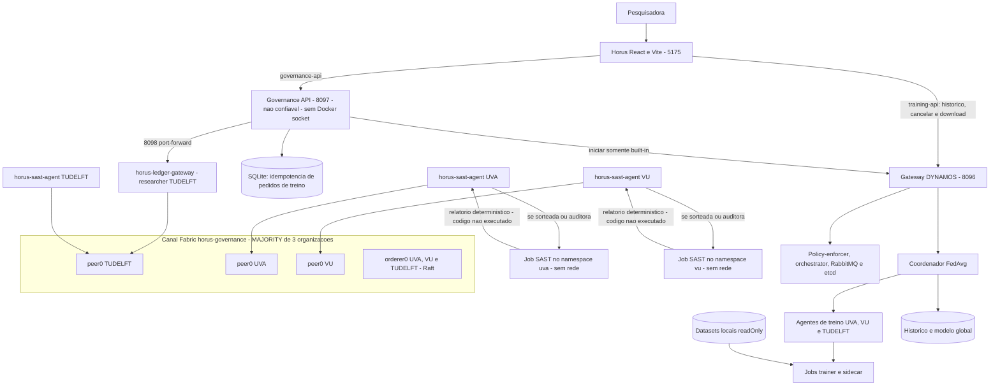

# Horus: estrutura, testes de uso e monitoracao

Para a visao consolidada de todo o projeto, consultar o
[guia completo do codigo, testes e observacao](HORUS_GUIA_COMPLETO.md). Para
entender com calma cada etapa do ledger e da analise local, consultar
[ledger Fabric e SAST local](ledger-fabric-e-sast-local.md).

Atualizado em 03/11/2026, sem alterar go/, python/, charts/, configuration/
ou fabric/. A API de treinamento continua na porta 8096.

## O que mudou nesta versao

| Antes (02/11/2026) | Agora (03/11/2026) |
| --- | --- |
| API + worker com `docker.sock` no Mac | So a API no Mac; nenhum componente da governanca monta o Docker socket. |
| Servidor sorteava a revisora | As organizacoes elegiveis sorteiam por commit-reveal, no chaincode. |
| Analise em container Docker no Mac | Analise em Job Kubernetes efemero no namespace da organizacao sorteada. |
| Ninguem assinava o resultado | A revisora assina a transacao com a identidade Fabric dela. |
| Ledger SQLite com ancora local | Canal Hyperledger Fabric replicado em 3 peers, ordenado por 3 orderers Raft. |
| Sem conferencia independente | A outra organizacao elegivel refaz a analise; divergencia marca disputa. |
| Limite de 1 MiB | Limite de 900 KiB (cabe num ConfigMap). |

## Arquitetura

Desenho renderizado: [diagrams/governanca-1.svg](diagrams/governanca-1.svg).



O agente da TUDELFT participa do canal e audita submissoes de outras
organizacoes, mas nunca revisa nem audita submissoes da propria TUDELFT.
Treino e analise usam Jobs diferentes, com finalidades e politicas de rede
diferentes. Nenhum algoritmo submetido e executado.

## Mapa do projeto

| Local | Responsabilidade |
| --- | --- |
| horus-sandbox-frontend/src/pages/FederatedTraining.tsx | Treino real, identidade e catalogo com notas. |
| horus-sandbox-frontend/src/components/AlgorithmSubmission.tsx | Upload/texto, as cinco etapas, relatorio, assinatura, auditorias, disputa e links. |
| horus-sandbox-frontend/src/pages/Ledger.tsx | Eventos Fabric, filtros, bloco/validacao da transacao e verificadores. |
| horus-sandbox-frontend/src/data/governance.ts | Cliente HTTP; nao armazena bearer token no navegador. |
| horus-sandbox-frontend/src/types/governance.ts | Contratos de submissao, auditoria, evento, transacao e status. |
| horus-governance/app/main.py | Endpoints, autenticacao local, limites, uploads e rotas do ledger. |
| horus-governance/app/settings.py | Identidade exibida, URL de treino, URL e token do gateway do ledger. |
| horus-governance/app/reviewer.py | Validacao de elegiveis (o sorteio saiu do servidor). |
| horus-governance/app/service.py | Normalizacao, limite, deduplicacao pelo ledger, apresentacao e verificacao. |
| horus-governance/app/ledger.py | FabricLedger: cliente do gateway e mapeamento de erros. |
| horus-governance/app/storage.py | SQLite so para pedidos de treino idempotentes. |
| horus-governance/app/training_bridge.py | Inicio idempotente do built-in, reconciliacao e TrainingStarted no ledger. |
| horus-governance/ledger/ | Go: chaincode, sast-agent e gateway, com testes. |
| horus-governance/deploy/ledger/ | Chart Helm e setup.py do ledger. |
| horus-governance/sast/ | Regras locais, wrapper Semgrep (roda no Job) e runner Docker de operador. |
| horus-governance/config/ | Politica comum, imagens/namespaces/MSPs e identidade local. |
| horus-governance/examples/ | Scripts para enviar como texto. Nunca executar unsafe.py. |
| horus-governance/tests/ | Contratos, API, ledger falso, ponte de treino e testes ao vivo. |
| horus-governance/.local/ | Token da API, SQLite de treino e .local/ledger/ (token do gateway, configuracao, material publico). Ignorada pelo Git. |
| go/, python/, charts/, configuration/ | DYNAMOS e treinamento horizontal existente; nao alterados. |
| extremexp_accesscontrol/ | Flask/Web3 e ABAC Besu existentes; contratos nao usados (ver documento do ledger, secao 12). |
| fabric/, VFL_*.py, house_energy_consumption/ | VFL/TTP do testbed FABRIC original, sem relacao com Hyperledger Fabric. |

O Dashboard mostra o status real do ledger e os eventos recentes. Os demais
graficos, numeros e autorizacoes continuam demonstrativos e marcados demo.

## Executar

Manter Docker Desktop, kind-scattered-training, o port-forward 8096 e o Vite
ativos. Na raiz de Scattered-Directive:

```bash
cd horus-governance
python3 tools.py ledger setup        # so na primeira vez (idempotente)
python3 tools.py ledger forward --background
python3 tools.py start
python3 tools.py status
python3 tools.py ledger verify
```

Em outro terminal, se o frontend nao estiver rodando:

```bash
npm --prefix horus-sandbox-frontend run dev -- --strictPort
```

Abrir <http://127.0.0.1:5175/training> e <http://127.0.0.1:5175/ledger>.
/governance-api aponta para 8097; /training-api continua em 8096; a API fala
com o gateway em 8098. `python3 tools.py stop` para so a API; o ledger continua.

## Roteiro de teste de uso manual

1. Conferir Researcher e Organization (TUDELFT).
2. Selecionar UVA/VU/TUDelft. Logistic regression deve ter 100/100 e origem
   Trusted built-in baseline.
3. Em outro terminal, observar as analises:
   `kc get jobs -A -l app=horus-sast -w`.
4. Enviar examples/clean.py. A tela mostra drawing (commits e reveals de UVA
   e VU), depois assigned (revisora sorteada), depois approved com 100. Um Job
   `horus-sast-...` aparece e some no namespace da revisora; logo depois outro
   no namespace da auditora.
5. Conferir a etapa 4 (assinatura pelo MSP da revisora) e a etapa 5 (auditoria
   "matches"). Abrir a transacao: bloco e VALID.
6. Reenviar o mesmo texto: reused, mesmo hash e resultado, nenhuma transacao
   nova. Alterar um caractere real gera novo fluxo; mudar so CRLF/LF nao.
7. Enviar examples/unsafe.py: rejected, nota 0, quatro altos e um medio. O
   token falso nao aparece nas mensagens nem nos eventos.
8. Selecionar algoritmo novo aprovado: Start training desabilitado; o servidor
   tambem bloqueia.
9. Voltar ao built-in, iniciar tres rodadas, acompanhar os Jobs e baixar o
   modelo. O ledger deve ter um TrainingStarted com o UUID real.
10. Na tela Ledger: filtrar por code_hash e por tipo, usar Chain head e Verify
    report. No terminal: `python3 tools.py ledger verify`.

Os eventos contem hashes, organizacoes, segredos revelados do sorteio,
relatorio resumido e decisoes. Nomes pessoais, codigo fonte e achados
detalhados nao vao aos eventos.

## Testes automatizados e como criar novos

Na pasta horus-governance:

```bash
python3 -m venv .venv
.venv/bin/pip install -r requirements.lock
.venv/bin/python -m unittest discover -s tests -v
(cd ledger && go test ./...)
```

Sem flags, testes Docker/live sao pulados explicitamente. Para SAST real em
Docker local nas tres organizacoes, apos construir as imagens:

```bash
HORUS_SAST_DOCKER_TESTS=1 .venv/bin/python -m unittest discover -s tests -v
```

Para exercitar ledger, agentes, Jobs SAST, API e proxy reais, sem treino:

```bash
HORUS_GOV_LIVE_TESTS=1 .venv/bin/python -m unittest discover -s tests -p test_live.py -v
```

Para tambem criar um treino Kubernetes de tres rodadas:

```bash
HORUS_GOV_LIVE_TESTS=1 HORUS_GOV_LIVE_TRAINING=1 \
  .venv/bin/python -m unittest discover -s tests -p test_live.py -v
```

| Quero testar | Onde acrescentar um caso |
| --- | --- |
| Regra do chaincode (quem pode o que) | ledger/governance/contract_test.go: identidades simuladas em memoria. |
| Comportamento dos agentes | ledger/internal/agent/agent_test.go: tres agentes contra o chaincode em memoria. |
| Gateway HTTP | ledger/internal/httpgw/httpgw_test.go. |
| Entradas, identidade, uploads e HTTP da API | tests/test_api.py: TestClient com FakeLedger. |
| Elegiveis, catalogo e reuso | tests/test_governance.py: FakeLedger e TemporaryDirectory. |
| Regras e isolamento SAST | tests/test_sast.py: enviar bytes, nunca importar/executar o exemplo. |
| Timeout/idempotencia/queda do ledger | tests/test_training_bridge.py. |
| Uso ponta a ponta | tests/test_live.py: polling limitado, servicos reais locais. |
| Interface | Playwright com labels Python code, Script file, Submit for validation, Chain head e Verify report. |

Variantes uteis: .exe renomeado, UTF-8 invalido, 900 KiB + 1 byte, somente
TUDelft, tentativa de enviar researcher_org, revisora desonesta (ja coberta em
Go), configuracao divergente e timeout ao iniciar treino. Nao usar o canal
real para testes de adulteracao. Nao copiar tokens para testes ou prints.

## Monitoracao disponivel agora

No Mac, com Vite ativo:

```bash
curl -fsS http://127.0.0.1:5175/governance-api/status | python3 -m json.tool
curl -fsS -X POST http://127.0.0.1:5175/governance-api/ledger/verify | python3 -m json.tool
cd horus-governance && python3 tools.py ledger verify && python3 tools.py ledger status
```

```bash
kc() { /Applications/Docker.app/Contents/Resources/bin/docker exec dynamos-dev kubectl --context kind-scattered-training "$@"; }
kc get pods -A -l app=horus-ledger
kc get jobs -A -l app=horus-sast -w
kc logs -n uva deploy/horus-sast-agent -f
kc logs -n tudelft deploy/horus-ledger-gateway --tail=50
/Applications/Docker.app/Contents/Resources/bin/docker logs --tail=100 horus-governance-api
```

Jobs SAST sao temporarios; uma lista vazia depois do relatorio pronto nao e
falha. Para treino, usar tambem o roteiro de observacao de Pods.

Registrar como evidencias: code_hash, report_hash, tx_id, bloco, revisora,
auditorias, seed, cabecas dos tres peers, UUID do treino e Jobs. Nao registrar
codigo fonte, nomes, credenciais, Secrets ou chaves dos volumes do ledger.
Prometheus, Grafana, Loki, collector/Jaeger e Hubble Relay/UI continuam
ausentes; peers e orderers expoem metricas na porta 9443, ainda sem coletor.

## Limites e recuperacao

- As tres organizacoes estao num mesmo kind administrado por uma pessoa. O
  desenho e o de producao; o isolamento real exige um cluster por organizacao.
- Raft tolera queda, nao malicia; MAJORITY com tres organizacoes nao protege
  contra conluio de duas.
- Assinatura prova quem gravou; a auditoria prova a analise quando ha outra
  organizacao elegivel honesta.
- Mudar regras, politica ou imagens SAST muda a configuracao acordada; o
  ledger recusa outra configuracao. No sandbox: `ledger down --purge` e
  `ledger setup` (apaga o historico).
- Eventos do SQLite anterior nao foram migrados; o arquivo continua intacto.
- O wrapper persiste Idempotency-Key antes da chamada de treino. Se o ledger
  falhar depois do inicio, repetir o mesmo pedido grava TrainingStarted sem
  novo treino. Nao ha atomicidade distribuida nem exactly-once.
- Clientes diretos de 8096 ficam fora do ledger.
- O ambiente nao tem OIDC, secure aggregation, differential privacy ou execucao
  de algoritmos submetidos. Uma nota alta de SAST nao prova seguranca.

## Resultado desta entrega

Execucao real de 03/11/2026: clean.py sorteado para VU, analisado no
namespace vu, assinado por VuMSP, aprovado com 100 e auditado pela UVA com o
mesmo hash; unsafe.py sorteado para UVA, rejeitado com 0 e auditado pela VU
com o mesmo hash. Os tres peers ficaram com a mesma altura e o mesmo hash, o
sorteio foi recalculado a partir dos eventos publicos, e RBAC/rede do agente e
do Job SAST foram conferidos. Testes Go e 37 testes Python passaram; o teste
ao vivo completou duas submissoes em 61 s.

Entrega anterior (02/11/2026): treino governado
03702e1f-181b-4116-b513-b01a54338ce5 concluiu tres rodadas, exportou o modelo
global e gerou um TrainingStarted (no SQLite daquela versao).
