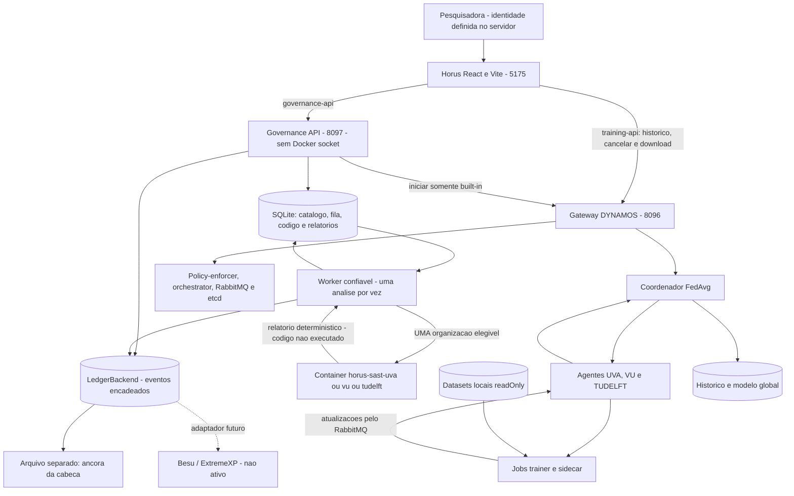

# Horus: estrutura, testes de uso e monitoracao

Para a visao consolidada de todo o projeto, consultar o
[guia completo do codigo, testes e observacao](HORUS_GUIA_COMPLETO.md).

Integracao validada em 02/11/2026, sem alterar go/, python/, charts/,
configuration/ ou fabric/. A API de treinamento continua na porta 8096.

## Arquitetura

Desenho renderizado: [diagrams/governanca-1.svg](diagrams/governanca-1.svg).



SAST roda no Docker fora do cluster; trainers rodam no Kubernetes. Sao
containers e finalidades diferentes. O template de Job SAST ainda nao foi
instalado. Nenhum algoritmo submetido e executado.

## Mapa do projeto

| Local | Responsabilidade |
| --- | --- |
| horus-sandbox-frontend/src/pages/FederatedTraining.tsx | Treino real, identidade do servidor e catalogo com notas. |
| horus-sandbox-frontend/src/components/AlgorithmSubmission.tsx | Upload/texto, progresso, sorteio, relatorio, hashes e links. |
| horus-sandbox-frontend/src/pages/Ledger.tsx | Filtros, historico por hash, detalhe e verificadores. |
| horus-sandbox-frontend/src/data/governance.ts | Cliente HTTP; nao armazena bearer token no navegador. |
| horus-sandbox-frontend/src/types/governance.ts | Contratos separados dos mocks antigos. |
| horus-governance/app/main.py | Endpoints, autenticacao local, limites e uploads. |
| horus-governance/app/settings.py | Identidade do servidor, caminhos, credenciais e URL de treino. |
| horus-governance/app/reviewer.py | Sorteio reproduzivel sem a organizacao autora. |
| horus-governance/app/service.py | Deduplicacao, fila, validacao, catalogo e eventos. |
| horus-governance/app/worker.py | Worker separado, heartbeat e tratamento de interrupcao. |
| horus-governance/app/storage.py | SQLite parametrizado, lock de escrita e ancora. |
| horus-governance/app/ledger.py | Interface LedgerBackend e SQLiteLedger. |
| horus-governance/app/training_bridge.py | Inicio idempotente do built-in e reconciliacao. |
| horus-governance/sast/ | Regras locais, wrapper Semgrep e runner isolado. |
| horus-governance/config/ | Politica comum, imagens/namespaces e identidade local. |
| horus-governance/examples/ | Scripts para enviar como texto. Nunca executar unsafe.py. |
| horus-governance/tests/ | Contratos, API, sorteio, concorrencia, integridade e testes ao vivo. |
| horus-governance/.local/ | Banco, ancora, locks, heartbeat e token. Ignorada pelo Git; sensivel. |
| go/, python/, charts/, configuration/ | DYNAMOS e treinamento horizontal existente; nao alterados nesta integracao. |
| extremexp_accesscontrol/ | Flask/Web3 e ABAC existentes; auditoria Besu futura. |
| fabric/, VFL_*.py, house_energy_consumption/ | VFL/TTP/FABRIC original, ainda nao ligado ao catalogo. |

O Dashboard mostra ledger e worker reais. Os demais graficos, numeros e
autorizacoes demonstrativos nao viraram monitoracao real. Entradas de status
remanescentes sao marcadas demo.

## Executar

Manter Docker Desktop, kind-scattered-training, o port-forward 8096 e o Vite
ativos. Na raiz de Scattered-Directive:

```bash
cd horus-governance
python3 tools.py build
python3 tools.py start
python3 tools.py status
```

Em outro terminal, se o frontend nao estiver rodando, partir da pasta
Scattered-Directive e executar:

```bash
npm --prefix horus-sandbox-frontend run dev -- --strictPort
```

Abrir <http://127.0.0.1:5175/training> e <http://127.0.0.1:5175/ledger>.
/governance-api aponta para 8097; /training-api continua em 8096.
Para parar apenas os novos servicos, executar `python3 tools.py stop` na
pasta horus-governance. Os arquivos .local/ permanecem.

## Roteiro de teste de uso manual

1. Conferir Researcher e Organization. A identidade vem de /me, nao do pedido.
2. Selecionar UVA/VU/TUDelft. Logistic regression deve ter 100/100 e origem
   Trusted built-in baseline: confianca inicial configurada, nao uma nova
   varredura Semgrep de todo o runtime de aprendizado.
3. Enviar examples/clean.py ou colar seu conteudo. Esperar queued, running e
   approved com 100. TUDelft deve ser excluida, com UVA ou VU como revisora.
4. Conferir hashes, tx_id e proveniencia. No evento ReviewerSelected estao
   elegiveis, excluida, semente e selection_version do sorteio.
5. Reenviar o mesmo texto: reutiliza resultado, hash e revisora, sem outro
   container ou CodeAnalyzed. Alterar um caractere real gera nova analise;
   mudar apenas CRLF para LF nao muda o hash.
6. Enviar examples/unsafe.py: rejected, nota 0, quatro altos e um medio. O
   token falso nao aparece nas mensagens nem nos eventos.
7. Selecionar algoritmo novo aprovado: Start training deve ficar desabilitado.
   O servidor tambem bloqueia essa execucao sem depender da interface.
8. Voltar ao built-in, iniciar tres rodadas, acompanhar os Jobs e baixar o
   modelo. Ledger deve conter um TrainingStarted com o UUID real do treino.
9. Abrir Analysis transaction; conferir dados, hash e hash anterior. Usar
   Verify chain e Verify report. Testar filtro por tipo, code_hash e paginacao.

O historico de codigo contem submissao, sorteio, analise, decisao e registro
no catalogo se aprovado. Nomes pessoais, fonte e achados nao vao ao ledger.

## Testes automatizados e como criar novos

Na pasta horus-governance:

```bash
python3 -m venv .venv
.venv/bin/pip install -r requirements.lock
.venv/bin/python -m unittest discover -s tests -v
```

Sem flags, testes Docker/live sao pulados explicitamente. Para SAST real nas
tres organizacoes, apos construir as imagens:

```bash
HORUS_SAST_DOCKER_TESTS=1 .venv/bin/python -m unittest discover -s tests -v
```

Para exercitar API/proxy/worker/ledger reais, sem treino:

```bash
HORUS_GOV_LIVE_TESTS=1 .venv/bin/python -m unittest discover -s tests -p test_live.py -v
```

Para tambem criar um treino Kubernetes de tres rodadas:

```bash
HORUS_GOV_LIVE_TESTS=1 HORUS_GOV_LIVE_TRAINING=1 \
  .venv/bin/python -m unittest discover -s tests -p test_live.py -v
```

O teste de treinamento pula quando encontra outra execucao ativa. Testes de
adulteracao usam bancos temporarios: nao editar o banco real para demonstra-los.
O teste integrado antigo altera acordo sintetico e requer ausencia de outros
treinos; os testes de governanca nao revogam os acordos de treinamento.

| Quero testar | Onde acrescentar um caso |
| --- | --- |
| Entradas, identidade, uploads e HTTP | tests/test_api.py: TestClient com estado temporario e upstream simulado. |
| Sorteio, catalogo e duplicatas | tests/test_governance.py: Settings com TemporaryDirectory. |
| Regras e isolamento SAST | tests/test_sast.py: enviar bytes, nunca importar/executar o exemplo; habilitar gate Docker. |
| Adulteracao do ledger | tests/test_ledger.py: modificar apenas banco/ancora temporarios. |
| Relatorio alterado | Teste de governanca: modificar JSON temporario e verificar recusa. |
| Timeout/idempotencia | tests/test_training_bridge.py: MockTransport com timeout, resposta e reconciliacao. |
| Uso ponta a ponta | tests/test_live.py: polling limitado, timeouts e servicos reais locais. |
| Interface | Playwright com roles/labels Python code, Script file, Submit for validation, Verify chain e Verify report. |

Variantes uteis: .exe renomeado, UTF-8 invalido, 1 MB + 1 byte, somente TUDelft,
tentativa de enviar researcher_org, dois envios concorrentes, nosemgrep,
alteracao do relatorio e timeout ao iniciar treino. Nao copiar o token real
para testes, prints ou arquivos versionados.

## Monitoracao disponivel agora

No Mac, com Vite ativo, sem precisar expor o bearer token:

```bash
curl -fsS http://127.0.0.1:5175/governance-api/status | python3 -m json.tool
curl -fsS -X POST http://127.0.0.1:5175/governance-api/ledger/verify | python3 -m json.tool
```

O status informa backend, integridade e heartbeat do worker. O heartbeat pode
ter ate 180 segundos: e liveness aproximada, nao garantia de saude de todos
os recursos externos.

```bash
/Applications/Docker.app/Contents/Resources/bin/docker logs --tail=100 horus-governance-api
/Applications/Docker.app/Contents/Resources/bin/docker logs --tail=100 horus-governance-worker
/Applications/Docker.app/Contents/Resources/bin/docker ps --filter name=horus-sast
/Applications/Docker.app/Contents/Resources/bin/docker stats --no-stream
/Applications/Docker.app/Contents/Resources/bin/docker exec dynamos-dev \
  kubectl --context kind-scattered-training get pods,jobs -A
```

Containers SAST sao temporarios; podem sumir antes do comando manual. Uma
lista vazia depois do relatorio pronto nao e falha. As imagens permanecem.
Para treino, usar tambem o roteiro de observacao de Pods ja existente.

Registrar como evidencias: code_hash, report_hash, tx_id, revisora, UUID do
treino, estado e quantidade de Jobs. Nao registrar codigo fonte, nomes,
credenciais, Secrets ou dados dos datasets em logs publicos.
Prometheus, Grafana, Loki, collector/Jaeger e Hubble Relay/UI continuam ausentes;
nenhum grafico mock representa esses servicos em execucao.

## Limites e recuperacao

- SQLiteLedger e local, nao blockchain. IDs local-* nao sao hashes de transacao
  Besu. O adaptador futuro tem interface definida, mas nao esta instalado.
- A ancora fica fora do banco, mas no mesmo host. Um administrador que
  reescreva banco e ancora nao e impedido. E necessario ancoramento externo
  para proteger contra esse adversario.
- Uma queda entre commit e atualizacao da ancora causa recusa fail-closed.
  Nao ha reparo automatico que aceite silenciosamente outra cadeia. Para
  backup consistente, parar API/worker e copiar .local/ para local protegido.
- Worker interrompido marca a analise como error na proxima inicializacao;
  nao aprova nem reanalisa automaticamente.
- Mudancas de regras/politica exigem estrategia explicita de revalidacao do
  catalogo antes de usar aprovacoes antigas. Nao atualizar as imagens
  supondo que o catalogo foi automaticamente renovado.
- O wrapper persiste Idempotency-Key antes da chamada de treino. Resultado
  incerto nao e reenviado automaticamente. Consultar GET /training/requests/{id}.
  Se o UUID real for conhecido, o operador pode usar
  POST /training/requests/{id}/reconcile?run_id={uuid}. Parametros e horario sao
  conferidos. Nao ha promessa de atomicidade distribuida ou exactly-once.
- Clientes diretos de 8096 ficam fora do novo ledger. Sem alterar o gateway
  existente, nao se pode alegar auditoria obrigatoria para todos os clientes.
- O ambiente nao tem OIDC, secure aggregation, differential privacy ou execucao
  de algoritmos submetidos. Uma nota alta de SAST nao prova seguranca.

## Resultado desta entrega

API/worker reais aprovaram o limpo com 100, reprovaram o problematico com 0,
reutilizaram duplicatas e verificaram relatorio/cadeia. O treino governado
03702e1f-181b-4116-b513-b01a54338ce5 concluiu tres rodadas, exportou o modelo
global e gerou exatamente um TrainingStarted.
No navegador foram conferidos envio por texto/arquivo, exclusao de TUDelft,
notas/achados, bloqueio do algoritmo novo, links e verificadores. Treinamento,
Ledger e Dashboard foram conferidos em desktop e celular.