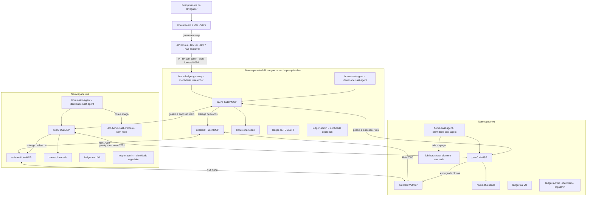
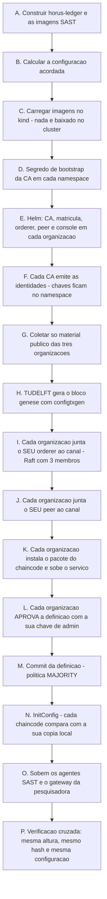
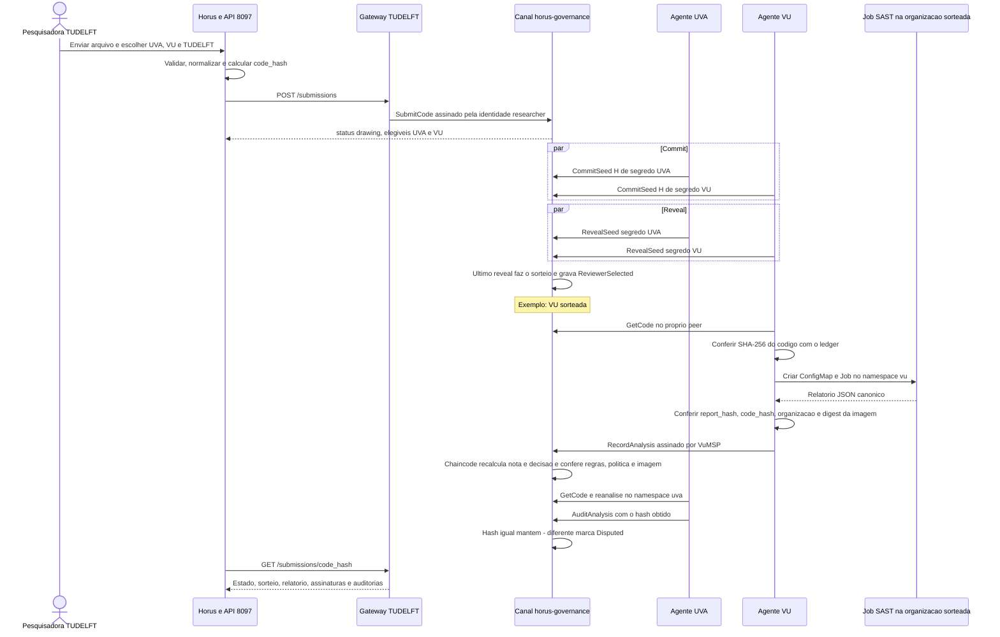
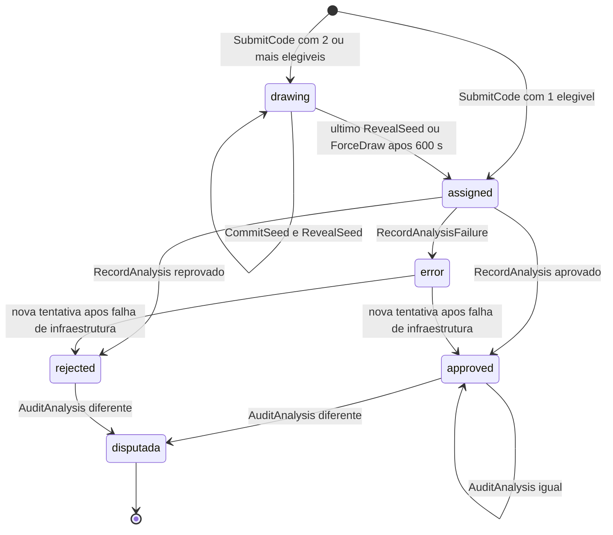

# Ledger Hyperledger Fabric e analise SAST local por organizacao

**Referencia:** implementado e validado em 03/11/2026 no cluster
`kind-scattered-training`.

Este documento explica, com calma e na ordem em que as coisas acontecem,
como a governanca do Horus funciona depois da mudanca para **confianca zero**:
o sorteio da organizacao revisora, a analise SAST executada no ambiente da
organizacao sorteada e o registro do resultado em um ledger Hyperledger
Fabric mantido pelas tres organizacoes.

Desenhos renderizados:
[componentes por organizacao](diagrams/ledger-fabric-1.svg),
[como o ledger nasce](diagrams/ledger-fabric-2.svg),
[vida de uma submissao](diagrams/ledger-fabric-3.svg) e
[estados de uma submissao](diagrams/ledger-fabric-4.svg).

Versao editavel no draw.io (3 paginas: arquitetura, fluxo de uma submissao e
setup do ledger): [drawio/horus-ledger-fabric.drawio](diagrams/drawio/horus-ledger-fabric.drawio),
com previas em [PNG 1](diagrams/horus-ledger-fabric-drawio-1.png),
[PNG 2](diagrams/horus-ledger-fabric-drawio-2.png) e
[PNG 3](diagrams/horus-ledger-fabric-drawio-3.png).

## Sumario

1. [A ideia em poucas linhas](#1-a-ideia-em-poucas-linhas)
2. [Por que mudou: ninguem confia em ninguem](#2-por-que-mudou-ninguem-confia-em-ninguem)
3. [Conceitos do Fabric em linguagem simples](#3-conceitos-do-fabric-em-linguagem-simples)
4. [O que cada organizacao roda](#4-o-que-cada-organizacao-roda)
5. [Como o ledger nasce, etapa por etapa](#5-como-o-ledger-nasce-etapa-por-etapa)
6. [A vida de uma submissao, etapa por etapa](#6-a-vida-de-uma-submissao-etapa-por-etapa)
7. [Quem poderia trapacear e o que impede](#7-quem-poderia-trapacear-e-o-que-impede)
8. [Como observar cada etapa](#8-como-observar-cada-etapa)
9. [Operacao do dia a dia](#9-operacao-do-dia-a-dia)
10. [Testes](#10-testes)
11. [Limites conhecidos](#11-limites-conhecidos)
12. [Por que os contratos do ExtremeXP nao foram usados](#12-por-que-os-contratos-do-extremexp-nao-foram-usados)
13. [Evidencias da validacao](#13-evidencias-da-validacao)

## 1. A ideia em poucas linhas

1. A pesquisadora (TUDELFT) envia um algoritmo. Ele **nunca e executado**:
   e apenas texto para analise estatica.
2. O texto e gravado em um **canal Fabric** que as tres organizacoes mantem.
3. As organizacoes elegiveis (todas as escolhidas, menos a da pesquisadora)
   **sorteiam juntas** quem vai revisar, por *commit-reveal*. Ninguem escolhe
   sozinho.
4. A organizacao sorteada roda o Semgrep **no seu proprio namespace**, num
   Job Kubernetes efemero, sem rede, e **assina** o relatorio com a sua
   identidade Fabric.
5. O chaincode so aceita o relatorio se ele veio da sorteada, com as regras,
   politica e imagem combinadas, e se a nota e coerente com os achados.
6. As outras organizacoes elegiveis **refazem a analise** e comparam o hash.
   Se divergir, a submissao fica **Disputada** e nao pode ser usada.
7. Qualquer organizacao pode conferir tudo no seu proprio peer.

## 2. Por que mudou: ninguem confia em ninguem

Antes, um unico servidor (a API + o worker com `docker.sock`) fazia tudo.
Mesmo com boas protecoes, todos precisavam **confiar nesse servidor**.

| Ponto | Antes (SQLite local) | Agora (Fabric + agentes locais) |
| --- | --- | --- |
| Onde roda a analise | Docker do Mac, as tres imagens no mesmo daemon | Job no namespace da organizacao sorteada, criado pelo agente dela |
| Quem sorteia | Servidor, com semente propria | As organizacoes elegiveis, por commit-reveal no chaincode |
| Quem assina o resultado | Ninguem; o servidor grava | A organizacao revisora, com a chave privada dela |
| Onde fica o historico | Um arquivo SQLite + ancora no mesmo host | Canal Fabric replicado nos peers de UVA, VU e TUDELFT |
| Como se confere | Confiar no arquivo do servidor | Cada organizacao consulta o proprio peer e refaz a analise |
| Organizacao da pesquisadora | Campo de configuracao do servidor | Lida do certificado X.509 da pesquisadora |
| Docker socket | Montado no worker | Nao existe mais em nenhum componente da governanca |

O servidor Horus continua existindo, mas virou **nao confiavel**: ele so
guarda a interface e repassa pedidos. Se ele mentir, as organizacoes
percebem, porque o que vale e o que esta no ledger.

## 3. Conceitos do Fabric em linguagem simples

| Termo | O que e neste projeto |
| --- | --- |
| Organizacao | UVA, VU ou TUDELFT. Cada uma e dona do seu namespace no cluster. |
| CA (Certificate Authority) | Emite os certificados de UMA organizacao. Cada uma tem a sua (`ledger-ca`). |
| MSP (Membership Service Provider) | O "cracha" da organizacao: `UvaMSP`, `VuMSP`, `TudelftMSP`. Diz quais certificados pertencem a ela. |
| Identidade | Certificado + chave privada. Ex.: `sast-agent` da UVA, `researcher` da TUDELFT. |
| NodeOU | Tipo da identidade gravado no certificado: `peer`, `orderer`, `admin` ou `client`. |
| Atributo `horus.role` | Papel dentro do Horus, gravado no certificado pela CA: `researcher` ou `reviewer-agent`. |
| Peer | Guarda uma copia do ledger e executa o chaincode. Cada organizacao tem o seu (`peer0`). |
| Orderer | Coloca as transacoes em ordem e fecha os blocos. Cada organizacao tem um (`orderer0`); os tres formam um cluster **Raft**. |
| Canal | O "livro" compartilhado: `horus-governance`. So as tres organizacoes participam. |
| Bloco genese | O primeiro bloco do canal. Diz quem sao os membros e quais sao as regras do canal. |
| Chaincode | O contrato inteligente: `horus-governance`, escrito em Go, com as regras do Horus. |
| Endosso | Peers executam a transacao e assinam o resultado. A regra aqui e **MAJORITY**: 2 de 3 organizacoes precisam chegar ao mesmo resultado. |
| Commit / validacao | Cada peer confere assinaturas e conflitos antes de gravar. Resultado `VALID` ou um codigo de erro. |
| MVCC_READ_CONFLICT | Duas transacoes leram e alteraram a mesma chave no mesmo bloco; o Fabric rejeita uma delas. O agente simplesmente tenta de novo. |
| Chaincode-as-a-service | O chaincode roda como um Deployment comum; o peer conecta nele. Nao precisa de Docker dentro do cluster. |

Sobre o "fechamento de blocos": o orderer fecha um bloco quando junta ate 10
transacoes ou depois de 1 segundo, o que vier primeiro. Nao ha mineracao,
gas, nonce ou blocos vazios, e uma transacao gravada e **final** (nao existe
fork que a desfaca). O codigo so precisa esperar a confirmacao, que o SDK ja
faz.

## 4. O que cada organizacao roda



| Componente (em cada namespace) | Tipo | Para que serve |
| --- | --- | --- |
| `ledger-ca` + Service `ca` | Deployment | CA da organizacao. So o Job de matricula fala com ela. |
| `ledger-enroll` | Job | Registra e matricula as identidades da organizacao. Gera as chaves **dentro** do namespace. |
| `orderer0` | Deployment | Membro do cluster Raft. Porta 7050 (ordenacao/Raft) e 7053 (administracao do canal, com TLS mutuo). |
| `peer0` | Deployment | Copia do ledger, endosso, gateway Fabric. Porta 7051. |
| `ledger-admin` | Deployment | "Console" do administrador da organizacao (imagem fabric-tools). Usado so no setup. |
| `horus-chaincode` | Deployment | Chaincode `horus-governance` desta organizacao. So o peer local conecta (porta 9999). |
| `horus-sast-agent` | Deployment | Agente que participa do sorteio, roda analises e auditorias da organizacao. |
| Jobs `horus-sast-<hash>-<id>` | Job efemero | Uma analise. Criado e apagado pelo agente. Sem rede, sem token, root somente leitura. |
| `horus-ledger-gateway` (so TUDELFT) | Deployment | Ponte HTTP entre a API Horus e o peer da TUDELFT, com a identidade `researcher`. |

Volumes persistentes por organizacao: `ledger-ca` (CA), `ledger-crypto`
(identidades), `ledger-peer-data`, `ledger-orderer-data` e
`ledger-agent-state` (segredos do sorteio). Todos com
`helm.sh/resource-policy: keep`: desinstalar o chart nao apaga o ledger.

Cada Pod monta **so a sua identidade** (subPath do volume `ledger-crypto`):
o peer nao ve a chave do agente, o agente nao ve a chave do administrador.

Identidades emitidas por cada CA:

| Identidade | NodeOU | `horus.role` | Usada por |
| --- | --- | --- | --- |
| `peer0` | peer | - | peer0 (e certificado TLS) |
| `orderer0` | orderer | - | orderer0 (e certificado TLS) |
| `orgadmin` | admin | - | ledger-admin (canal, chaincode, configuracao) |
| `sast-agent` | client | `reviewer-agent` | horus-sast-agent |
| `researcher` (so TUDELFT) | client | `researcher` | horus-ledger-gateway |

## 5. Como o ledger nasce, etapa por etapa

Comando unico, a partir de `horus-governance/`:

```bash
python3 tools.py ledger setup        # ou --skip-build para reaproveitar imagens
```

O script [deploy/ledger/setup.py](../horus-governance/deploy/ledger/setup.py)
faz o papel do operador de cada organizacao. Entre organizacoes ele so move
**material publico**: certificado da CA, configuracao NodeOU, certificado TLS
do orderer e o bloco genese. Ele e idempotente: rodar de novo nao recria
nada que ja existe.



**A. Imagens.** `horus-ledger:local` contem um unico binario Go com tres
modos: `chaincode`, `agent` e `gateway`. As imagens `horus-sast-uva`,
`horus-sast-vu` e `horus-sast-tudelft` sao as mesmas de antes.

**B. Configuracao acordada.** O script monta um JSON com: membros e MSPs,
`rules_hash` (SHA-256 dos bytes de `sast/rules.yaml`), `policy_hash` (JSON
canonico de `config/policy.json`), versao do Semgrep, **digest da imagem SAST
de cada organizacao**, as regras (severidade e mensagem) e a politica de nota,
e o prazo do sorteio (600 s). Uma copia fica em
`horus-governance/.local/ledger/governance.json` e outra vai para o ConfigMap
`horus-ledger-config` de **cada** namespace.

**C. Imagens no kind.** Imagens multi-arquitetura do Docker Desktop sao
exportadas so para a plataforma local e importadas no no; as demais usam
`kind load`. Nada e baixado de dentro do cluster.

**D. Segredo da CA.** Um Secret `ledger-ca-bootstrap` com senha aleatoria em
cada namespace. O token do gateway (`ledger-gateway-token`) so em `tudelft`.

**E e F. Matricula.** O Job `ledger-enroll` de cada organizacao espera a CA,
registra `peer0`, `orderer0`, `orgadmin`, `sast-agent` (e `researcher` na
TUDELFT) com segredos de uso unico gerados ali mesmo, matricula cada um
(certificado de identidade + certificado TLS) e grava em `/crypto` do volume
da organizacao. Ao final cria `/crypto/public`, a unica pasta destinada a ser
compartilhada.

**G. Material publico.** O script le `/crypto/public` dos tres consoles e
**recusa** o pacote se encontrar qualquer arquivo de chave. Copias ficam em
`.local/ledger/public/`.

**H. Bloco genese.** O console da TUDELFT roda `configtxgen` com o
`configtx.yaml` gerado pelo script: tres organizacoes, cada uma com peer e
orderer, politicas `Readers/Writers = member`, `Admins = admin`,
`Endorsement = peer`, e no canal `Admins = MAJORITY`,
`Endorsement = MAJORITY`, `LifecycleEndorsement = MAJORITY`. O bloco e
publico; cada organizacao pode inspeciona-lo com `configtxlator` antes de
entrar.

**I. Orderers.** Cada console usa `osnadmin channel join` no **seu** orderer,
autenticando com o certificado TLS do seu administrador. O script espera os
tres ficarem `active` como `consenter`.

**J. Peers.** Cada console usa `peer channel join` no seu peer, com a sua
identidade de administrador.

**K. Chaincode.** Cada organizacao gera um pacote *ccaas* deterministico
(datas e donos fixos, para o ID nao mudar entre execucoes) que contem so o
endereco do seu servico `horus-chaincode`. Os IDs de pacote sao diferentes por
organizacao, o que o Fabric permite. O Helm sobe o Deployment do chaincode
com esse ID.

**L e M. Aprovacao e commit.** Cada organizacao aprova a mesma definicao
(nome, versao 1.0, sequencia 1, politica padrao MAJORITY) com a sua chave de
administrador. So entao a TUDELFT faz o commit, que precisa de endosso da
maioria. Mudar o chaincode no futuro exige nova aprovacao da maioria.

**N. InitConfig.** O administrador da TUDELFT envia a configuracao. O
chaincode de **cada** organizacao compara o argumento com o ConfigMap local:
se for diferente, recusa. Como o endosso exige maioria, so uma configuracao
que a maioria aceitou pode ser gravada. Repetir com a mesma configuracao e
inofensivo; outra configuracao e recusada (`conflict`).

**O. Agentes e gateway.** Cada `horus-sast-agent`, ao iniciar, le a
configuracao do ledger no seu peer e compara com a sua copia local. Se
divergir, **recusa trabalhar**. O gateway sobe na TUDELFT.

**P. Verificacao cruzada.** O script pergunta a cada peer a altura e o hash
do ultimo bloco, e a configuracao ativa. Saida esperada:

```text
   UVA      height=  19  block=a4ZmSncEeDwjAPJY  config=agreed
   VU       height=  19  block=a4ZmSncEeDwjAPJY  config=agreed
   TUDELFT  height=  19  block=a4ZmSncEeDwjAPJY  config=agreed
   result: all organizations see the same ledger and configuration
```

Depois do setup, expor o gateway para a API (em outro terminal, ou em
segundo plano):

```bash
python3 tools.py ledger forward              # mantem o terminal ocupado
python3 tools.py ledger forward --background # segundo plano
```

## 6. A vida de uma submissao, etapa por etapa



### Etapa 1 - Submissao

A tela `/training` envia o texto ou o arquivo para a API Horus. A API:

- aceita `.py`/`.txt`, UTF-8 valido, sem bytes de controle, ate **900 KiB**
  (o limite caiu de 1 MiB porque o codigo precisa caber num ConfigMap no
  namespace da organizacao revisora);
- troca CRLF/CR por LF e calcula o `code_hash` (SHA-256);
- confere que existe ao menos uma revisora fora da organizacao da pesquisadora;
- se o hash ja esta no ledger, devolve o registro existente (`reused`).

O gateway chama `SubmitCode(codigo, organizacoes)` com a identidade
`researcher`. O **chaincode** le a organizacao da pesquisadora do certificado
(`TudelftMSP` -> TUDELFT), exige o papel `researcher`, recalcula o SHA-256,
repete as validacoes de texto e calcula as elegiveis. O texto do codigo fica
numa chave separada (`code:<hash>`); os eventos nunca o contem.

Estado inicial: `drawing`. Se so houver UMA elegivel (ex.: UVA e TUDELFT
escolhidas), nao ha sorteio: estado `assigned` com `single-eligible-v1`.

### Etapa 2 - Commit (compromisso)

Cada agente elegivel ve a submissao em `drawing` e:

1. gera 32 bytes aleatorios e grava no **seu** volume
   (`/state/secrets/<code_hash>`, permissao 0600) **antes** de enviar;
2. envia `CommitSeed(code_hash, SHA-256(segredo))`.

Ninguem ve os segredos ainda, entao ninguem consegue prever o sorteio. Se o
agente reiniciar entre o commit e o reveal, ele relê o segredo do volume.

### Etapa 3 - Reveal e sorteio

Quando **todas** as elegiveis fizeram commit, cada agente envia
`RevealSeed(code_hash, segredo)`. O chaincode confere que
`SHA-256(segredo)` e igual ao compromisso. A ultima revelacao dispara o
sorteio, na mesma transacao:

```text
semente  = SHA-256( code_hash_bytes || segredo_org1 || segredo_org2 ... )   (orgs em ordem alfabetica)
revisora = organizacao com o MENOR SHA-256( semente || nome_da_org )
```

Qualquer pessoa pode refazer a conta com os eventos publicos
`SeedRevealed`. Exemplo (o mesmo usado na validacao):

```bash
cd horus-governance
curl -s -H "Authorization: Bearer $(cat .local/ledger/gateway-token)" http://127.0.0.1:8098/events | python3 -c '
import json, sys, hashlib
eventos = json.load(sys.stdin)
for h in sorted({e["code_hash"] for e in eventos if e["code_hash"]}):
    segredos = {e["organization"]: e["payload"]["secret"] for e in eventos
                if e["code_hash"] == h and e["event_type"] == "SeedRevealed"}
    sorteio = [e for e in eventos if e["code_hash"] == h and e["event_type"] == "ReviewerSelected"]
    if not segredos or not sorteio:
        continue
    semente = hashlib.sha256(bytes.fromhex(h) + b"".join(bytes.fromhex(segredos[o]) for o in sorted(segredos))).digest()
    revisora = min(sorteio[0]["payload"]["eligible"], key=lambda o: hashlib.sha256(semente + o.encode()).hexdigest())
    print(h[:12], "recalculada:", revisora, "| ledger:", sorteio[0]["payload"]["reviewer"])'
```

Se uma organizacao nao fizer commit ou nao revelar, as que revelaram podem,
depois de 600 s, chamar `ForceDraw`: quem nao revelou fica **publicamente**
marcado em `defaulted` e deixa de concorrer (`commit-reveal-timeout-v1`).

### Etapa 4 - Analise no ambiente da organizacao sorteada

So o agente da sorteada age. Ele:

1. le o codigo do **seu** peer (`GetCode`) e confere o SHA-256 contra o hash
   do ledger: se a API ou outro componente tivesse trocado o texto, pararia aqui;
2. cria, no **seu** namespace, um ConfigMap com `submission.py` e um Job
   `horus-sast-<hash>-<id>` com a imagem da organizacao;
3. espera o Job terminar (ate 150 s), le a saida e o `imageID` real do
   container, e **apaga** Job e ConfigMap.

Isolamento do Job de analise:

| Controle | Valor |
| --- | --- |
| Rede | NetworkPolicy `horus-sast-deny-network`: nenhuma entrada e nenhuma saida (nem DNS, nem API Kubernetes). |
| Usuario | UID/GID **20001**, exclusivo do analisador. |
| Processos | `ulimit -u 128` (por isso o UID e exclusivo: o limite conta todos os processos do UID no no). |
| Sistema de arquivos | Root somente leitura; `/tmp` em memoria, 128 MiB; entrada montada somente leitura. |
| Privilegios | Todas as capabilities removidas, sem escalada, seccomp RuntimeDefault. |
| Credenciais | Sem token da API Kubernetes, sem Secrets, sem datasets. |
| Recursos | 1 CPU e 768 MiB; prazo de 150 s; sem nova tentativa automatica do Job. |
| Imagem | `imagePullPolicy: Never`; o digest que o kubelet informou precisa ser o acordado. |
| PodSecurity | Os namespaces exigem o perfil `restricted`, e o Job cumpre. |

O codigo continua **nunca executado**: o container so roda `ast.parse` e o
Semgrep sobre o texto, como antes.

### Etapa 5 - Registro assinado e as checagens do chaincode

O agente confere localmente o envelope (hash do relatorio, `code_hash`,
organizacao e digest da imagem) e envia
`RecordAnalysis(code_hash, relatorio, report_hash, digest)` assinado pela
identidade `sast-agent` da sua organizacao. O chaincode recusa se:

- quem assinou nao e a organizacao sorteada, ou nao tem o papel
  `reviewer-agent`;
- o `report_hash` nao e o SHA-256 dos bytes do relatorio;
- `rules_hash`, `policy_hash` ou a versao do Semgrep diferem do acordado;
- o digest da imagem nao e o da imagem acordada **daquela** organizacao;
- algum achado usa regra, severidade ou mensagem fora do conjunto acordado;
- contagens, nota, decisao ou motivos nao batem com o recalculo pela politica.

O ultimo item significa que a revisora **nao consegue** gravar "aprovado" com
achados graves: para mudar a decisao ela teria de esconder achados, e isso a
etapa 6 detecta. Se aceito, o estado vira `approved` ou `rejected`, com
eventos `CodeAnalyzed` e `CodeValidated`/`CodeRejected` (e
`AlgorithmRegistered` quando aprovado; continua `executable=false`).

Falhas: se o analisador rejeitar a entrada (ex.: `invalid_python`), o agente
grava `RecordAnalysisFailure` e o estado vira `error`, definitivo. Se a falha
for de infraestrutura (ex.: `scanner_unavailable`), a mesma revisora tenta de
novo automaticamente; depois de 3 tentativas sem sucesso, desiste e o
registro de falha permanece.

### Etapa 6 - Auditoria por re-execucao

O relatorio e **deterministico**: mesmo texto, regras, politica e motor geram
o mesmo `report_hash`, em qualquer organizacao. Por isso cada organizacao
elegivel que nao foi sorteada refaz a analise no seu proprio namespace e
envia `AuditAnalysis(code_hash, report_hash, digest)`:

- igual: auditoria `match=true`;
- diferente: `match=false` e a submissao fica `disputed=true` para todos.
  Um algoritmo disputado nao entra no catalogo e `IsApproved` responde falso.

A organizacao da pesquisadora nao audita a propria submissao.

### Etapa 7 - Leitura e verificacao

- **Horus** mostra as etapas: commits, reveals, revisora, quem assinou,
  auditorias e o aviso de disputa.
- **Verify report** (`POST /reports/{hash}/verify`) recalcula o SHA-256 do
  relatorio e pergunta ao peer se a transacao `CodeAnalyzed` esta num bloco e
  foi validada (`VALID`).
- **Chain head** (`POST /ledger/verify`) mostra altura e hash do ultimo bloco
  vistos pelo peer da TUDELFT.
- **Comparacao entre organizacoes**: `python3 tools.py ledger verify` compara
  altura, hash e configuracao nos tres peers.

### Etapa 8 - Inicio de treino

O treino continua usando so o algoritmo built-in pela API 8096. Depois que a
API de treino devolve o UUID, a API Horus grava `TrainingStarted` no ledger
(`RecordTrainingStart`, identidade `researcher`). Se o ledger estiver fora do
ar nesse momento, a resposta e 503 explicando que o treino comecou; repetir o
**mesmo** pedido (mesma `Idempotency-Key`) grava o evento sem iniciar outro
treino. O chaincode e idempotente por UUID.

### Estados de uma submissao



`disputada` nao e um status separado no ledger: e `disputed=true` junto de
`approved` ou `rejected`.

## 7. Quem poderia trapacear e o que impede

| Tentativa | O que impede |
| --- | --- |
| Servidor Horus escolher a revisora | O servidor nao sorteia; o chaincode sorteia com segredos das organizacoes. |
| Servidor trocar o codigo depois da submissao | O agente confere o SHA-256 do texto lido no proprio peer. |
| Pesquisadora fingir ser de outra organizacao | A organizacao vem do certificado; campos extras no pedido sao recusados. |
| Uma organizacao prever o sorteio | Commits sao enviados antes de qualquer segredo ser revelado. |
| Organizacao nao sorteada gravar o resultado | `RecordAnalysis` exige a identidade da sorteada. |
| Revisora usar outras regras, politica ou imagem | Hashes e digests acordados no chaincode. |
| Revisora gravar "aprovado" com achados graves | O chaincode recalcula nota e decisao a partir dos achados. |
| Revisora esconder achados | A outra organizacao refaz a analise; hash diferente marca disputa. |
| Uma organizacao alterar regras ou o chaincode sozinha | Configuracao e definicao do chaincode exigem a maioria. |
| Reescrever o historico em um peer | Os outros peers mantem suas copias; `ledger verify` compara cabecas. |
| Uma organizacao configurar um agente com outra configuracao | O agente compara com a copia local e recusa trabalhar. |

O que **nao** e impedido (ver secao 11): uma organizacao que se recusa a
revelar consegue apenas se excluir; o sorteio pode ser reaplicado pela
pesquisadora com pequenas variacoes do texto (cada tentativa fica publica).

## 8. Como observar cada etapa

Preparacao no Mac (mesma funcao `kc` do guia completo):

```bash
export DOCKER_BIN=/Applications/Docker.app/Contents/Resources/bin/docker
kc() { "$DOCKER_BIN" exec dynamos-dev kubectl --context kind-scattered-training "$@"; }
```

| O que ver | Comando |
| --- | --- |
| Todos os componentes do ledger | `kc get pods -A -l app=horus-ledger -o wide` |
| Analises em andamento (Jobs efemeros) | `kc get jobs -A -l app=horus-sast -w` |
| Agente de uma organizacao | `kc logs -n uva deploy/horus-sast-agent -f` |
| Chaincode de uma organizacao | `kc logs -n vu deploy/horus-chaincode --tail=50` |
| Peer (blocos gravados) | `kc logs -n tudelft deploy/peer0 --tail=50 \| grep "Committed block"` |
| Orderer (lider Raft) | `kc logs -n uva deploy/orderer0 --tail=100 \| grep -i leader` |
| Altura e hash em cada peer | `cd horus-governance && python3 tools.py ledger verify` |
| Eventos de uma submissao | `curl -s http://127.0.0.1:5175/governance-api/ledger/events?code_hash=HASH` |
| Detalhe de uma transacao | `curl -s http://127.0.0.1:5175/governance-api/ledger/transactions/TX_ID` |
| Permissoes do agente | `kc auth can-i create jobs -n vu --as=system:serviceaccount:uva:horus-sast-agent` (esperado `no`) |
| Politicas de rede | `kc get networkpolicy -n uva` |

Linhas reais dos logs dos agentes (UVA nas duas primeiras, VU nas demais):

```text
62c16e007c94: committed draw seed (tx 86b0ebad5252, block 9)
62c16e007c94: revealed draw seed (tx cad3d2bf5284, block 13)
62c16e007c94: recorded signed analysis 08c1a7daa206 (tx 479673cc17ae, block 19)
e87151b8dcd3: audit recorded, match=true (tx 7b13c0cfee27)
```

Uma linha `conflict: ... MVCC_READ_CONFLICT` e normal quando duas
organizacoes escrevem a mesma submissao no mesmo bloco: o Fabric rejeita uma
transacao e o agente repete no ciclo seguinte (a cada 3 s).

Na interface: `/training` mostra as cinco etapas da submissao; `/ledger`
lista eventos com quem assinou, e o olho abre bloco, codigo de validacao e
conteudo de cada evento da transacao.

## 9. Operacao do dia a dia

| Comando (em `horus-governance/`) | Efeito |
| --- | --- |
| `python3 tools.py ledger setup [--skip-build]` | Cria ou completa o ledger. Idempotente. |
| `python3 tools.py ledger forward [--background]` | Port-forward do gateway para `127.0.0.1:8098`. |
| `python3 tools.py ledger verify` | Compara altura, hash e configuracao nos tres peers. |
| `python3 tools.py ledger status` | Pods do ledger e Jobs de analise. |
| `python3 tools.py ledger down` | Remove os Deployments; **mantem** volumes, identidades e historico. |
| `python3 tools.py ledger down --purge` | Apaga volumes, segredos e o historico do ledger. Irreversivel. |
| `python3 tools.py start` / `stop` | API Horus via Compose (exige `ledger setup` antes). |

Ordem para ligar tudo: cluster e treino (guia completo, secao 5) ->
`ledger setup` (so na primeira vez) -> `ledger forward` -> `tools.py start`
-> Vite.

Cuidados:

- O port-forward cai quando o pod do gateway reinicia. Sintoma na API:
  "Ledger gateway is unreachable". Basta rodar `ledger forward` de novo.
- **Reconstruir as imagens SAST muda o digest** e, portanto, a configuracao
  acordada. O ledger recusa uma configuracao diferente. Mudar regras,
  politica ou imagens exige uma nova configuracao acordada (no sandbox:
  `ledger down --purge` e `ledger setup`; em producao: nova versao de
  configuracao aprovada pela maioria, ainda nao implementada).
- Uma nova imagem `horus-ledger` reinicia sozinha chaincode, agentes e gateway
  (o Helm anota os pods com o ID da imagem).

## 10. Testes

| Onde | O que cobre |
| --- | --- |
| `ledger/governance/contract_test.go` | Regras do chaincode em memoria: configuracao acordada, organizacao pelo certificado, commit-reveal recalculavel, prazo, so a sorteada grava, recalculo da nota, disputa, idempotencia do treino, eventos sem codigo. |
| `ledger/internal/agent/agent_test.go` | Tres agentes contra o chaincode real em memoria: sorteio, analise, auditoria; revisora desonesta pega pela auditoria; configuracao divergente; nova tentativa apos falha de infraestrutura. |
| `ledger/internal/httpgw/httpgw_test.go` | Token do gateway e mapeamento de erros do chaincode para HTTP. |
| `tests/test_governance.py`, `test_api.py`, `test_training_bridge.py` | API Horus com um ledger falso: servidor nao sorteia, reuso, limites, catalogo sem disputados, verificacao de relatorio, gravacao de TrainingStarted apos queda do ledger. |
| `tests/test_live.py` | Fluxo real: cluster, ledger, agentes, Semgrep e API. |

```bash
cd horus-governance/ledger && go test ./...
cd .. && .venv/bin/python -m unittest discover -s tests -v
HORUS_GOV_LIVE_TESTS=1 .venv/bin/python -m unittest tests.test_live -v
```

O teste ao vivo usa o Vite por padrao. Para chamar uma API diretamente:
`HORUS_GOV_LIVE_API=http://127.0.0.1:8097 HORUS_GOV_LIVE_TOKEN=<token>`.
Ele acrescenta um comentario unico ao codigo para sempre gerar um hash novo.

## 11. Limites conhecidos

- **Sandbox em um cluster so.** As tres organizacoes sao namespaces de um
  kind operado por uma pessoa, que consegue ler todos os Secrets. O desenho e
  o de producao; o isolamento real vem quando cada organizacao tiver seu
  proprio cluster e operador.
- **Orderers Raft** toleram queda, nao malicia: um orderer pode atrasar ou
  censurar, mas nao forjar transacoes (elas sao assinadas e endossadas).
  Fabric 3.x com BFT exigiria 4 orderers.
- **Tres organizacoes e endosso MAJORITY**: duas organizacoes em conluio
  conseguem endossar juntas. O chaincode de cada uma impoe as regras, mas um
  conluio da maioria esta fora do modelo de ameaca.
- **Sorteio**: quem nao revela so consegue se excluir. A pesquisadora pode
  reenviar pequenas variacoes do texto para tentar outra revisora; cada
  tentativa fica publica no ledger. O prazo usa o timestamp da transacao,
  definido pelo cliente.
- **Prova de execucao**: a assinatura prova quem registrou, nao que o
  Semgrep rodou de fato. A auditoria por re-execucao cobre isso enquanto
  houver ao menos uma outra organizacao elegivel honesta. Com uma so
  elegivel nao ha auditoria.
- **Chave da pesquisadora** fica no gateway (namespace tudelft), por decisao
  do sandbox; o ideal seria a carteira/certificado no navegador.
- **Codigo no canal**: o texto fica no estado do canal, visivel para as tres
  organizacoes (necessario para a auditoria). Uma organizacao nao membro nao
  o ve. Private Data Collections seriam a alternativa se houver membros que
  nao revisam.
- **Limite de processos aproximado**: `ulimit -u` por UID, compartilhado entre
  analises simultaneas no mesmo no. `emptyDir` em memoria nao tem `noexec`.
- **Atualizar regras/imagens** exige nova configuracao acordada (ainda sem
  fluxo de governanca para isso).
- **Historico antigo**: eventos do SQLite anterior (`governance.sqlite3`)
  nao foram migrados; o arquivo e mantido intacto e nao e mais lido.
- **TLS do chaincode**: o peer fala com o chaincode sem TLS, dentro do
  namespace, restrito por NetworkPolicy.

## 12. Por que os contratos do ExtremeXP nao foram usados

A pasta `extremexp_accesscontrol/` (repositorio proprio, nao alterado) usa
Hyperledger Besu e contratos Solidity de ABAC: `PIP` (atributos), `PAP`
(recurso -> politica), `PDP` (decisao), `SamplePolicy` e `KeycloakLogs`.

1. Eles respondem outra pergunta: "este usuario pode acessar este recurso?".
   O Horus precisa provar "a organizacao sorteada analisou este codigo com as
   regras acordadas".
2. Eles nao controlam quem escreve: qualquer conta pode chamar
   `PDP.setPAP/setPIP`, sobrescrever `PAP.registerResource`, trocar
   `PIP.updateResourceContentHash` de outro dono ou dar a si mesma um papel.
   Em confianca zero, qualquer um poderia gravar "aprovado".
3. A rede Besu nao esta no repositorio (o codigo espera um no em
   `localhost:8555`), e o modelo de blocos/gas da Besu foi uma preocupacao
   explicita. O Fabric resolve identidade por organizacao nativamente e nao
   tem gas nem blocos periodicos.

O ExtremeXP continua util para o que foi feito: autenticacao com Keycloak e
ABAC de usuarios, se um dia o Horus tiver login real.

## 13. Evidencias da validacao

Execucao real de 03/11/2026, cluster `kind-scattered-training`:

| Item | Resultado |
| --- | --- |
| Setup | Canal criado, 3 orderers Raft `active/consenter`, 3 peers no canal, chaincode aprovado pelas 3 e commitado, configuracao gravada. |
| Cabecas | UVA, VU e TUDELFT na mesma altura e com o mesmo hash. |
| `clean.py` | Sorteio UVA+VU -> **VU**; Job no namespace `vu`; assinado por `VuMSP`; aprovado, nota 100; UVA auditou com hash igual; bloco 19, `VALID`. |
| `unsafe.py` | Sorteio UVA+VU -> **UVA**; Job no namespace `uva`; assinado por `UvaMSP`; rejeitado, nota 0 (4 altos, 1 medio); VU auditou com hash igual. |
| Sorteio | Recalculado so com eventos publicos: igual ao ledger nas duas submissoes. |
| RBAC do agente UVA | `create jobs/configmaps` em `uva`: sim. `jobs` em `vu`, `secrets`, `pods`, `pods/log` em `tudelft`: nao. |
| Rede do Job SAST | API Kubernetes, internet e DNS: bloqueados. |
| Limpeza | Nenhum Job ou ConfigMap de analise restante. |
| Treino existente | Pods de `training-system`, `uva`, `vu`, `tudelft` intactos. |
| Testes | Go: chaincode, agentes e gateway OK. Python: 37 OK (12 com gate). Ao vivo: 2 submissoes completas em 61 s. |

Problemas encontrados e corrigidos durante a validacao, mantidos aqui como
aprendizado:

1. `/healthz` do peer verifica um daemon Docker; com chaincode-as-a-service
   nao ha Docker, entao a prontidao usa a porta 7051.
2. O UID 10001 ja era usado pelos servicos de treino; com `ulimit -u` o
   analisador nao conseguia criar processos (`scanner_unavailable`). Passou a
   usar o UID exclusivo 20001.
3. O pacote do chaincode feito com `tar` mudava de ID a cada execucao; agora e
   gerado de forma deterministica e, se ja aprovado, o ID aprovado e reutilizado.
