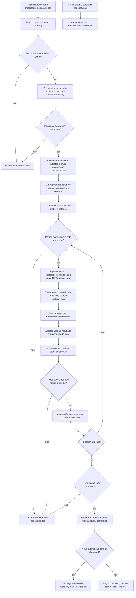
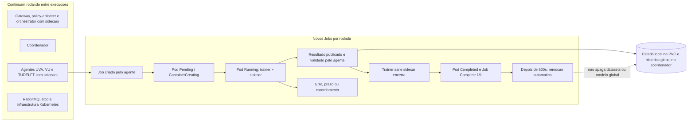

# Ver o sistema inteiro funcionando, passo a passo

Este roteiro acompanha o sandbox horizontal real. Leia na ordem; abra os
terminais de observacao ANTES de clicar em Start training. Nao e necessario
alterar codigo, permissoes ou datasets para esta demonstracao.

Desenhos:
[arquitetura completa](diagrams/scattered-atual-1.svg),
[sequencia entre servicos](diagrams/scattered-atual-2.svg),
[monitoracao ativa e ausente](diagrams/scattered-atual-3.svg),
[fluxo com decisoes](diagrams/passo-a-passo-1.svg) e
[ciclo de vida dos Pods](diagrams/passo-a-passo-2.svg).

A [arquitetura detalhada](arquitetura-atual.md) explica cada componente.

## 0. O que funciona e o que nao esta integrado

| Parte | Situacao |
| --- | --- |
| Horus `/training` | API real: iniciar, acompanhar, cancelar e baixar modelo. |
| Gateway, policy-enforcer, orchestrator e agentes Go | Reutilizados do Scattered Directive, com sidecars DYNAMOS. |
| Treinamento demonstrado | Horizontal, regressao logistica e FedAvg, dados sinteticos UVA/VU/TUDELFT. |
| VFL/TTP e notebooks FABRIC | Codigo preservado; nao sao acionados pela tela `/training`. |
| Tela `/ledger` e validacao de algoritmos | Reais desde 03/11/2026: ledger Hyperledger Fabric nos namespaces das organizacoes, com analise SAST local. Roteiro proprio em [ledger Fabric e SAST local](ledger-fabric-e-sast-local.md), secao 8. |
| Outras telas do Horus | Demonstrativas. Autorizacoes e graficos dessas telas nao provam operacoes reais deste fluxo. |
| Monitoracao | Logs, estados/probes Kubernetes, metricas de ML e Hubble local. Sem Grafana/Prometheus/Loki/Jaeger/collector/Relay/UI instalados. |

Nao execute todos os comandos do documento de uma vez. Comandos com `-w` ou
`-f` acompanham eventos continuamente e ocupam aquele terminal ate Ctrl+C.

## 1. Entender as caixas antes de executar

| Termo | Significado aqui |
| --- | --- |
| Docker Desktop | Executa containers Linux no Mac. |
| Container `scattered-training-control-plane` | E o no do cluster kind. Dentro dele rodam os Pods Kubernetes; nao confundir com um trainer. |
| Container `dynamos-dev` | Caixa de ferramentas fora do cluster: Docker CLI, kubectl, kind e Helm. |
| Namespace | Separacao logica: core, training-system, uva, vu, tudelft, kube-system e local-path-storage. Nao sao tres universidades fisicamente remotas. |
| Deployment | Mantem um servico permanente. Recria seu Pod quando necessario. |
| Pod | Unidade Kubernetes com um ou mais containers. Containers do mesmo Pod compartilham rede localhost. |
| Job | Executa uma tarefa ate terminar. Cada organizacao recebe um Job novo por rodada. |
| Service | Nome e endereco estaveis para acessar Pods, mesmo quando seus nomes/IPs mudam. |
| PVC | Volume persistente: dados sobrevivem a recriacao dos Pods, mas dependem do armazenamento do no local. |
| Sidecar DYNAMOS | Container Go que recebe gRPC local e transporta mensagens pelo RabbitMQ. Nao e Linkerd nem ferramenta de monitoracao. |

Aplicacao permanente: 11 Pods, sem contar infraestrutura e Jobs finalizados:
quatro em core, quatro em training-system e um agente em cada organizacao.
Gateway, policy-enforcer, orchestrator e cada agente tem dois containers.
O coordenador tem um. Cada Job de treinamento tem trainer e sidecar.

Nos mesmos namespaces uva, vu e tudelft tambem rodam os Pods do ledger de
governanca (ledger-ca, orderer0, peer0, ledger-admin, horus-chaincode,
horus-sast-agent e, em tudelft, horus-ledger-gateway), alem de Jobs
`horus-sast-...` de poucos segundos quando ha uma analise. Eles tem labels
`app=horus-ledger` e `app=horus-sast` e nao participam do treino. Para ver so
o treino, filtrar por `app=federated-training`; para ignorar o ledger em
`get pods -A -w`, acrescentar `-l 'app notin (horus-ledger,horus-sast)'`.

## 2. Preparar o ambiente

Todos os comandos do Mac abaixo partem da raiz do projeto novo:

```bash
cd /Users/meiryleneavelino/Desktop/TUDelft/desenvolvimento/DYNAMOS_TUDelft_Test/Scattered-Directive
bash dev.sh --no-rebuild
```

Na primeira utilizacao, ou se a imagem de ferramentas nao existir, use
`bash dev.sh` sem `--no-rebuild`. Docker Desktop precisa estar ligado.

Em CADA terminal de inspecao no Mac, definir:

```bash
D=/Applications/Docker.app/Contents/Resources/bin/docker
k() { "$D" exec dynamos-dev kubectl --context kind-scattered-training "$@"; }
```

`k` nao altera o contexto global: cada chamada fixa o cluster correto.
No Linux, substituir o valor de `D` pelo executavel Docker local.

```bash
"$D" ps --format 'table {{.Names}}\t{{.Status}}'
k get nodes
k get namespaces
k get deployments,statefulsets,daemonsets -A
k get pods,jobs -A
```

Esperado: node Ready; servicos permanentes Running; agentes e servicos Go
`2/2`; coordenador `1/1`; tres membros etcd `1/1` em core. Jobs antigos
Completed sao normais. RESTARTS e historico, nao necessariamente falha atual.

Se o cluster nao estiver ligado, pode-se iniciar o container existente:

```bash
"$D" start scattered-training-control-plane
k wait --for=condition=Ready nodes --all --timeout=180s
```

Se o cluster ainda nao existir, seguir o setup no
[guia de operacao](horus-federated-training.md). Nao repetir `manage.py setup`
durante uma execucao: ele reinicia agentes/servicos e reconfigura a liberacao
do treinamento. Nao ligar os clusters antigos junto com este em Docker com
apenas 4 CPUs/8 GB.

## 3. Conectar interface e gateway

O ambiente entregue ja tem os dois processos abaixo ativos. Nao inicie
copias: `address already in use`/`port already in use` indica porta ocupada.

Terminal da API, apenas quando precisar reiniciar o acesso:

```bash
python3 configuration/federated-training/manage.py forward
```

Esperado: `Forwarding from 127.0.0.1:8096 -> 8080`. Manter aberto.

Terminal do frontend, apenas quando precisar reinicia-lo:

```bash
npm --prefix horus-sandbox-frontend run dev -- --strictPort
```

Se faltarem dependencias, executar primeiro
`npm --prefix horus-sandbox-frontend ci`. O comando deve partir da pasta
Scattered-Directive, nao da pasta-pai.

Abrir <http://127.0.0.1:5175/training>. Esperado: `Isolation: verified`.
O navegador chama `/training-api`; o Vite encaminha ao gateway em
`8096/api/v1/ml`, acrescentando o token apenas no servidor.

```bash
curl -fsS http://127.0.0.1:5175/training-api/catalog | python3 -m json.tool
```

O catalogo mostra organizacoes, algoritmo, dataset e estado do isolamento.
Nao compartilhar `.local/access.json`, Secrets ou ConfigMaps de entrada:
eles podem conter tokens. Nao e preciso ler credenciais para observar o fluxo.

## 4. Abrir as janelas de observacao

Terminal A, todos os Pods e suas transicoes:

```bash
k get pods -A -w
```

Terminal B, Jobs de treinamento/preparacao:

```bash
k get jobs -A -l app=federated-training -w
```

O label filtra os Jobs de rodadas; `training-seed` nao tem esse label no
objeto Job e pode nao aparecer nessa listagem. Para ver tambem a preparacao,
usar `k get jobs -A` sem filtro.

Terminal C, resultados recebidos pelo agente UVA:

```bash
k logs deployment/training-agent -n uva -c agent --tail=20 -f
```

Repetir com `-n vu` e `-n tudelft` se quiser observar cada organizacao.
Nao e necessario acompanhar todos os logs ao mesmo tempo.

## 5. Iniciar e ver uma execucao no Horus

1. Selecionar UVA, VU e TUDelft.
2. Manter Logistic regression, Synthetic local v1, 3 rodadas e 2 epocas locais.
3. Clicar Start training uma unica vez.
4. Copiar o UUID mostrado na interface: ele identifica a execucao inteira.
5. Acompanhar os terminais A/B/C e a tela. Nao iniciar um teste de revogacao
   enquanto esta demonstracao estiver em curso.

Esperado por rodada:

1. Surgem tres Jobs com o mesmo nome em namespaces diferentes.
2. Cada Job cria um Pod com containers `trainer` e `sidecar`.
3. Pods passam por Pending/ContainerCreating, Running e Completed.
4. No agente aparece `Training result received through DYNAMOS sidecar`.
5. O coordenador espera os tres resultados e agrega os modelos.
6. Horus avanca de rodada 0 para 1, depois 2 e 3.

Em uma execucao de tres rodadas: nove Jobs ao todo, normalmente tres por vez.
Com 10 rodadas seriam 30 Jobs. Mais rodadas nao significam mais organizacoes.
Os pedidos sao enviados aos agentes em sequencia, e os Jobs podem executar
simultaneamente depois de criados. A proxima rodada so comeca apos agregar
as tres organizacoes da rodada anterior.

O Horus consulta o estado aproximadamente a cada dois segundos, mas o contador
avanca somente ao concluir uma rodada global. Nao ha painel de gradientes nem
streaming de cada epoca. Os logs do trainer podem ser vazios numa execucao
bem-sucedida: o resultado vai ao sidecar/agente, nao necessariamente ao stdout.

## 6. Relacionar o UUID aos Pods e Jobs

Em um terminal de inspecao, usar o UUID real que aparece no Horus:

```bash
RUN_ID='COLE-O-UUID-DA-EXECUCAO'
JOB_PREFIX=$(python3 -c 'import sys,uuid; print("training-" + uuid.UUID(sys.argv[1]).hex[:16])' "$RUN_ID")
JOB="${JOB_PREFIX}-r1"
k get jobs -A --field-selector "metadata.name=$JOB"
k get pods -n uva -l "job-name=$JOB" -o wide
```

O nome e `training-<16 caracteres hexadecimais do UUID>-r<rodada>`.
Usar `r2` e `r3` para as demais rodadas. Nunca reutilizar nomes de Pods
copiados de uma execucao antiga: nomes e sufixos mudam.

```bash
k logs "job/$JOB" -n uva -c trainer --tail=80
k logs "job/$JOB" -n uva -c sidecar --tail=80
k describe job "$JOB" -n uva
```

Para seguir logs enquanto o container ainda existe, acrescentar `-f`.
Se ainda nao iniciou, esperar o container; se estiver com erro, `describe`
mostra eventos de agendamento, imagem, volume e prazo.

Os Jobs de rodada tem TTL de 600 segundos apos terminar. Depois de cerca de
dez minutos, Jobs/Pods e seus ConfigMaps associados podem sumir. Isso nao
apaga historico/modelo no coordenador nem o dataset. Colete logs enquanto
existem; nao ha Loki para recupera-los depois da remocao.

## 7. Inspecionar o isolamento sem mostrar o dataset

Enquanto o Job ainda existir:

```bash
k get job "$JOB" -n uva -o jsonpath='{.spec.template.spec.containers[*].name}{"\n"}'
k get job "$JOB" -n uva -o jsonpath='{.spec.template.spec.automountServiceAccountToken}{"\n"}'
k get job "$JOB" -n uva -o jsonpath='{range .spec.template.spec.containers[?(@.name=="trainer")].volumeMounts[*]}{.name}{": readOnly="}{.readOnly}{"\n"}{end}'
k get pvc -A
k get networkpolicy -A
k auth can-i get secrets -n uva --as system:serviceaccount:uva:training-agent
k auth can-i get persistentvolumeclaims -n vu --as system:serviceaccount:uva:training-agent
```

Esperado: containers trainer/sidecar, automount `false`, dataset `readOnly=true`
e respostas RBAC `no`. Esses `no` sao sucesso do teste, embora o comando possa
retornar exit code diferente de zero.

Somente o trainer monta `/data`. O sidecar nao monta esse volume, mas compartilha
a rede do Pod. A NetworkPolicy bloqueia ingress nos workers e limita egress a
DNS, agente local e RabbitMQ, nao a zero acesso de rede. Agentes tem permissoes
maiores que trainers para criar Jobs e acessar etcd/RabbitMQ/API Kubernetes.
Nao afirmar que todas as saidas dos agentes estao restritas ao seu namespace.

Nao executar `cat /data/dataset.csv` para demonstrar isolamento. O que deve
ser provado e acesso local controlado, nao exportacao dos dados ao operador.

## 8. Ver aprovacao, descoberta e mensageria

Logs do gateway, da decisao de politica e da composicao:

```bash
k logs deployment/api-gateway -n training-system -c api-gateway --tail=100
k logs deployment/policy-enforcer -n training-system -c policy-enforcer --tail=100
k logs deployment/orchestrator -n training-system -c orchestrator --tail=100
k logs deployment/training-coordinator -n training-system -c coordinator --tail=100
```

Os logs nao garantem uma linha explicita para cada operacao ou epoca. Pedidos
HTTP, mensagens de aprovacao e o log do agente de resultado sao evidencias
complementares; nao existe Jaeger para reconstruir automaticamente esse caminho.

Saude do broker e filas, sem expor senha:

```bash
k exec deployment/rabbitmq -n core -- rabbitmq-diagnostics -q ping
k exec deployment/rabbitmq -n core -- rabbitmqctl -q list_queues name messages_ready messages_unacknowledged consumers
```

Filas vazias nao significam falha: mensagens sao consumidas rapidamente.
Nao purgar filas nem reiniciar o broker para apenas observar.

Saude do etcd da aplicacao e nomes das chaves:

```bash
k exec etcd-0 -n core -- /usr/local/bin/etcdctl --endpoints=http://127.0.0.1:2379 endpoint health --cluster
k exec etcd-0 -n core -- /usr/local/bin/etcdctl --endpoints=http://127.0.0.1:2379 get /agents/online/ --prefix --keys-only
k exec etcd-0 -n core -- /usr/local/bin/etcdctl --endpoints=http://127.0.0.1:2379 get /training/approvals/ --prefix --keys-only
```

Esperado: membros saudaveis, registros UVA/VU/TUDELFT e chaves de aprovacao.
O etcd em core e da aplicacao. O Pod etcd em kube-system e do Kubernetes:
nao consultar/alterar o etcd do Kubernetes para inspecionar acordos.

## 9. Entender o aprendizado que aconteceu

Cada organizacao tem 240 linhas sinteticas e quatro features, com seeds
diferentes. O split local usa 80% para treino e 20% para validacao:
192 amostras de treino e 48 de validacao por organizacao.

Na primeira rodada, o modelo global inicia com quatro coeficientes e intercepto
zerados. Cada trainer recebe esse mesmo modelo, faz duas passagens locais com
SGDClassifier de perda logistica e devolve coeficientes, intercepto, numero de
amostras, accuracy e validation loss. Nao devolve CSV ou predicoes individuais.

O coordenador aplica FedAvg:

$$
\theta_{r+1} = \sum_{k=1}^{K} \frac{n_k}{\sum_{j=1}^{K} n_j}\theta_{k,r}
$$

`theta` representa coeficientes e intercepto, `n_k` o numero de amostras de
treino local e `K` as organizacoes. Neste exemplo todas tem 192, portanto o
peso de cada uma e 1/3. O modelo agregado e enviado na rodada seguinte.

Accuracy e a fracao de acertos na validacao LOCAL. Validation loss e a perda
logistica local; geralmente menor e melhor, mas nao precisa cair em toda
rodada. Nao existe aqui uma avaliacao final independente de producao nem
garantia de precisao ou privacidade baseada nesses numeros.

## 10. Conferir conclusao e baixar o modelo

O Horus deve mostrar `Completed | Round 3 / 3` e habilitar Download final model.
Os agentes permanentes continuam `2/2 Running`; trainers terminam.

```bash
curl -fsS "http://127.0.0.1:5175/training-api/runs/$RUN_ID" | python3 -m json.tool
curl -fsS "http://127.0.0.1:5175/training-api/runs/$RUN_ID/model" | python3 -m json.tool
```

O historico contem `round_history`, Jobs e metricas por organizacao. O modelo
global contem formato, algoritmo, features, classes, organizacoes, rodadas,
coeficientes e intercepto. Nao contem dataset ou contagem de amostras locais.
Cada download e autorizado novamente. O download no navegador nao substitui
backup do PVC.

## 11. Cancelamento, negacao e revogacao

Cancelamento manual: iniciar OUTRA execucao e clicar Cancel enquanto estiver
ativa. Esperado: cancelling/cancelled e remocao dos Jobs rastreados. Pode
terminar rapido demais para clicar; nao modificar o modelo para prolonga-lo.
Nao ha comando para continuar do ponto exato de uma execucao cancelada.

Para uma demonstracao automatica normal, sem alterar acordos:

```bash
python3 configuration/federated-training/test_run.py
```

Para testar aprovacao negada, tres rodadas, download negado apos revogacao e
parada por revalidacao, SEM outras execucoes ativas:

```bash
python3 configuration/federated-training/test_integrated.py
```

O segundo teste altera temporariamente o acordo sintetico de TUDELFT e restaura
em `finally`. Nao executar simultaneamente com a demonstracao no Horus e nao
matar abruptamente. Uma execucao marcada failed nesse teste e intencional:
mostra que a revogacao foi respeitada. Isso nao representa falha do teste.
Revogacao nao e preempcao imediata de um processo ja rodando.

## 12. Monitoracao, eventos e diagnostico

```bash
k get events -A --sort-by=.lastTimestamp
"$D" stats --no-stream
```

`docker stats` mostra containers Docker, incluindo o NO kind, nao uma tabela
individual de cada Pod. `kubectl top` nao esta disponivel sem metrics-server.
Os detalhes de todos os sinais estao no
[diagrama de monitoracao](diagrams/scattered-atual-3.svg).

| Sinal | Interpretacao e proximo passo |
| --- | --- |
| Pod `0/2 Completed` | Normal para trainer finalizado: nenhum dos dois containers continua rodando. Conferir Job Complete 1/1 e historico. |
| Pod `1/2` por alguns segundos | Trainer ou sidecar iniciou/terminou antes do outro. O sidecar precisa finalizar para concluir o Job. |
| Pending | Conferir `k describe pod NOME -n NAMESPACE`: recursos, volume e agendamento. |
| ImagePullBackOff | Conferir imagem/importacao kind. Nao trocar imagem por uma publica aleatoria. |
| CrashLoopBackOff | Ler logs com `-c CONTAINER`; para instancia anterior usar `--previous`. |
| Job DeadlineExceeded | Prazo de 180 segundos atingido; investigar CPU, inicializacao e logs antes de repetir. |
| Horus API error 500 | Conferir Vite do projeto correto, proxy em 8096 e port-forward. |
| HTTP 401 | Falta autenticacao/credencial local. Nao desabilitar autorizacao para corrigir proxy. |
| HTTP 403 | Permissao/capacidade negada; pode ser resultado esperado de teste de revogacao. |
| Isolation unverified | Treinamento bloqueado. Verificar isolamento sem execucao ativa; nao editar a flag manualmente. |
| Historico presente, Pod NotFound | TTL pode ter removido o Job. Historico persistido nao depende de manter o Pod vivo. |

Para demonstrar verificacoes de isolamento, apenas sem treinamento em curso:

```bash
python3 configuration/federated-training/manage.py verify
```

Esse comando cria probes temporarios, bloqueia a liberacao enquanto verifica,
testa rede/mount/RBAC e restaura a liberacao se tudo passar. Nao e um monitor
continuo. Os relatorios dos testes ficam em
`configuration/federated-training/.local/` e sao ignorados pelo Git.

## 13. Fluxo completo com decisoes



## 14. Ciclo de vida dos Pods



## 15. Checklist para explicar o sistema com evidencias

- Ver servicos permanentes Running antes e depois do treino.
- Identificar o UUID e os tres namespaces dos Jobs de cada rodada.
- Ver dois containers em cada Pod de treinamento e conclusao de ambos.
- Localizar o resultado recebido via sidecar no log de cada agente.
- Conferir tres entradas de `round_history` e suas metricas.
- Confirmar dataset readOnly, ausencia de token no trainer e RBAC negado.
- Conferir RabbitMQ/etcd saudaveis sem expor credenciais ou CSV.
- Baixar o modelo global apos nova autorizacao.
- Distinguir teste de revogacao intencional de falha operacional.
- Nao apresentar telas mock, VFL/FABRIC ou ferramentas de monitoracao ausentes
  como parte dessa demonstracao real.

## Exemplo validado nesta demonstracao

Em 29/10/2026, foi executado `test_run.py` com o observador de Pods aberto:

```text
UUID: e0a7dd5a-2d11-476c-9ccc-360027d2d1fe
Jobs: training-e0a7dd5a2d11476c-r1, -r2 e -r3
Namespaces: uva, vu e tudelft
Resultado: completed, 3/3 rodadas e modelo global baixado
```

Foram conferidos nove Jobs completos, dois containers por Job, dataset readOnly
e ausencia de token Kubernetes. Os logs dos agentes mostraram tres resultados
recebidos via sidecar por organizacao. RabbitMQ respondeu ao ping, as seis filas
tinham consumidores e os tres membros etcd estavam saudaveis.

O historico desta execucao pode ser selecionado no Horus. Seus Pods/Jobs podem
ja ter sido removidos pelo TTL quando voce abrir este documento: iniciar nova
execucao para observar as transicoes novamente. O observador `get pods -A -w`
foi deixado aberto; Ctrl+C interrompe somente a observacao, nao o treinamento.